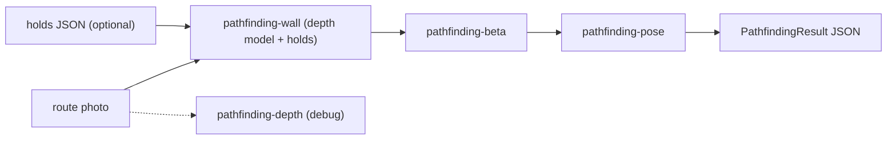

:::warning
**Version:** 0.1
:::

---

# Pathfinding

## What it does

It takes a route photo (and a climber's height and arm span) and returns the beta of the route as a list of steps. Each step says which hold is under each limb and gives the 33 landmarks of the climber in pixels of the photo, so the app can draw a "ghost" on the photo. Vocabulary: pathfinding is this computation, the ghost is the product feature (Ghost Mode) and `ghosts` is the table that stores the job and its result.

---

## How it works



*Summary: a depth model gives the distances in the photo, the wall plane turns photo pixels into centimetres, an A\* search finds the sequence of holds, and inverse kinematics draws a posture for each step. `pathfinding` runs the wall, beta and pose steps in one go; `pathfinding-depth` only exports the depth map for debugging.*

Code in `apps/ai/src/worker/_4_pathfinding/`:

1. `_1_depth.py`: metric depth model (MoGe-2 ViT-S, ONNX, CPU). Also `depth-eval`.
2. `_0_wall.py`: fits the wall plane (RANSAC on the pixels outside the holds), returns the homography photo pixels to cm and the wall angle. The angle needs an optional `--gravity` vector, without it the wall is treated as vertical.
3. `_2_beta.py`: A\* search over the state of the four limbs (hold under each hand and foot), with the climber's morphology, a preference (`easy`, `power`, `technique`) and the start and finish marks of the holds.
4. `_3_pose.py`: inverse kinematics, 33 MediaPipe landmarks per step.
5. `_4_pathfinding.py`: the chain, shared by the CLI and the job.

Known limits: the metric scale is not measured (it is probably 15 to 25 % too small on the sample photo), and the postures are simple 2D ones. See the "Known limits" section of `apps/ai/README.md`.

---

## Prerequisites

From the root of the repository:

1. Tools: `uv`, `moon`. Docker only for the job.
2. `cp .env.example .env`. Optional variable: `DEPTH_MODEL_PATH` (default `resources/moge-2-vits-normal.onnx`).
3. `moon run ai:install`, then `moon run ai:setup`: it downloads the depth model (141 MB, from Hugging Face without a token, SHA-256 checked, skipped if present) and checks the MediaPipe model.
4. The hold model `apps/ai/resources/holds_seg.onnx` is versioned in git. `pathfinding`, `pathfinding-wall` and `pathfinding-depth` need the depth model, and the first two also need the hold model (unless you pass `--holds`). `pathfinding-beta` and `pathfinding-pose` need no model.

---

## Run it from the CLI

The photo is `apps/ai/resources/voie.jpg`. `--gravity 0 1 0` says that the floor is down in the camera frame (a vertical wall), `--color yellow` selects the yellow holds as the route.

```bash
cd apps/ai
mkdir -p /tmp/ascension

# All at once (about 6 s with both models on a 24-core CPU)
uv run worker pathfinding --image resources/voie.jpg --out /tmp/ascension/pathfinding.json \
  --render /tmp/ascension/pathfinding.jpg --gravity 0 1 0 --color yellow
```

It prints `Wall: 0.7 deg, inliers 48%`, `Beta: 13 steps` and `Wrote ... (13 steps)`. `pathfinding.json` is a `PathfindingResult`: `image_width`, `image_height`, `wall_angle_deg` and `steps`. Each step has `index`, `moved_limb`, `holds` (hold id under each limb), `center_of_mass` and 33 `landmarks`. `pathfinding.jpg` is the photo with the skeletons drawn.

The same, step by step (the final JSON is identical to the one above):

```bash
uv run worker pathfinding-depth --image resources/voie.jpg --out /tmp/ascension/depth.npy --render /tmp/ascension/depth.png
uv run worker pathfinding-wall  --image resources/voie.jpg --out /tmp/ascension/holds_wall.json --gravity 0 1 0
uv run worker pathfinding-beta  --input /tmp/ascension/holds_wall.json --out /tmp/ascension/beta.json --color yellow
uv run worker pathfinding-pose  --input /tmp/ascension/beta.json --holds /tmp/ascension/holds_wall.json \
  --out /tmp/ascension/steps.json --render /tmp/ascension/steps.jpg --image resources/voie.jpg
```

- `pathfinding-depth` prints `focal 2381.4 px, depth median 4.56 m, 97% valid pixels` and writes the depth map in metres (`.npy`). It is a debugging step: `pathfinding-wall` computes the depth again itself.
- `pathfinding-wall` detects the holds and the wall plane, and writes the holds JSON with a `wall` key. Pass `--holds <holds-detect output>` to reuse holds you already have (their start and finish marks are kept).
- `pathfinding-beta` and `pathfinding-pose` only read that JSON: no model, no network.

Climber and route options of `pathfinding-beta` and `pathfinding` (defaults in brackets): `--height` (175) and `--arm-span` (178) in cm, `--morphology <ClimberMorphology JSON>` (overrides both and adds `missing` or `injured` limbs), `--preference easy|power|technique` (easy), `--feet-free` (every usable hold can hold a foot), `--color <name>` and `--selected <ids>` (which holds are the route; default all). On `voie.jpg`, `pathfinding-beta --color yellow --preference technique --feet-free` gives 27 steps instead of 13.

`depth-eval --dataset <folder>` measures the depth model on photos with known distances. The folder holds the photos and an `annotations.json`, with `a` and `b` in pixels of the photo:

```json
[{"image": "voie.jpg", "pairs": [{"a": [300, 2200], "b": [900, 1200], "distance_cm": 120}]}]
```

```bash
mkdir -p /tmp/ascension/depth-dataset
cp resources/voie.jpg /tmp/ascension/depth-dataset/
# write the annotations.json above in /tmp/ascension/depth-dataset/annotations.json, then:
uv run worker depth-eval --dataset /tmp/ascension/depth-dataset
```

It prints, per image then overall, the relative error of the 3D distance between the two pixels. No real annotated dataset exists in the repository: the `distance_cm` above is an invented value used only to check that the command runs (it printed `all: 1 pairs (0 skipped) ...`), so its error means nothing. Measure real distances on a wall to use it.

---

## Run it as a job

The job `pathfinding.compute` is on the queue `pathfinding.compute`. It needs a route that went through the hold job with success and a `wall_plane` (so the depth model must be installed when the hold job runs). Start the infrastructure and the worker as described in [Worker modules](readme.md). Then:

```bash
cd apps/ai
uv run python src/producer.py seed-route --image resources/voie.jpg        # prints route_id, object_key
uv run python src/producer.py holds --job-id <route_id> --object-key <object_key>
# wait for routes.status = success and routes.wall_plane filled, then:
uv run python src/producer.py seed-ghost --route-id <route_id>             # prints ghost_id
uv run python src/producer.py pathfinding --job-id <ghost_id> --preference easy
```

`seed-ghost` creates a `pending` row of `ghosts` (height 175, arm span 178, options `--height` and `--arm-span`) with no `ghost_holds`: all the usable holds of the route are then the route. `pathfinding` publishes `pathfinding.compute.requested`; `--job-id` is the **ghost id** (`ghosts.id`).

Where to read the result: the row of `ghosts` whose id is `ghost_id`. `status` goes `started`, `running` (progress 10, 30), `success` (progress 100). `path` holds the `PathfindingResult`. On failure `error` is short and the message goes to `pathfinding.compute.dlq`: `Wall geometry missing` (no wall plane on the route), `No beta between holds A and B` (no passage between those holds), `Invalid pathfinding data`, `Pathfinding failed`. The worker also publishes `pathfinding.compute.status`.

---

## Tests

```bash
cd apps/ai
uv run pytest -p no:cacheprovider -m "not e2e and not integration" -q \
  tests/test_pathfinding_*.py tests/test_producer_pathfinding.py tests/functional/test_cli_pathfinding.py
```

Expected: `214 passed` in about 25 s. They need no infrastructure and no network. The end-to-end test is `tests/e2e/test_e2e_pathfinding.py` (`moon run ai:e2e`, real RabbitMQ, PostgreSQL and RustFS, see the README of `apps/ai`).
