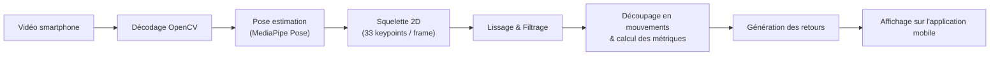
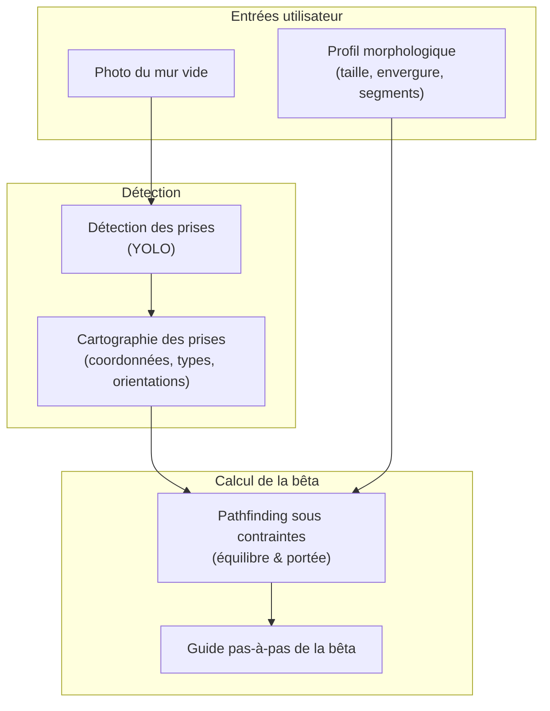

:::warning
**Version:** 1.0
:::

# Questionnaire pour Lionel REVERET

**Destinataire :** Lionel Reveret (Directeur de recherche INRIA Grenoble Rhône-Alpes, coordinateur du projet PerfAnalytics)  
**Émetteur :** Équipe Ascension  
**Fichier envoyé :** [PDF](./questionnaire-pour-lionel-reveret.pdf)

---

## Introduction

Bonjour Monsieur REVERET,

Nous sommes une équipe de 5 étudiants à Epitech et nous développons **Ascension**, une application mobile qui vise à transformer un simple smartphone en coach d'escalade grâce à la computer vision.

Sur les conseils de notre mentor Ilyes Talbi, nous nous tournons vers vous. Nous avons rédigé ce document pour vous présenter concrètement notre architecture, le flow de nos pipelines d'IA, et vous poser une série de questions ciblées sur nos blocages actuels. Vos retours nous permettraient d'éviter de faire fausse route et pourrais grandement nous aider.

---

## Le projet Ascension et nos deux fonctionnalités clés

Ascension est pensé pour les grimpeurs en salle (bloc et voie) qui n'ont pas accès à un entraîneur au quotidien et qui veulent comprendre concrètement leurs erreurs de placement ou optimiser leurs méthodes. L'application tourne sur smartphone grand public, sans capteurs embarqués ni matériel dédié.

Le projet repose sur deux briques d'IA principales :

### L'analyse de pose et de la grimpe

Le grimpeur pose son smartphone ou se fait filmer par un ami pendant sa grimpe. La vidéo est envoyée à nos workers pour être analysée :

- **Extraction du squelette :** suivi des articulations et du centre de gravité estimé tout au long de la voie.
- **Analyse technique :** repérage des phases de mouvement et des temps d'arrêt, fluidité générale, détection des zippettes de pied ou des bras inutilement fléchis.
- **Rendu côté client :** superposition du squelette sur la vidéo directement dans l'application mobile avec un retour visuel pas-à-pas.

Voici le flow de traitement que nous mettons en place pour cette partie :

### Le Mode Fantôme

Le Mode Fantôme sert d'aide à la lecture de voie :

- À partir d'une simple **photo du mur vide**, le système détecte les prises de la voie.
- En combinant ces prises avec la **morphologie du grimpeur** (taille, envergure, longueur des membres renseignées dans l'application), un algorithme cherche la séquence de mouvements la plus logique pour réussir la voie.
- Le grimpeur dispose ensuite d'un guide étape par étape pour suivre la bêta calculée, avec un rendu visuel de chaque mouvement.

Voici le flow prévu pour le Mode Fantôme :

---

## Nos questions

### Sur l'estimation de pose et le tracking

1. Sur nos vidéos de test filmées de dos, MediaPipe perd souvent les poignets : ils sont peu visibles sur plus de la moitié des images. Comment vous gérez ça, vous ? On a du mal à savoir s'il vaut mieux baisser le seuil, interpoler les points ou changer de modèle.
2. Est-ce que MediaPipe est un bon choix pour l'escalade, ou est-ce qu'on fait fausse route ? Si vous deviez choisir un modèle qui tourne sur serveur sans GPU, vous prendriez lequel ? Et comment on peut les comparer sur nos propres vidéos ?
3. Quels conseils de tournage changent vraiment la qualité de l'analyse (angle, distance, etc.) ? Et qu'est-ce qu'on peut vraiment demander à un grimpeur amateur sans le décourager ?

### Sur l'analyse du mouvement

4. D'après vous, qu'est-ce qu'on peut vraiment mesurer de fiable avec une vidéo 2D pour juger la technique d'un grimpeur ? Et quels indicateurs on ferait mieux d'oublier à cause de la perspective ?
5. Pour découper une grimpe en mouvements, on utilise pour l'instant de simples seuils sur la vitesse des poignets et des chevilles. Ça vous paraît suffisant pour commencer, ou il y a une méthode plus solide qu'on devrait regarder ?
6. Est-ce que ce qui marche pour l'escalade de vitesse s'applique aussi au bloc et à la voie en salle, où les mouvements sont plus lents et plus variés ? Quels pièges vous nous conseilleriez d'anticiper ?
7. On aimerait passer à la 3D plus tard, avec une seule caméra. Est-ce que ça vaut vraiment le coup, ou est-ce qu'on a intérêt à d'abord bien maîtriser la 2D ?

### Sur la lecture de voie et le Mode Fantôme

8. Notre plus gros défi, c'est de calculer une bêta à partir des prises et de la morphologie du grimpeur. Vous commenceriez par un algo déterministe avec une fonction de coût, ou directement par un modèle appris ? Si vous avez des articles à nous conseiller, ça nous aiderait beaucoup.
9. Pour comparer une vidéo à une bêta calculée sur une photo, on pensait aligner les deux images (ORB ou SIFT, puis homographie). Est-ce que ça a des chances de marcher en salle avec un téléphone à la main ? Sinon, vous feriez comment ?
10. Pour détecter les prises, est-ce que la segmentation vaut le temps d'annotation en plus par rapport à de simples boîtes ? Il faudrait combien d'images à votre avis pour démarrer ? Et si on vise le temps réel, plutôt YOLO nano ou small ?

### Sur les jeux de données et la validation

11. Est-ce que vous connaissez des jeux de données d'escalade annotés qu'on pourrait utiliser ? Et si on doit annoter les nôtres, vous avez des astuces pour ne pas y passer des semaines ?
12. Comme il n'existe pas vraiment de « bêta parfaite », comment on peut prouver que notre système marche ? Quelles métriques et quel type de test avec de vrais grimpeurs vous nous conseilleriez ?

---

## Contact

Merci beaucoup pour le temps que vous accorderez à la lecture de nos questions.

Notre mail de contact : [ascension.eip@gmail.com](mailto:ascension.eip@gmail.com).

**L'équipe Ascension :**

- Christophe VANDEVOIR - Développeur Backend
- Gianni TUERO - Chef de Projet & Développeur IA
- Lou PELLEGRINO - Développeur Backend
- Nicolas TORO - Chef d'équipe & Développeur Mobile
- Olivier POUECH - Développeur IA