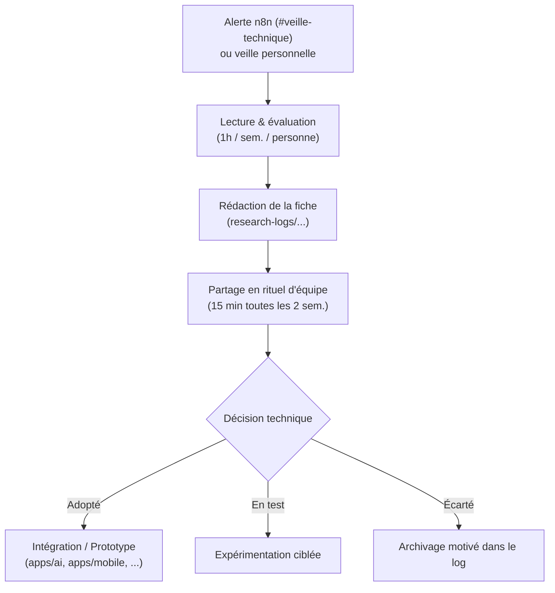

:::success
**Version:** 1.0
:::

---

# Journal de recherche (Research Log)

Ce répertoire regroupe l'ensemble des fiches de veille et d'exploration technologique réalisées par l'équipe tout au long du projet Ascension. Ce journal constitue le support direct de l'**Objectif Mandatory 1** de l'EIP Technical Track (_« Track what's out there and use it to crack your project's hard problem »_).

Son rôle principal est de tracer la manière dont nous explorons l'état de l'art scientifique et technique pour lever notre **point dur** : le **Mode Fantôme** (génération d'une séquence de mouvements d'escalade réaliste, équilibrée et adaptée à la morphologie du grimpeur).

---

## 1\. Exigences académiques EIP

- **Volume minimum :** Au moins **20 fiches** documentées sur l'année.
- **Répartition temporelle :** Les fiches doivent être réparties de manière continue entre **octobre et mai** (pas de remplissage artificiel en fin d'année).
- **Règle d'or de décision :** Une fiche sans conclusion concrète ne compte pas. Chaque analyse doit déboucher sur un statut explicite (**Adopté**, **En test** ou **Écarté**) accompagné de sa justification.
- **Valorisation des pistes écartées :** Une exploration qui conclut au rejet motivé d'une approche (résultat négatif) a autant de valeur académique qu'une adoption.

---

## 2\. Cycle de vie d'une entrée de veille



---

## 3\. Gabarit type (Template)

Chaque nouvelle fiche doit suivre la structure ci-dessous et être enregistrée dans ce dossier sous un nom normalisé (ex. `YYYY-MM-DD-titre-court.md`) :

```markdown
# [RL-XX] Titre explicite de la ressource ou technologie

- **Date d'analyse :** YYYY-MM-DD
- **Auteur :** Prénom NOM (Pôle : IA / Backend / Mobile / Infra)
- **Thématique :** (ex. Pathfinding, Vision par ordinateur, Biomécanique, Performance API)
- **Source :** Référence formelle (Titre du papier, auteurs, conférence / Dépôt GitHub / Doc officielle)
- **Lien :** URL accessible ou DOI pérenne (identifié via la veille n8n ou recherche manuelle)

---

### 1. Synthèse technique

Résumé concis (5 à 10 lignes) du contenu technique : problème adressé par la ressource, méthodologie employée, algorithmes ou architectures proposés.

### 2. Apport pour le point dur d'Ascension (Mode Fantôme)

- **Problème ciblé :** En quoi cette ressource répond (ou non) à l'un de nos verrous techniques.
- **Impact sur nos critères de succès :** Impact mesurable ou attendu sur nos métriques (faisabilité physique 100 %, équilibre $\ge 85\%$, différenciation morphologique $\ge 20\%$, temps de calcul $< 30$s).

### 3. Décision & Plan d'action

- **Statut :** **Adopté** | **En test** | **Écarté**
- **Justification :** Pourquoi ce choix ? Quels compromis ou contraintes cela implique-t-il (coût mémoire, dépendances, complexité d'intégration) ?
- **Action concrète :** Fichier/module impacté dans la base de code, issue associée ou protocole de test mis en place.
```

---

## 4\. Entrées du journal

:::subpages
