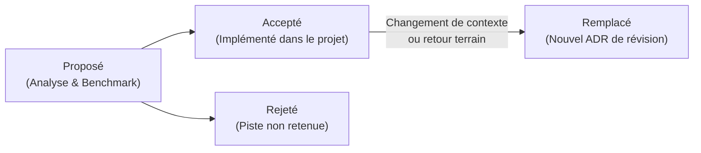

:::success
**Version:** 1.0
:::

---

# Journal des décisions techniques (ADR)

Ce répertoire rassemble l'ensemble des **Architecture Decision Records (ADR)** — ou fiches de décisions techniques — rédigées tout au long du projet Ascension. Ce journal constitue un livrable direct de l'**Objectif Obligatoire 2** de l'Epitech Innovative Project (EIP) Technical Track (*« Structure, document and make your technical architecture reliable »*).

Son objectif est de conserver la trace écrite du **raisonnement** derrière chaque choix structurant (et non uniquement du résultat final) : le contexte, les options réellement comparées, les critères de décision, les compromis acceptés et les retours en arrière lorsque le réel invalide une hypothèse initiale.

---

## 1\. Exigences académiques EIP

- **Volume minimum :** au moins **4 décisions structurantes** consignées entre octobre et mai.
- **Options pesées :** au moins **2 alternatives réellement évaluées** pour chaque décision, avec des critères explicites.
- **Conséquences assumées :** chaque fiche explicite ce que la décision coûte en dépendances, complexité opérationnelle, performance ou dette technique.
- **Révision de décision :** au moins **1 décision révisée** au cours de l'année, en documentant ce qui a fait changer l'équipe d'avis.

---

## 2\. Cycle de vie d'un ADR

Le diagramme ci-dessous illustre le cycle de vie d'une fiche de décision technique, de sa proposition jusqu'à son acceptation ou son remplacement éventuel par une nouvelle décision.



---

## 3\. Registre des décisions

| ID | Date | Décision | Statut | Révision ? |
| --- | --- | --- | --- | --- |
| [ADR-001](adr-001-backend-migration-rust-to-go.md) | 2026-04-01 | Migration du backend API Gateway de Rust (Axum) vers Go (Gin) | Accepté | Oui (remplace Rust) |
| [ADR-002](adr-002-object-storage-minio-to-rustfs-and-ovh-s3.md) | 2026-09-24 | Remplacement de MinIO par RustFS (dev) et OVHcloud Object Storage (prod) | Accepté | Oui (remplace MinIO) |
| [ADR-003](adr-003-decoupled-ai-and-product-scope-pivot.md) | 2026-09-26 | Découplage des pipelines IA (Pose 2D vidéo vs Mode Fantôme photo) et recentrage BTP/ATP | Accepté | Oui (remplace l'architecture couplée) |
| [ADR-004](adr-004-cloud-hosting-hetzner-to-ovhcloud.md) | 2026-10-15 | Transition de l'hébergement cloud de Hetzner vers OVHcloud (VPS-4 + S3) | Accepté | Oui (remplace Hetzner) |

---

## 4\. Gabarit type (Template)

Toute nouvelle décision structurante doit être enregistrée dans ce dossier sous la forme `adr-XXX-titre-court.md` en suivant la structure ci-dessous :

```markdown
:::success
**Version:** 1.0
:::

---

# ADR-XXX : Titre explicite de la décision

- **Date :** YYYY-MM-DD
- **Statut :** Proposé | Accepté | Remplacé par ADR-YYY | Déprécié
- **Périmètre :** Backend / IA / Mobile / Infrastructure / Données
- **Références :** Liens vers les benchmarks, audits ou commits associés

---

## 1. Contexte et problème

Description factuelle du besoin technique, des contraintes (performance, coût, conformité, compétences de l'équipe) et du problème à résoudre.

---

## 2. Options envisagées

Comparaison d'au moins deux alternatives réellement étudiées, avec leurs avantages et limites.

---

## 3. Option choisie

Solution retenue clairement identifiée.

---

## 4. Raison

Justification argumentée s'appuyant sur des faits, mesures ou contraintes vérifiables. En cas de révision d'une décision antérieure, expliquer ce qui a fait changer d'avis.

---

## 5. Conséquences acceptées

Impact positif et surtout compromis assumés : dépendances introduites, complexité, coûts, limites connues ou dette technique acceptée.
```

---

## 5\. Entrées du journal

:::subpages cards 1
