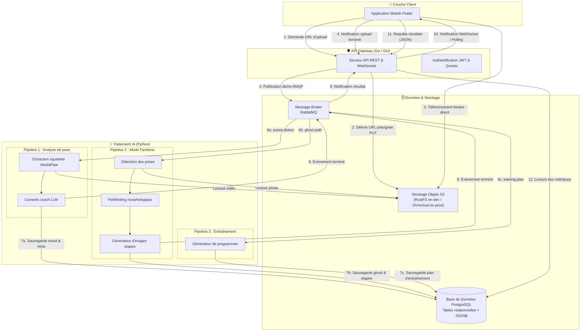
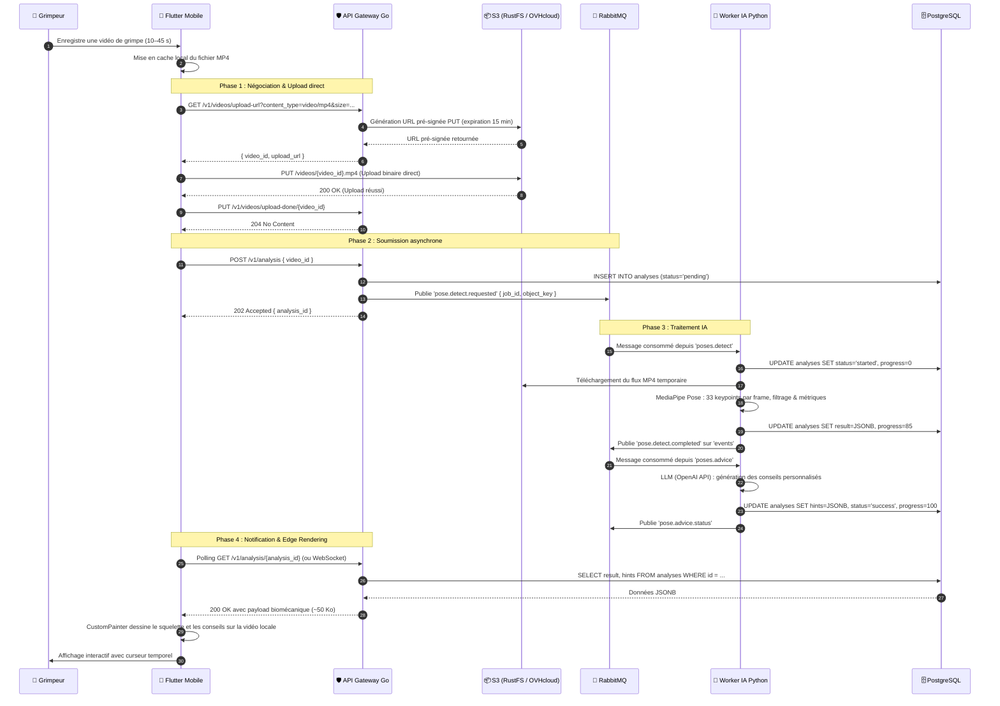
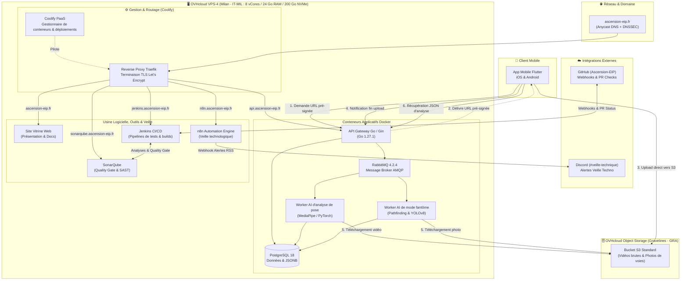
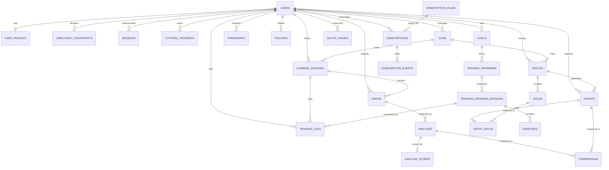
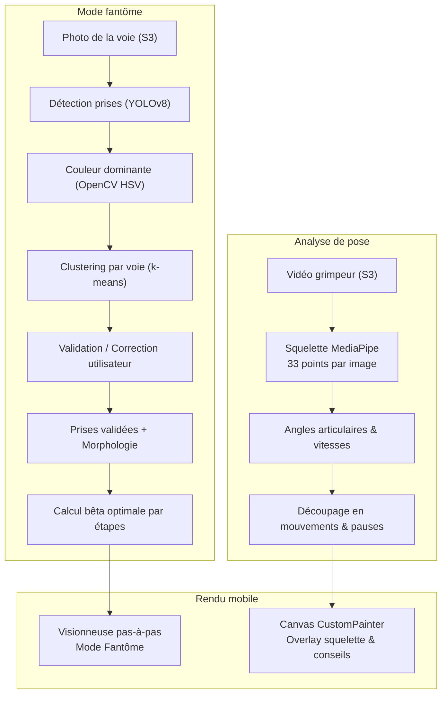

:::success
**Version:** 1.0
:::

# Schèmas et diagrammes de l'architecture et des données

---

## 1. Schéma d'architecture globale du système

---

## 2. Diagramme de séquence de bout en bout pour l'analyse de pose

---

## 3 Schèma d'hébergement et d'infrastructure cloud

---

## 4. Schéma de Données (Data Diagram)

### 5. Schèma de la pipeline de l'IA

