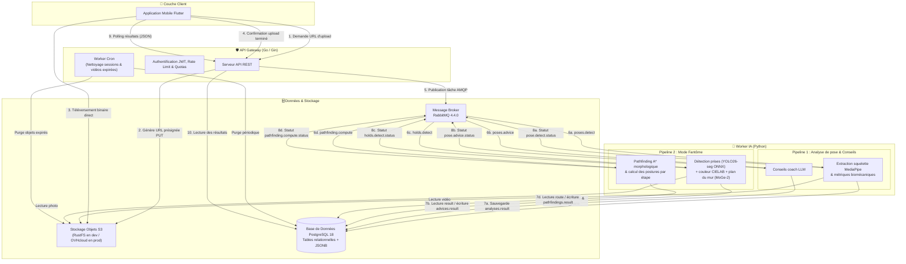
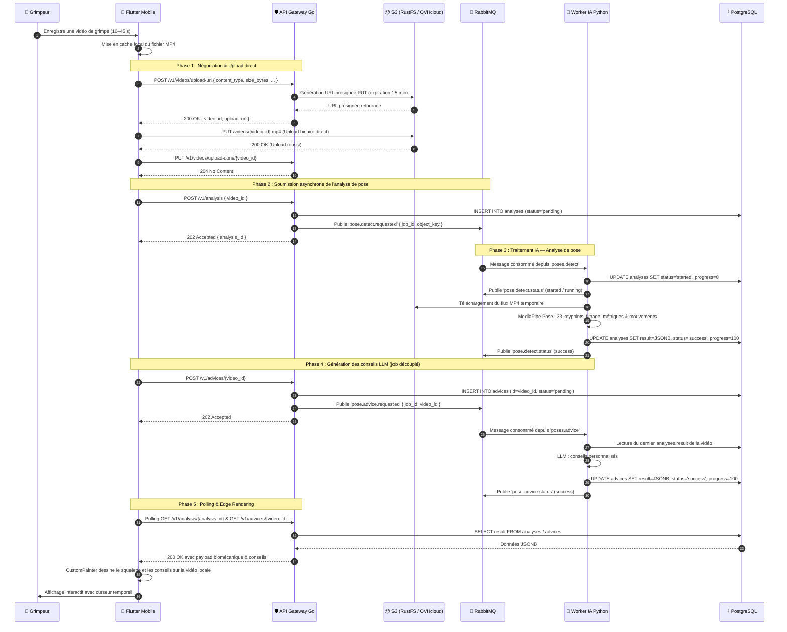
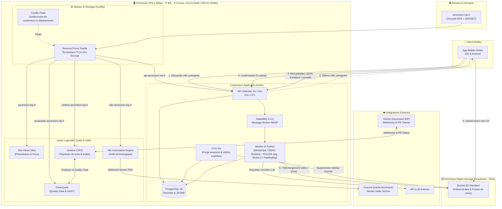
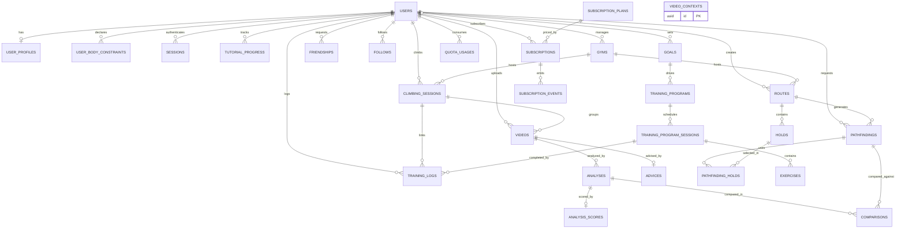
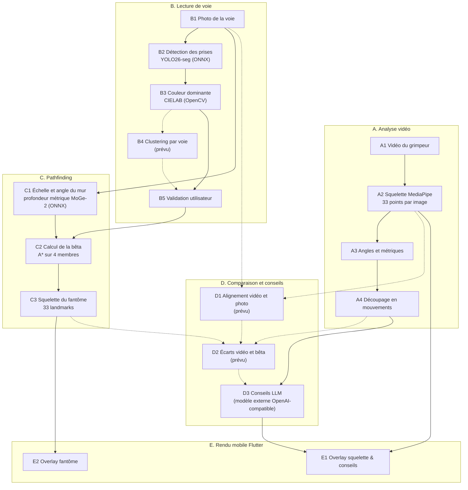

:::success
**Version:** 1.1
:::

# Schémas et diagrammes de l'architecture et des données

---

## 1\. Schéma d'architecture globale du système

Ce diagramme présente l'architecture événementielle d'Ascension : l'application mobile Flutter dialogue avec l'API Gateway Go/Gin en REST (upload direct vers S3 via URL présignée, soumission asynchrone via RabbitMQ et récupération des résultats par polling), tandis qu'un worker IA Python unique traite les 4 files de tâches (`poses.detect`, `poses.advice`, `holds.detect`, `pathfinding.compute`) et persiste les résultats dans PostgreSQL.

---

## 2\. Diagramme de séquence de bout en bout pour l'analyse de pose et les conseils

Ce diagramme détaille le cycle complet d'une vidéo de grimpe : upload direct sur S3, lancement asynchrone de l'analyse de pose (`POST /v1/analysis`), génération découplée des conseils personnalisés (`POST /v1/advices/:id` via Gemini) et rendu local (*edge rendering*) sur l'application Flutter.

---

## 3\. Schéma d'hébergement et d'infrastructure cloud

Ce schéma illustre le déploiement de production sur OVHcloud : un VPS-4 à Milan administré par Coolify et exposé via Traefik, hébergeant les conteneurs applicatifs (API Go, Cron Go, Worker IA unique, RabbitMQ 4.4.0, PostgreSQL 18) ainsi que l'usine logicielle (Jenkins, SonarQube, n8n), couplé au stockage objet S3 OVHcloud à Gravelines.

---

## 4\. Schéma de données (Data Diagram)

Ce diagramme entité-association reflète le schéma PostgreSQL 18 issu des migrations actives, incluant la table `ADVICES` découplée de `ANALYSES`, le renommage de `GHOSTS` / `GHOST_HOLDS` en `PATHFINDINGS` / `PATHFINDING_HOLDS` et la table `VIDEO_CONTEXTS`.

---

## 5\. Schéma de la pipeline IA

Ce diagramme reprend la décomposition en 5 blocs de la pipeline IA 2D : la vidéo (A) et la photo de la voie (B) sont traitées en parallèle, le pathfinding (C) estime le plan du mur, calcule la bêta A\* et génère le squelette fantôme, la comparaison et les conseils (D) croisent l'analyse et la bêta (les conseils LLM tournent déjà directement depuis le bloc A ; le clustering B4, l'alignement D1 et la comparaison D2 sont en pointillés car prévus), et le client Flutter assure le rendu mobile (E).

