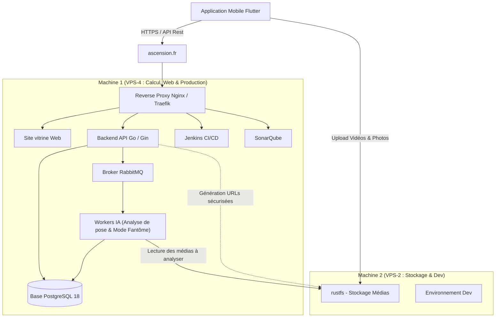
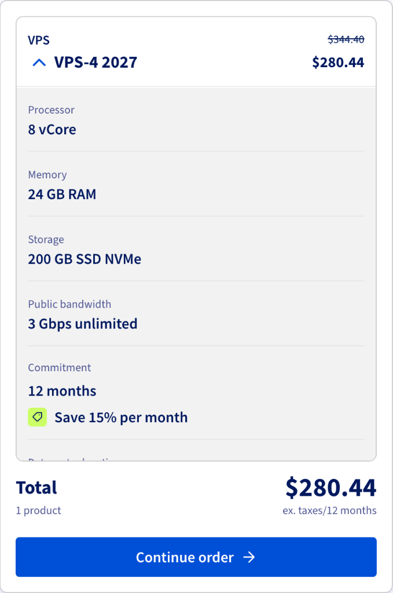
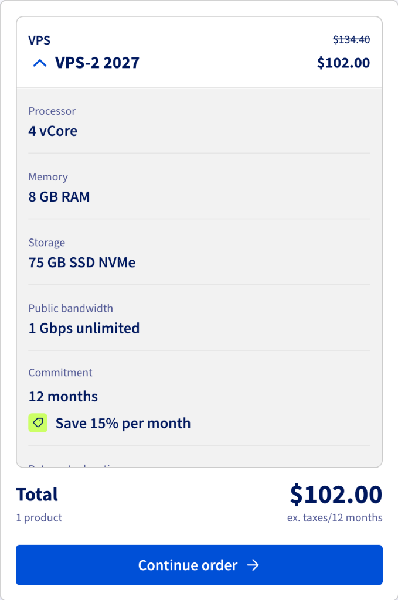
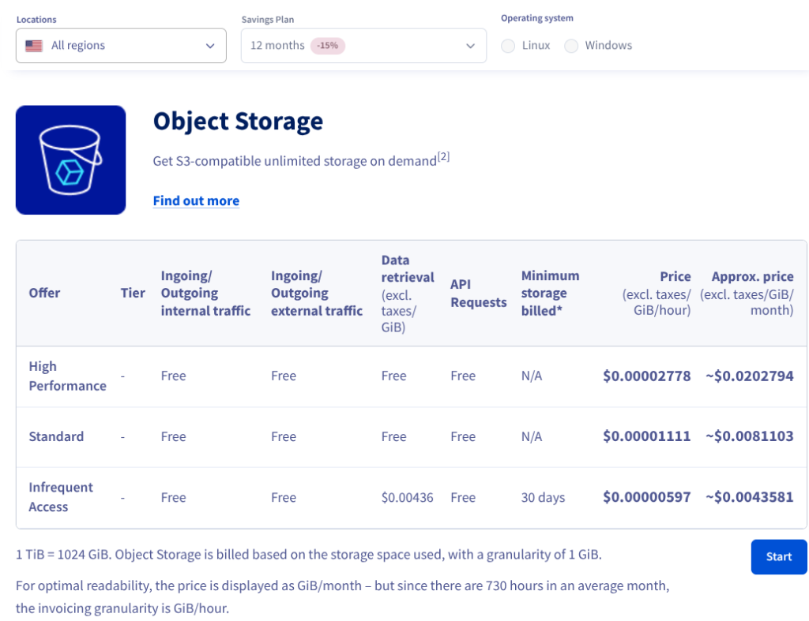
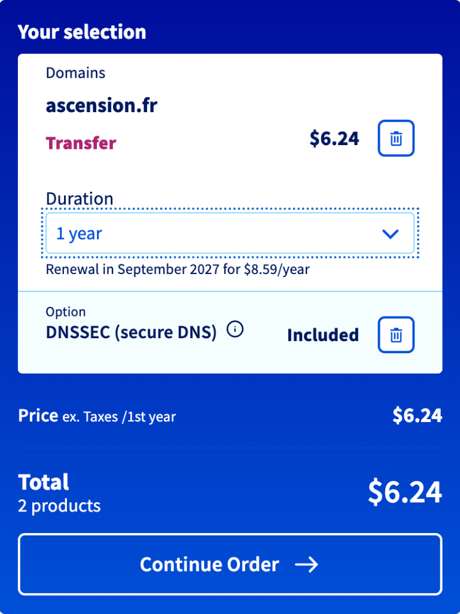

:::success
**Version:** 1.0
:::

---

# Besoins d'Infrastructure & Hébergement

---

## 1. Contexte du projet et du suivi pédagogique

Dans le cadre de l'Epitech Innovative Project (EIP) et de notre engagement sur le parcours **Technical Track**, notre équipe développe **Ascension**, une application mobile qui transforme un smartphone en coach d'escalade personnel grâce à l'analyse vidéo et l'intelligence artificielle. 

Au-delà des fonctionnalités classiques de suivi de progression, de programmes d'entraînement et d'échanges communautaires (partage de grimpe, comparaison de performances entre amis), la valeur ajoutée d'Ascension repose sur ses deux fonctionnalités phares d'analyse par intelligence artificielle :
1. **L'analyse de pose :** Le grimpeur filme sa montée avec son smartphone. L'application analyse sa posture et ses mouvements image par image grâce à MediaPipe Pose, puis lui fournit des conseils personnalisés pour corriger ses erreurs techniques et progresser.
2. **Le Mode Fantôme :** Le grimpeur prend une photo de la voie vide. L'application détecte automatiquement les prises (ou l'utilisateur les sélectionne manuellement), puis l'IA calcule la meilleure voie selon la morphologie du grimpeur et génère une suite d'images étape par étape pour visualiser chaque mouvement à réaliser.

Lors du **suivi pédagogique 3 du 25 septembre à 10h00**, notre équipe a formulé une demande d'accès aux ressources d'hébergement fournies par Epitech. L'équipe pédagogique nous a confirmé que nous avions droit à **deux machines virtuelles (VM)** et nous a demandé :
1. De consulter les offres disponibles sur OVHcloud afin de sélectionner les configurations adaptées à notre architecture.
2. D'identifier le nom de domaine souhaité pour le projet.
3. De formaliser ce document pour détailler et justifier l'utilité technique de chaque ressource demandée.

Le présent document expose l'organisation technique envisagée, le dimensionnement des serveurs ainsi qu'une alternative d'optimisation financière et technique basée sur le stockage objet.

---

## 2. Architecture technique et répartition des services

Dans la configuration initiale à 2 machines virtuelles, les rôles sont séparés afin d'isoler les calculs et l'API des transferts et du stockage de fichiers volumineux.

Le schéma ci-dessous décrit les échanges entre l'application mobile, le nom de domaine, la Machine 1 (production & calcul) et la Machine 2 (stockage des médias & dev) :

*Description du flux : Le domaine ascension.fr achemine le trafic web et API vers la Machine 1. L'application mobile envoie les vidéos de montée et photos de voie directement sur le serveur de stockage rustfs hébergé sur la Machine 2, où les workers IA de la Machine 1 viennent ensuite les récupérer pour les analyser.*

---

## 3. Spécifications et justification des ressources

### 3.1 Machine 1 : Calcul intensif, API, Site vitrine & Usine logicielle (VPS-4)

#### Caractéristiques techniques retenues
- **Modèle :** OVHcloud VPS-4 (Gamme 2027)
- **Processeur :** 8 vCores
- **Mémoire vive :** 24 Go de RAM
- **Stockage :** 200 Go SSD NVMe
- **Bande passante :** 3 Gbps illimitée
- **Tarif indicatif :** 280,44 $ HT / an (engagement 12 mois avec remise de 15 %)

#### Rôles et services hébergés
Cette machine est le cœur opérationnel du projet. Elle héberge l'ensemble des briques applicatives, communautaires et de calcul :
1. **Moteurs de calcul IA (Workers Python) :** Traitement des deux analyses phares du projet :
   - *Analyse de pose :* traitement vidéo image par image avec MediaPipe Pose, analyse de la biomécanique et génération des conseils personnalisés.
   - *Mode Fantôme :* traitement de la photo de la voie, détection/sélection des prises, calcul du chemin optimal par pathfinding et génération des images étape par étape.
   L'exécution de ces traitements en parallèle nécessite une forte capacité multi-cœur et suffisamment de RAM pour faire tourner les workers de manière stable.
2. **Backend API Gateway (Go / Gin) :** Serveur central recevant les requêtes de l'application mobile, gérant l'authentification, les fonctionnalités communautaires et l'orchestration des analyses.
3. **Site vitrine du projet :** Hébergement de la page web publique d'Ascension présentant l'application, ses fonctionnalités et les liens de téléchargement.
4. **Base de données principale (PostgreSQL 18) :** Stockage des données utilisateurs, profils morphologiques, sessions d'escalade et résultats d'analyse sous format JSONB.
5. **Message Broker (RabbitMQ) :** File d'attente permettant de traiter les analyses de manière asynchrone sans bloquer l'API.
6. **Serveur d'intégration continue (Jenkins CI/CD) :** Exécution automatisée des tests et compilation des applications du monorepo (Go, Python, Flutter). Les builds déclenchés à chaque push demandent d'importantes ressources ponctuelles en CPU et mémoire.
7. **Serveur d'analyse de code (SonarQube) :** Contrôle de la qualité du code et détection de bugs. SonarQube et son moteur interne (JVM / Elasticsearch) nécessitent à eux seuls 3 à 4 Go de RAM dédiée pour tourner de manière fluide.

#### Justification du dimensionnement
Pour cette machine, **la priorité absolue est la puissance processeur (8 vCores) et la mémoire vive (24 Go de RAM)**, et non l'espace de stockage. Faire cohabiter simultanément l'API, les workers IA, la base de données, la file RabbitMQ, le site vitrine, Jenkins et SonarQube requiert une réserve de RAM conséquente afin d'éviter les coupures dues à des manques de mémoire (*Out Of Memory*) lors des builds CI ou des analyses vidéo simultanées.

---

### 3.2 Machine 2 : Stockage des médias (rustfs) & Environnement Dev (VPS-2)

#### Caractéristiques techniques retenues
- **Modèle :** OVHcloud VPS-2 (Gamme 2027)
- **Processeur :** 4 vCores
- **Mémoire vive :** 8 Go de RAM
- **Stockage :** 75 Go SSD NVMe
- **Bande passante :** 1 Gbps illimitée
- **Tarif indicatif :** 102,00 $ HT / an (engagement 12 mois avec remise de 15 %)

#### Rôles et services hébergés
Dans la formule à deux machines virtuelles, la Machine 2 remplit deux rôles :
1. **Stockage des médias auto-hébergé avec rustfs :** Déploiement de **rustfs** (serveur de stockage de fichiers performant développé en Rust et compatible S3). rustfs sert de point de dépôt pour les vidéos de montée et les photos de voies envoyées par les utilisateurs.
2. **Environnement de développement :** Permet à l'équipe de tester de nouvelles versions ou des fonctionnalités en cours de développement sans impacter la production sur la Machine 1.

#### Justification du dimensionnement
Ce gabarit (4 vCores, 8 Go de RAM) permet de faire tourner rustfs et un environnement de dev léger avec un débit réseau de 1 Gbps adapté aux transferts de fichiers. 

**Cependant**, l'espace disque de cette machine est limité à 75 Go NVMe. Pour un projet traitant des vidéos d'escalade, cette limite sera atteinte très rapidement. C'est pourquoi nous proposons l'alternative ci-dessous, bien plus pertinente.

---

### 3.3 Option alternative recommandée : Remplacement de la Machine 2 par l'Object Storage OVHcloud

Au lieu d'utiliser une deuxième machine virtuelle (VPS-2) limitée à 75 Go pour stocker les vidéos et photos, nous recommandons si possible de **remplacer la Machine 2 par l'offre OVHcloud Object Storage (Standard)**.

#### Pourquoi cette option est bien plus avantageuse ?
1. **Suppression de la Machine 2 :** Nous n'aurions plus besoin de la deuxième machine virtuelle. L'infrastructure se composerait uniquement de la **Machine 1 (VPS-4)** et d'un **bucket Object Storage**. L'environnement de dev peut alors être géré directement en conteneurs sur la Machine 1 ou sur les postes de travail.
2. **Capacité illimitée et pérenne :** Contrairement au disque de 75 Go du VPS-2 qui saturera vite, l'Object Storage offre un stockage illimité sur mesure, sans risque de blocage lié à la taille des vidéos des utilisateurs.
3. **Coût nettement inférieur pour l'école :**
   - La Machine 2 (VPS-2) coûte **102,00 $ / an**.
   - L'Object Storage Standard coûte environ **0,0081103 \$ / Gio / mois** (soit 0,00001111 \$ / Gio / heure), sans engagement de volume minimum, avec trafic entrant/sortant gratuit et requêtes API gratuites.
   - Pour un volume moyen de 100 Go de vidéos stockées en continu, le coût réel est d'environ **0,81 \$ / mois**, soit **moins de 10 \$ par an**.
   - C'est donc une économie directe d'environ **90 $ / an** par rapport à l'achat du second VPS.
4. **Performance et compatibilité S3 native :** Notre backend gère nativement le protocole S3 via des URLs sécurisées temporaires, ce qui correspond exactement au fonctionnement de l'Object Storage OVHcloud.

---

### 3.4 Nom de domaine : ascension.fr

#### Caractéristiques techniques retenues
- **Nom de domaine :** `ascension.fr`
- **Option de sécurité :** DNSSEC inclus
- **Tarif indicatif :** 6,24 \$ HT pour la première année (renouvellement à 8,59 \$ / an)

#### Justification
L'attribution du nom de domaine `ascension.fr` est indispensable pour :
- **Hébergement du site vitrine :** Le nom de domaine principal (`ascension.fr` et `www.ascension.fr`) pointera directement vers le site vitrine hébergé sur le VPS 4, servant de vitrine officielle du projet.
- **Sécurisation des échanges applicatifs (HTTPS / TLS) :** L'application mobile Flutter nécessite de communiquer avec des API publiques protégées par des certificats SSL/TLS valides (Let's Encrypt). Une simple adresse IP brute n'est pas acceptée par les magasins d'applications mobiles (iOS App Store et Google Play Store).
- **Organisation claire des sous-domaines techniques :**
  - `ascension.fr` : Site vitrine public.
  - `api.ascension.fr` : API backend Go.
  - `ci.ascension.fr` : Plateforme d'intégration continue Jenkins.
  - `sonar.ascension.fr` : Plateforme de métrologie et qualité SonarQube.
  - `storage.ascension.fr` : Accès au stockage des médias (si rustfs auto-hébergé sur la Machine 2).
- **Crédibilité du projet :** Donner une image professionnelle et soignée au projet Ascension auprès des utilisateurs, des partenaires de salles d'escalade et des jurys Epitech.

---

## 4. Récapitulatif budgétaire et liens sources

### Option A : Configuration 2 VMs + Nom de domaine (Demande initiale)

| Ressource | Offre OVHcloud | Spécifications | Rôle principal | Coût annuel estimé (HT) |
| :--- | :--- | :--- | :--- | :--- |
| **Machine 1** | VPS-4 2027 | 8 vCore, 24 Go RAM, 200 Go NVMe, 3 Gbps | IA, API Go, Site vitrine, PostgreSQL, Jenkins, SonarQube, RabbitMQ | 280,44 $ |
| **Machine 2** | VPS-2 2027 | 4 vCore, 8 Go RAM, 75 Go NVMe, 1 Gbps | Stockage médias et environnement Dev | 102,00 $ |
| **Nom de domaine** | Domaine `.fr` | `ascension.fr` (avec DNSSEC inclus) | Site vitrine, terminaison HTTPS pour l'API et sous-domaines CI/Sonar | 6,24 $ |

**Total Option A : 388,68 $ HT pour la première année.**

---

### Option B : Configuration recommandée (1 VM VPS-4 + Object Storage + Nom de domaine)

| Ressource | Offre OVHcloud | Spécifications | Rôle principal | Coût annuel estimé (HT) |
| :--- | :--- | :--- | :--- | :--- |
| **Machine 1 (Unique VM)** | VPS-4 2027 | 8 vCore, 24 Go RAM, 200 Go NVMe, 3 Gbps | IA, API Go, Site vitrine, DB PostgreSQL, Jenkins, SonarQube, RabbitMQ, Dev | 280,44 $ |
| **Stockage Objet** | Object Storage Standard | Stockage illimité compatible S3, trafic et requêtes inclus | Stockage dédié des vidéos et photos d'utilisateurs (remplace la Machine 2) | ~10,00 $ / an (pour ~100 Go) |
| **Nom de domaine** | Domaine `.fr` | `ascension.fr` (avec DNSSEC inclus) | Site vitrine, terminaison HTTPS pour l'API et sous-domaines CI/Sonar | 6,24 $ |

**Total Option B : ~296,68 \$ HT pour la première année (soit une économie d'environ 92 \$ / an tout en bénéficiant d'un stockage illimité).**

---

### Liens sources officiels
- **Offres VPS OVHcloud :** [https://us.ovhcloud.com/vps/](https://us.ovhcloud.com/vps/)
- **Réservation de noms de domaine OVHcloud :** [https://www.ovhcloud.com/en/domains/](https://www.ovhcloud.com/en/domains/)
- **Tarifs Public Cloud & Object Storage OVHcloud :** [https://us.ovhcloud.com/public-cloud/prices/#object-storage](https://us.ovhcloud.com/public-cloud/prices/#object-storage)
