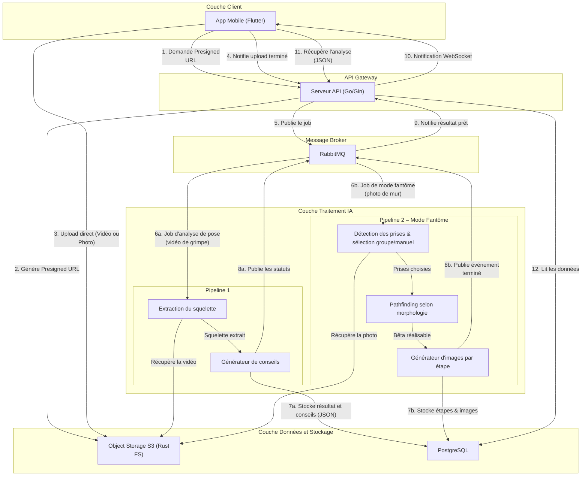

:::warning
**Version:** 0.2
:::

---

# Worker IA

Le worker IA (`apps/ai`, Python 3.11, géré par `uv`) fait le travail lourd hors de l'API : il récupère la vidéo d'un grimpeur, calcule l'analyse 2D et produit des conseils. Il ne parle jamais directement au mobile. Il consomme des jobs RabbitMQ, lit la vidéo dans RustFS (S3), écrit sa progression et ses résultats dans PostgreSQL, et publie ses statuts sur RabbitMQ.

Aujourd'hui, seul le pipeline vidéo 2D existe : lecture de voie (photo), pathfinding, mode fantôme et 3D ne sont pas implémentés. Le détail des briques, des seuils et de leurs limites est dans [pipeline-2d-decomposition.md](./pipeline-2d-decomposition.md). L'installation, les variables d'environnement, les commandes et les tests sont dans le [README du worker](../../../../../apps/ai/README.md).

---

## Ce que fait le worker

| Étape | Queue | Entrée | Sortie |
| --- | --- | --- | --- |
| Détection de pose | `poses.detect` | `pose.detect.requested` : `{job_id, object_key}` | `analyses.result` (squelette filtré, angles, vitesses, métriques, mouvements, pauses) |
| Conseils | `poses.advice` | `pose.detect.completed` ou `pose.advice.requested` : `{job_id}` | `analyses.hints` (conseils structurés, en français) |

- L'exchange est `events` (topic). Les jobs en échec définitif partent dans `<queue>.dlq`.
- `job_id` est l'identifiant de la ligne `analyses`. Le bucket est une valeur de configuration, pas une donnée du message.
- Statuts : `pending` (créé par le serveur), `started` (pris par le worker), `running`, `success`, `failed`. `success` n'est posé qu'après l'étape conseils.
- Si le LLM échoue ou n'est pas configuré, l'analyse finit en `success` avec `hints` vide, et `pose.advice.status` vaut `failed`. Le squelette reste utilisable.
- Un job à la fois par process. Pour monter en charge, on ajoute des réplicas.
- Le modèle de langage est interchangeable : un seul client compatible OpenAI, réglé par `LLM_BASE_URL`, `LLM_API_KEY` et `LLM_MODEL`. Il ne reçoit que des valeurs calculées, jamais la vidéo ni d'identifiant.

Chaque étape du pipeline est aussi une sous-commande (`uv run worker pose-detect`, `pose-advice`, etc.) qui fonctionne sans broker, base ni stockage.

Le serveur Go n'est pas encore branché sur ces queues : il publie encore sur l'ancienne queue `vision.skeleton`. En attendant, `apps/ai/src/producer.py` déclenche les jobs à la main.

---

## Schéma du flow IA

*Résumé : l'application envoie la vidéo directement à RustFS, puis l'API publie le job. Le worker analyse la vidéo, écrit le résultat et les conseils dans PostgreSQL et publie ses statuts. Le pipeline 2 (mode fantôme) est prévu, pas implémenté.*

