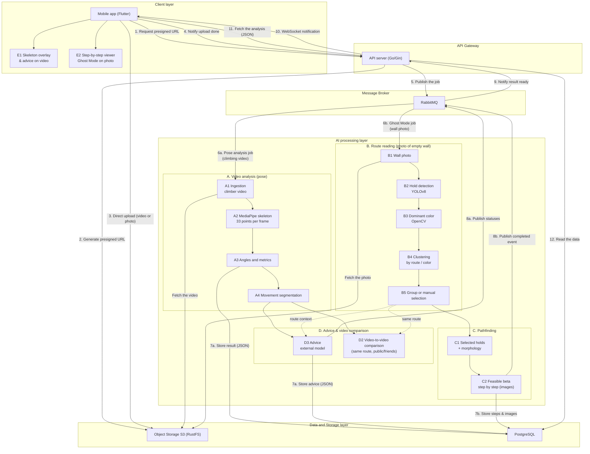

:::warning
**Version:** 0.3
:::

---

# AI worker

The AI worker (`apps/ai`, Python 3.11, managed with `uv`) does the heavy lifting outside the API: it fetches a climber's video, computes the 2D analysis and produces advice. It never talks directly to the mobile app. It consumes RabbitMQ jobs, reads the video from RustFS (S3), writes its progress and results to PostgreSQL, and publishes its statuses on RabbitMQ.

Today, only the 2D video pipeline exists: route reading (photo), pathfinding, Ghost Mode and 3D are not implemented. The details of each building block, its thresholds and its limits are in [pipeline-2d-decomposition.md](pipeline-2d-decomposition.md). Installation, environment variables, commands and tests are in the [worker README](../../../../../apps/ai/README.md).

---

## What the worker does

| Step | Queue | Input | Output |
| --- | --- | --- | --- |
| Pose detection | `poses.detect` | `pose.detect.requested`: `{job_id, object_key}` | `analyses.result` (filtered skeleton, angles, speeds, metrics, movements, pauses) |
| Advice | `poses.advice` | `pose.detect.completed` or `pose.advice.requested`: `{job_id}` | `analyses.hints` (structured advice, in French) |

- The exchange is `events` (topic). Jobs that fail permanently go to `<queue>.dlq`.
- `job_id` is the identifier of the `analyses` row. The bucket is a configuration value, not part of the message.
- Statuses: `pending` (created by the server), `started` (picked up by the worker), `running`, `success`, `failed`. `success` is only set after the advice step.
- If the LLM fails or is not configured, the analysis ends in `success` with empty `hints`, and `pose.advice.status` is `failed`. The skeleton remains usable.
- One job at a time per process. To scale, add replicas.
- The language model is interchangeable: a single OpenAI-compatible client, configured by `LLM_BASE_URL`, `LLM_API_KEY` and `LLM_MODEL`. It only receives computed values, never the video or any identifier.

Each pipeline step is also a subcommand (`uv run worker pose-detect`, `pose-advice`, etc.) that works without a broker, database or storage.

The Go server is not yet wired to these queues: it still publishes on the old `vision.skeleton` queue. In the meantime, `apps/ai/src/producer.py` triggers jobs by hand.

---

## AI flow diagram

*Summary: the app uploads the video directly to RustFS, then the API publishes the job. The worker analyzes the video, writes the result and the advice to PostgreSQL and publishes its statuses. The photo pipeline (Ghost Mode) is planned, not implemented. Both pipelines use the same blocks as the* [2D pipeline decomposition](pipeline-2d-decomposition.md) *and are connected in two places: the route context (dotted lines), which lets the video analysis and the advice refer to the same route as the holds detected on the photo, and the shared delivery path to the mobile app (API, WebSocket, then rendering E1 or E2).*

