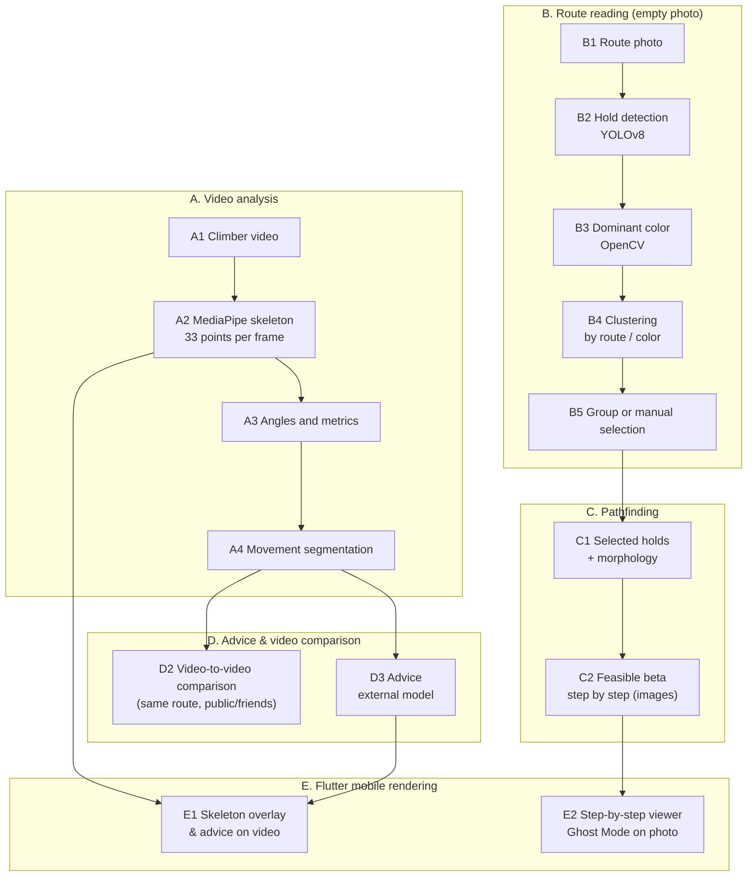
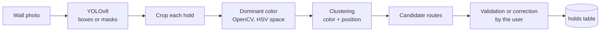

:::warning
**Version:** 0.3
:::

---

# 2D pipeline decomposition

This document breaks Ascension's 2D AI pipeline down into technical building blocks. It supports the monthly follow-up with the computer vision mentor (Ilyes TALBI). It draws on the Sep 14 memo, the Sep 29 follow-up meeting, the database schema and the state of the code (`apps/ai`). Updated on Oct 30, 2026: blocks A1 to A4 and D3 are done in `apps/ai` (see the [worker README](../../../../../apps/ai/README.md)), with their limits.

Each block lists its input, output, planned technology, status and risks. The points to settle with the mentor are grouped in section 7.

---

## 1\. Common vocabulary

| Term             | Definition used in this document                                                                        |
| ---------------- | ------------------------------------------------------------------------------------------------------- |
| **Hold**         | Object fixed to the wall and usable by a climber (hand or foot).                                        |
| **Route**        | Set of holds of the same color, set by the route setter, to be linked from start to finish.             |
| **Beta**         | Sequence of movements that solves the route: at each step, which hold for which hand or foot.           |
| **Pathfinding**  | Computation of the beta from the route's holds and the climber's morphology.                            |
| **Skeleton**     | 33 body points per frame, extracted by MediaPipe Pose.                                                  |
| **Ghost Mode**   | Step-by-step breakdown of a feasible (not "optimal") beta, as a sequence of images generated only from a photo of the route, the chosen holds (group/color or manual) and the climber's morphology. |
| **Clustering**   | Automatic grouping of similar holds (color, position) to recover the routes.                            |

---

## 2\. Overview

The 2D AI pipeline separates two independent flows: the **video (2D pose analysis)** flow, which produces the skeleton, the metrics, the advice and the comparison between climbers on the same route (blocks A, D, E1), and the **photo (Ghost Mode)** flow, which detects/groups holds on a photo of an empty route and generates a feasible beta as step-by-step images (blocks B, C, E2). No video-to-ghost comparison or alignment is performed.

_Diagram summary: the video pipeline (A) feeds the advice (D3), the comparison between users on the same route (D2) and the mobile overlay (E1). Independently, the photo pipeline (B) isolates the holds of an empty route, feeds the morphological pathfinding (C) to compute a feasible beta, and generates the step-by-step images displayed on the photo in the mobile app (E2)._

---

## 3\. Block A: video analysis (pose)

| Block                      | Input                                                         | Output                                                                                                      | Technology                                                   | Status                                                                                                                                 |
| -------------------------- | ------------------------------------------------------------- | ----------------------------------------------------------------------------------------------------------- | ------------------------------------------------------------ | -------------------------------------------------------------------------------------------------------------------------------------- |
| A1 Ingestion               | MP4 video (10 to 60 s) uploaded to RustFS via presigned URL   | Temporary local file in the worker, deleted after use                                                       | Go (presigned URL), RabbitMQ, RustFS (boto3)                 | **Done** on the worker side. The Go server is not wired yet (it publishes on the old queue)                                            |
| A2 Skeleton                | Video frames                                                  | 33 landmarks per frame (`x`, `y`, `z`, `visibility`)                                                        | MediaPipe PoseLandmarker (`full` model)                      | **Done**: one landmarker per video, constant memory (398 MiB measured for 309 and 1236 frames), unreadable video = permanent error    |
| A3 Angles and metrics      | Landmarks                                                     | 10 joint angles per frame, wrist and ankle speed, arm extension, global metrics                             | Python (geometry, numpy)                                     | **Done**: filtering (visibility ≥ 0.5, gaps of at most 5 frames filled, smoothing over 5 frames), angles computed in pixels, `z` discarded |
| A4 Movement segmentation   | Time series of speeds                                         | List of movements (which limb moves, start, end) and pauses                                                 | Hysteresis rules on wrist and ankle speed                    | **Done**, but **hands unreliable** on `example-2.mp4` (see below)                                                                      |

Points of attention:

- The output of A2 and A3 is already validated by the `AnalysisResult` schema and stored in `analyses.result` (JSONB).
- The MediaPipe confidence threshold stays very low (0.1) so that no pose is lost. Low-visibility landmarks are therefore filtered and then smoothed before computing the angles (`pose-filter` step). A missing landmark is omitted, never written as 0, and an angle with a missing point is omitted.
- A4 enriches the metrics passed to the advice model (block D3) and to the video-to-video comparison between climbers (block D2).
- Each step is a subcommand of `uv run worker` (`pose-skeleton`, `pose-filter`, `pose-metrics`, `pose-movements`, `pose-detect`), without RabbitMQ, database or storage.

**Chosen thresholds** (named constants, overridable on the command line):

| Threshold                                       | Value                                   | Step                                           |
| ----------------------------------------------- | --------------------------------------- | ---------------------------------------------- |
| `MIN_VISIBILITY`                                | 0.5                                     | Filtering                                      |
| `MAX_GAP_FRAMES`                                | 5                                       | Filtering (gap filling)                        |
| `SMOOTH_WINDOW`                                 | 5 frames                                | Filtering                                      |
| `BENT_ARM_THRESHOLD`                            | 0.8                                     | Metrics (arm bent below 80% of extension)      |
| `MOVE_SPEED_THRESHOLD` / `STOP_SPEED_THRESHOLD` | 0.8 / 0.4 torso lengths per second      | Movements (hysteresis)                         |
| `MERGE_GAP_MS` / `MIN_MOVE_MS` / `MIN_PAUSE_MS` | 150 / 100 / 500 ms                      | Movements                                      |

**Known limits**:

- **Thresholds calibrated on a single video** (`resources/example-2.mp4`, climber seen from behind, 309 frames). They need to be revisited with real climbs and other camera angles.
- **Hands are not reliable on this video with `MIN_VISIBILITY` at 0.5.** The average wrist visibility is 0.48 to 0.50: speed is only known on 142 frames (left) and 136 (right) out of 309, and no frame has both arms measurable at the same time. Result: 14 movements (feet consistent, hands unusable) and no pause. A pause requires all four limbs to be measured and still; a more permissive version produced a phantom pause.
- Lowering `MIN_VISIBILITY` (0.1 to 0.3) makes the hands continuous but is not validated: these are points the model considers unreliable. To be decided after visual validation on a climber filmed from the front or side.
- Angles are computed in 2D (pixels), `z` is discarded: on this video, 3D angles differ from 2D angles by 5 to 50° on average depending on the joint, without reducing frame-to-frame noise.
- Measured processing time: about 6 s for `example-2.mp4` (10 s of video), on CPU, with a mocked LLM. Reference value on a single video.

---

## 4\. Block B: route reading (photo)

_Diagram summary: YOLO detects the holds, OpenCV extracts the color of each one, clustering groups them into candidate routes, then the user validates before saving._

| Block                   | Input                               | Output                                                       | Technology                                                                       | Status                                      |
| ----------------------- | ----------------------------------- | ------------------------------------------------------------ | -------------------------------------------------------------------------------- | ------------------------------------------- |
| B1 Photo                | Photo taken in the app              | Image + dimensions (`routes.image_width`, `image_height`)    | Flutter, RustFS                                                                  | Planned                                     |
| B2 Hold detection       | Image                               | One box or mask per hold, with a confidence score            | YOLOv8 (Ultralytics), trained on our data                                        | To explore: dataset under construction      |
| B3 Dominant color       | Pixels of each hold                 | One color per hold (HSV or Lab)                              | OpenCV, k-means on the mask pixels                                               | To explore                                  |
| B4 Clustering           | Color and position of each hold     | Groups of holds = candidate routes                           | k-means (mentor's advice), DBSCAN or HDBSCAN if the number of routes is unknown  | To explore                                  |
| B5 Validation           | Candidate routes                    | Holds confirmed, corrected or added by hand                  | Flutter, `holds` table                                                           | Planned: DB schema already defined          |

Points of attention:

- The `holds` schema stores a polygon outline. A segmentation model (YOLOv8-seg) provides it directly. A bounding-box model only gives a rectangle.
- Large volumes (big triangles) are detected less well than green holds in the tests of the Sep 29 meeting.
- User corrections are kept next to the predictions (`predicted_*`) to feed a learning loop.
- Hold qualification (type, difficulty) comes after detection. It is not needed for the first prototype.

---

## 5\. Block C: pathfinding

| Item       | Content                                                                                                                                                                                |
| ---------- | -------------------------------------------------------------------------------------------------------------------------------------------------------------------------------------- |
| **Input**  | Validated holds of the route (position, type, usability), climber morphology (height, arm span, injured zones), start hold and finish hold                                             |
| **Output** | Beta by steps: at each step, the hold assigned to the left hand, right hand, left foot, right foot, and the center of mass. This is the format planned in `ghosts.path`               |
| **Status** | To explore                                                                                                                                                                             |

Three approaches are to be compared:

| Approach                       | Principle                                                                                                                                              | Advantages                                                        | Limits                                                                |
| ------------------------------ | ------------------------------------------------------------------------------------------------------------------------------------------------------ | ----------------------------------------------------------------- | --------------------------------------------------------------------- |
| **Deterministic**              | Search in a state graph (position of the four limbs), with a cost based on reach, hold difficulty and body constraints                                 | Explainable, no training data needed                              | Cost rules must be written by hand                                    |
| **Sequential model (LSTM)**    | The model predicts the next limb positions from the current position and the final position                                                            | Learns from real movements, interesting for the technical track   | Needs data (annotated climbing videos or synthetic betas)             |
| **LLM as reference**           | Claude receives the route image and proposes a sequence                                                                                                | Test done on Sep 29: broadly consistent result                    | Ambiguities on holds and volumes, call cost, not reproducible         |

Proposed line of work: use the LLM output as distillation data to train an open-source model (Ilyes's idea), then measure each approach on the same routes.

The point of separating detection (block B) from pathfinding (block C) is to give the movement model an already reduced set of holds. It can then focus on the order of movements, not on vision.

---

## 6\. Blocks D and E: comparison, advice and rendering

### 6.1 Block D: comparison and advice

| Block                            | Input                                                                                  | Output                                                                               | Technology                                                                                                                        | Status                                                                                                                                                         |
| -------------------------------- | -------------------------------------------------------------------------------------- | ------------------------------------------------------------------------------------ | --------------------------------------------------------------------------------------------------------------------------------- | -------------------------------------------------------------------------------------------------------------------------------------------------------------- |
| ~~D1 Video and photo alignment~~ | ~~One video frame and the route photo~~                                                | *Dropped after the pivot*                                                            | ~~OpenCV: ORB/SIFT + homography~~                                                                                                 | **Dropped**: Ghost Mode works strictly on a photo of an empty route; no video-vs-ghost comparison                                                              |
| D2 Video-to-video comparison     | Two pose analyses (`base_analysis_id`, `compared_analysis_id`) on the **same route** (`public` / `friends`) | Kinematic differences between climbers (`comparisons.metrics`)                 | Python, geometry                                                                                                                  | To implement (replaces the old video-vs-beta comparison)                                                                                                       |
| D3 Advice                        | Angles, metrics, movements, morphology and route context                               | Structured advice (`analyses.hints`: category, priority, body zones, frames)         | Interchangeable model via an OpenAI-compatible client (`LLM_BASE_URL`, `LLM_API_KEY`, `LLM_MODEL`), validated by the `Hints` schema | **Done** for pose-only advice. Providers (Gemini, DeepSeek) **not tested for real**; morphology still to be integrated into the prompt                         |

Points of attention:

- The hold detector (Block B) and Ghost Mode (Block C) work **only on a photo of a route**. They are never overlaid on or compared with a climbing video.
- The comparison (D2 / `F05`) compares exclusively **two pose videos on the same route** (for example, your own climb against a friend's with `friends` or `public` visibility).
- The external model must only receive already computed data (angles, metrics, morphology), not the raw video, to limit cost and hallucinations.
- Implemented this way: the prompt only contains computed, summarized and bounded values (never the video, nor any identifier), and the advice is written in French. For each limb, a measurement coverage is computed; a limb measured on less than 70% of the frames is flagged as unreliable and the model is forbidden from drawing conclusions about it. If the LLM fails, the analysis stays in `success` with `hints = NULL`.

### 6.2 Block E: mobile rendering

- **Pose analysis (F02):** the Flutter client draws the 2D skeleton and the advice on top of the original video from a lightweight JSON (client-side rendering, no video re-encoding). In **ATP**, an interactive 3D scene will make it possible to inspect the pose in 3D.
- **Ghost Mode (F07):** the mobile app displays, step by step, the sequence of images generated from the initial photo, without video overlay or video-vs-ghost comparison.

---

## 7\. Open questions for the mentor

1. **YOLO: boxes or masks?** The Roboflow datasets found (47 and 123 images) are not of the same type. The data schema expects a polygon outline. Is segmentation worth its annotation cost?
2. **How many images to start with?** About 300 varied images are planned. Is that enough for holds of very different shapes and colors (holds, volumes, triangles)?
3. **Clustering:** k-means requires knowing the number of routes. Should we use DBSCAN or HDBSCAN instead, or ask the user for the number of routes?
4. **Pathfinding:** deterministic or LSTM first? How to get training data (distillation from Claude, scraped videos, synthetic betas)?
5. ~~**Video and photo alignment (D1):**~~ *Closed after the pivot: video/photo alignment and video-vs-ghost comparison were dropped.*
6. **Pathfinding and 2D analysis:** *Resolved: the 2D pose analysis (skeleton, angles, metrics, LLM advice) is delivered independently of the photo pathfinding (Ghost Mode).*
7. **Evaluation:** which metrics to use for the technical track? For example mAP50 and per-color recall for YOLO, cluster purity, rate of betas judged feasible by a climber.

---

## 8\. Progress and next steps

| Block                                                                | Status                                                                                             |
| -------------------------------------------------------------------- | -------------------------------------------------------------------------------------------------- |
| A1 S3 ingestion, A2 skeleton, A3 angles and metrics, A4 movements    | **Done** (limits: hands unreliable on the example video, thresholds calibrated on a single video) |
| D3 advice                                                            | **Done** for pose only; LLM providers not tested for real                                          |
| B2 to B5 Route reading (photo + group/manual selection)              | To explore, data being collected                                                                   |
| C Pathfinding (feasible beta on photo)                               | To explore                                                                                         |
| D2 Video-to-video comparison (same route, `F05`)                     | To implement (*D1 video/photo alignment dropped*)                                                  |
| E Rendering                                                          | Planned on the mobile side (pose video overlay + Ghost Mode photo viewer)                          |
| Wiring the Go server to the worker                                   | To do (see the backend handoff, outside the repository)                                            |

Next steps decided at the Sep 29 meeting:

- Put the images on Google Drive and start the YOLO training with Google Colab (Jundo).
- Evaluate the 47- and 123-image Roboflow datasets for hold detection (Jundo).
- Build a sample of about 300 varied images to annotate (team).
- Study automatic annotation by Claude or by a script (Ilyes).
- Update the YouTube and Instagram video collection script (Olivier).

---
