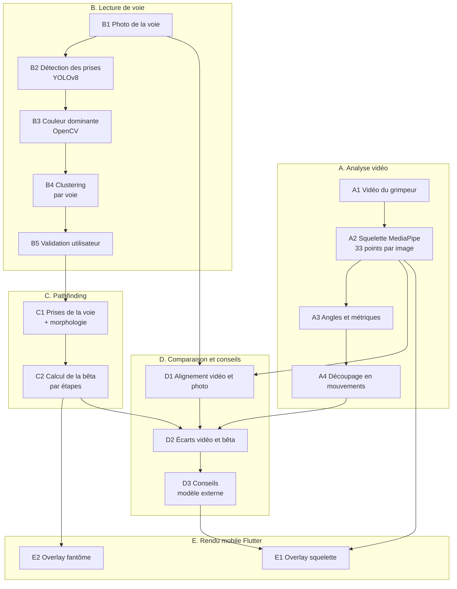
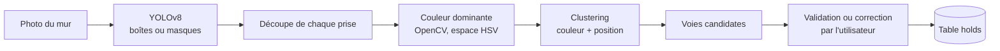

:::warning
**Version:** 0.1
:::

---

# Décomposition de la pipeline 2D

Ce document décompose la pipeline IA 2D d'Ascension en briques techniques. Il sert de support au suivi mensuel avec le mentor en vision par ordinateur (Ilyes TALBI). Il reprend le mémo du 14/09, la réunion de suivi du 29/09, le schéma de base de données et l'état du code (`apps/new_ai`).

Chaque brique indique son entrée, sa sortie, la technologie envisagée, son statut et ses risques. Les points à trancher avec le mentor sont regroupés en section 7.

---

## 1\. Vocabulaire commun

| Terme            | Définition utilisée dans ce document                                                                    |
| ---------------- | ------------------------------------------------------------------------------------------------------- |
| **Prise (hold)** | Objet fixé au mur et utilisable par un grimpeur (main ou pied).                                         |
| **Voie (route)** | Ensemble des prises d'une même couleur, posé par l'ouvreur, à enchaîner du départ à la fin.             |
| **Bêta**         | Séquence de mouvements qui résout la voie : à chaque étape, quelle prise pour quelle main ou quel pied. |
| **Pathfinding**  | Calcul de la bêta à partir des prises de la voie et de la morphologie du grimpeur.                      |
| **Squelette**    | 33 points du corps par image, extraits par MediaPipe Pose.                                              |
| **Mode fantôme** | Affichage de la bêta optimale en superposition sur la photo de la voie ou sur la vidéo du grimpeur.     |
| **Clustering**   | Regroupement automatique de prises similaires (couleur, position) pour retrouver les voies.             |

---

## 2\. Vue d'ensemble

La pipeline compte cinq blocs. Le bloc A (vidéo) et le bloc B (photo) sont indépendants et tournent en parallèle, comme proposé par le mentor le 14/09. Le bloc C a besoin des prises validées du bloc B. Le bloc D croise le squelette du bloc A avec la bêta du bloc C pour produire les conseils. Le bloc E est le rendu côté client.

_Résumé du diagramme : la vidéo (A) et la photo (B) sont traitées en parallèle. Les prises validées alimentent le pathfinding (C). La comparaison (D) croise le squelette et la bêta pour générer les conseils. Le client Flutter affiche le squelette, le fantôme et les conseils (E)._

> **Écart avec la documentation existante** : [system-overview.md](../../architecture/system-overview.md) décrit quatre étapes séquentielles (prises, squelette, conseils, fantôme). La version parallèle ci-dessus est plus proche de ce que le mentor a proposé et évite d'attendre la photo pour analyser la vidéo.

---

## 3\. Bloc A : analyse vidéo (pose)

| Brique                     | Entrée                                                       | Sortie                                                           | Technologie                                     | Statut                                                        |
| -------------------------- | ------------------------------------------------------------ | ---------------------------------------------------------------- | ----------------------------------------------- | ------------------------------------------------------------- |
| A1 Ingestion               | Vidéo MP4 (10 à 60 s) téléversée sur MinIO par URL présignée | Fichier local temporaire dans le worker                          | Go (URL présignée), RabbitMQ, MinIO             | Partiel : le handler existe, le téléchargement S3 est un TODO |
| A2 Squelette               | Frames de la vidéo                                           | 33 landmarks par image (`x`, `y`, `z`, `visibility`)             | MediaPipe PoseLandmarker (modèle `full`)        | Fait                                                          |
| A3 Angles et métriques     | Landmarks                                                    | 10 angles articulaires par image, vitesse, extension des bras    | Python (géométrie)                              | Partiel : angles faits, métriques à ajouter                   |
| A4 Découpage en mouvements | Série temporelle des landmarks                               | Liste de mouvements (quel membre bouge, début, fin) et de pauses | Règles sur la vitesse des poignets et chevilles | À explorer                                                    |

Points d'attention :

- La sortie de A2 et A3 est déjà validée par le schéma `AnalysisResult` et stockée dans `analyses.result` (JSONB).
- Le seuil de confiance MediaPipe est très bas (0,1) pour ne pas perdre de pose. Il faut donc filtrer ou lisser les landmarks peu visibles avant de calculer des angles.
- A4 est nécessaire pour comparer la vidéo à une bêta découpée en étapes (bloc D).

---

## 4\. Bloc B : lecture de voie (photo)

_Résumé du diagramme : YOLO détecte les prises, OpenCV extrait la couleur de chacune, le clustering les regroupe en voies candidates, puis l'utilisateur valide avant l'enregistrement._

| Brique                  | Entrée                              | Sortie                                                       | Technologie                                                                      | Statut                                      |
| ----------------------- | ----------------------------------- | ------------------------------------------------------------ | -------------------------------------------------------------------------------- | ------------------------------------------- |
| B1 Photo                | Photo prise dans l'app              | Image + dimensions (`routes.image_width`, `image_height`)    | Flutter, MinIO                                                                   | Prévu                                       |
| B2 Détection des prises | Image                               | Une boîte ou un masque par prise, avec un score de confiance | YOLOv8 (Ultralytics), entraîné sur nos données                                   | À explorer : jeu de données en construction |
| B3 Couleur dominante    | Pixels de chaque prise              | Une couleur par prise (HSV ou Lab)                           | OpenCV, k-means sur les pixels du masque                                         | À explorer                                  |
| B4 Clustering           | Couleur et position de chaque prise | Groupes de prises = voies candidates                         | k-means (conseil du mentor), DBSCAN ou HDBSCAN si le nombre de voies est inconnu | À explorer                                  |
| B5 Validation           | Voies candidates                    | Prises confirmées, corrigées ou ajoutées à la main           | Flutter, table `holds`                                                           | Prévu : schéma DB déjà défini               |

Points d'attention :

- Le schéma `holds` stocke un contour polygonal. Un modèle de segmentation (YOLOv8-seg) le fournit directement. Un modèle à boîtes englobantes ne donne qu'un rectangle.
- Les gros volumes (grands triangles) sont moins bien détectés que les prises vertes dans les tests de la réunion du 29/09.
- Les corrections de l'utilisateur sont conservées à côté des prédictions (`predicted_*`) pour alimenter une boucle d'apprentissage.
- La qualification des prises (type, difficulté) vient après la détection. Elle n'est pas nécessaire au premier prototype.

---

## 5\. Bloc C : pathfinding

| Élément    | Contenu                                                                                                                                                                                |
| ---------- | -------------------------------------------------------------------------------------------------------------------------------------------------------------------------------------- |
| **Entrée** | Prises validées de la voie (position, type, utilisabilité), morphologie du grimpeur (taille, envergure, zones blessées), prise de départ et prise finale                               |
| **Sortie** | Bêta par étapes : à chaque étape, la prise assignée à la main gauche, à la main droite, au pied gauche, au pied droit, et le centre de masse. C'est le format prévu dans `ghosts.path` |
| **Statut** | À explorer                                                                                                                                                                             |

Trois approches sont à comparer :

| Approche                     | Principe                                                                                                                                               | Avantages                                                         | Limites                                                               |
| ---------------------------- | ------------------------------------------------------------------------------------------------------------------------------------------------------ | ----------------------------------------------------------------- | --------------------------------------------------------------------- |
| **Déterministe**             | Recherche dans un graphe d'états (position des quatre membres), avec un coût fondé sur la portée, la difficulté des prises et les contraintes du corps | Explicable, sans données d'entraînement                           | Il faut écrire les règles de coût à la main                           |
| **Modèle séquentiel (LSTM)** | Le modèle prédit la prochaine position des membres à partir de la position actuelle et de la position finale                                           | Apprend des mouvements réels, intéressant pour la track technique | Besoin de données (vidéos de grimpe annotées ou bêtas synthétiques)   |
| **LLM en référence**         | Claude reçoit l'image de la voie et propose une séquence                                                                                               | Test fait le 29/09 : résultat globalement cohérent                | Ambiguïtés sur les prises et volumes, coût d'appel, non reproductible |

Piste de travail proposée : utiliser la sortie du LLM comme données de distillation pour entraîner un modèle open source (idée d'Ilyes), puis mesurer chaque approche sur les mêmes voies.

L'intérêt de séparer détection (bloc B) et pathfinding (bloc C) est de donner au modèle de mouvement un ensemble de prises déjà réduit. Il se concentre alors sur l'ordre des mouvements, pas sur la vision.

---

## 6\. Blocs D et E : comparaison, conseils et rendu

### 6.1 Bloc D : comparaison et conseils

| Brique                       | Entrée                                        | Sortie                                                                               | Technologie                                                               | Statut                                   |
| ---------------------------- | --------------------------------------------- | ------------------------------------------------------------------------------------ | ------------------------------------------------------------------------- | ---------------------------------------- |
| D1 Alignement vidéo et photo | Une frame de la vidéo et la photo de la voie  | Transformation qui place les pixels de la vidéo dans le repère de la photo           | OpenCV : correspondance de points (ORB ou SIFT) puis homographie (RANSAC) | À explorer : risque principal            |
| D2 Écarts                    | Squelette (A), mouvements (A4), bêta (C)      | Écarts par étape : membre, distance, instant (`comparisons.metrics`)                 | Python, géométrie                                                         | À explorer                               |
| D3 Conseils                  | Angles, écarts, contexte de voie, morphologie | Conseils structurés (`analyses.hints` : catégorie, priorité, zones du corps, frames) | Modèle externe type Gemini, validé par le schéma `Hints`                  | Partiel : schéma fait, `PoseAdvice` vide |

Points d'attention :

- Le détecteur de prises tourne sur la photo uniquement. Pour comparer la vidéo à la bêta, il faut donc relier les deux repères (D1). Sans cela, on ne sait pas quelle prise le grimpeur touche.
- D1 est fragile si la caméra bouge ou si l'angle diffère de la photo. Deux alternatives : demander une photo cadrée comme la vidéo, ou comparer des séquences de mouvements sans repère commun en pixels.
- Le modèle externe ne doit recevoir que des données déjà calculées (angles, écarts), pas la vidéo brute, pour limiter le coût et les hallucinations.

### 6.2 Bloc E : rendu mobile

- Le client Flutter dessine le squelette, le fantôme et les conseils par-dessus la vidéo d'origine, à partir d'un JSON léger (rendu côté client, pas de ré-encodage vidéo).
- Le mode fantôme sans grimpe (F07) affiche la bêta sur la photo. Le mode fantôme en comparaison (F05) l'affiche sur la vidéo, avec un décalage temporel (`alignment.offset_ms`).

---

## 7\. Questions ouvertes pour le mentor

1. **YOLO : boîtes ou masques ?** Les jeux Roboflow trouvés (47 et 123 images) ne sont pas du même type. Le schéma de données attend un contour polygonal. La segmentation vaut-elle son coût d'annotation ?
2. **Combien d'images pour démarrer ?** Environ 300 images variées sont prévues. Est-ce suffisant pour des prises de formes et de couleurs très différentes (prises, volumes, triangles) ?
3. **Clustering :** le k-means impose de connaître le nombre de voies. Faut-il plutôt DBSCAN ou HDBSCAN, ou demander le nombre de voies à l'utilisateur ?
4. **Pathfinding :** déterministe ou LSTM en premier ? Comment obtenir des données d'entraînement (distillation depuis Claude, vidéos scrapées, bêtas synthétiques) ?
5. **Alignement vidéo et photo (D1) :** l'homographie est-elle réaliste en salle (caméra à la main, angle différent) ? Existe-t-il une approche plus robuste ?
6. **Pathfinding et analyse 2D :** nous le considérons nécessaire aux conseils (comparaison à la bêta). Peut-on livrer d'abord une analyse sans bêta (squelette, angles, règles) et ajouter la comparaison ensuite ?
7. **Évaluation :** quelles métriques retenir pour la track technique ? Par exemple mAP50 et rappel par couleur pour YOLO, pureté des clusters, taux de bêtas jugées valides par un grimpeur.

---

## 8\. État d'avancement et prochaines étapes

| Brique                                      | Statut                                   |
| ------------------------------------------- | ---------------------------------------- |
| A2 Squelette, A3 angles                     | Fait                                     |
| A1 Ingestion S3, A4 mouvements, D3 conseils | En cours ou à faire                      |
| B2 à B5 Lecture de voie                     | À explorer, données en cours de collecte |
| C Pathfinding                               | À explorer                               |
| D1, D2 Alignement et écarts                 | À explorer                               |
| E Rendu                                     | Prévu côté mobile                        |

Prochaines étapes décidées à la réunion du 29/09 :

- Mettre les images sur Google Drive et lancer l'entraînement YOLO avec Google Colab (Jundo).
- Évaluer les jeux Roboflow de 47 et 123 images pour la détection de prises (Jundo).
- Constituer un échantillon d'environ 300 images variées à annoter (équipe).
- Étudier l'annotation automatique par Claude ou par un script (Ilyes).
- Mettre à jour le script de collecte de vidéos YouTube et Instagram (Olivier).

---
