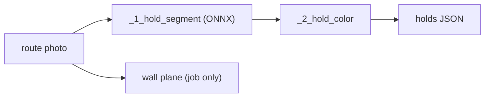

:::warning
**Version:** 0.1
:::

---

# Hold detection

## What it does

It takes a photo of a climbing wall and returns the holds it finds: for each hold a polygon contour, a type (`unknown` or `volume`; grip types are not classified yet) and a dominant colour with a colour name. In the job version it also estimates the plane of the wall (see [Pathfinding](page:placeholder)) and stores it on the route.

---

## How it works



*Summary: a segmentation model finds the holds, a second step names the colour of each, and the job also fits the wall plane from a depth map.*

Code in `apps/ai/src/worker/_3_holds/`:

1. `_1_hold_segment.py`: YOLO segmentation model exported to ONNX (`resources/holds_seg.onnx`, run by ONNX Runtime on the CPU, no PyTorch), non-maximum suppression, masks converted to polygons.
2. `_2_hold_color.py`: dominant colour of each mask and its name (`yellow`, `green`, ...). The `rgb` is reliable, the name is a hint.
3. `_0_hold_detect.py`: chains both steps. `evaluate.py` measures the colour accuracy (`holds-colors-eval`).

The job `holds.detect` is in `apps/ai/src/worker/handlers/hold_detect_request.py`. After the detection it calls the depth model and stores `routes.wall_plane`. This never fails the job: without the depth model the holds are stored and the wall plane stays empty.

---

## Prerequisites

From the root of the repository:

1. Tools: `uv`, `moon`. Docker only for the job.
2. `cp .env.example .env`. Optional variable: `HOLDS_MODEL_PATH` (default `resources/holds_seg.onnx`).
3. `moon run ai:install`. The hold model `apps/ai/resources/holds_seg.onnx` (42 MB) is versioned in git: nothing to download. It is produced by `moon run holds:export` from the training tool `apps/ai/training/holds`, which you only need to retrain it.
4. For the wall plane in the job only: `moon run ai:setup` downloads the depth model (`moge-2-vits-normal.onnx`, 141 MB).

---

## Run it from the CLI

```bash
cd apps/ai
mkdir -p /tmp/ascension
uv run worker holds-detect --image resources/voie.jpg --out /tmp/ascension/holds.json --render /tmp/ascension/holds.jpg
```

It takes about 1 s and prints `Wrote /tmp/ascension/holds.json (39 holds)`. `holds.json` has `image_width`, `image_height` and `holds`; each hold has `confidence`, `contour`, `type` and `color` (`{name, rgb, distance}`). On `voie.jpg` the colours found are yellow (12), green (9), orange (5), blue (5), white (3), red (2), cream (2) and black (1). `holds.jpg` is the photo with each hold drawn in its colour. Options: `--conf` (default 0.10, the confidence threshold) and `--model` (another ONNX file).

`holds-colors-eval --dataset training/holds/datasets/holds` measures the accuracy of the colour names on a labelled dataset. **It does not run from a fresh clone**: the dataset is not in git. It must first be built with `moon run holds:merge` from Roboflow exports unzipped in `apps/ai/training/holds/datasets/` (see `apps/ai/training/holds/README.md`). Without it the command fails with `No such file or directory: 'training/holds/datasets/holds/meta.json'`. This page did not run it with a dataset.

---

## Run it as a job

The job `holds.detect` is on the queue `holds.detect`. Start the infrastructure and the worker as described in [Worker modules](readme.md). Then:

```bash
cd apps/ai
uv run python src/producer.py seed-route --image resources/voie.jpg
# prints route_id=..., object_key=...
uv run python src/producer.py holds --job-id <route_id> --object-key <object_key>
```

`seed-route` creates a test user and a `pending` route and uploads the photo. `holds` publishes `holds.detect.requested` (`job_id` is the route id). The producer sends no `gravity`, so the wall angle stays empty.

Where to read the result:

- `routes` (id = `route_id`): `status` (`started`, `running`, `success`, `failed`), `progress`, `error`, `image_width`, `image_height`, `wall_plane` (homography, angle, focal length, inlier ratio) and `wall_angle_deg`.
- `holds` (`route_id`): one row per hold with `source = 'ai'`, `contour`, `color`, `type`. A redelivered job replaces the AI holds that the user has not corrected.

The worker also publishes `holds.detect.status`.

---

## Tests

```bash
cd apps/ai
uv run pytest -p no:cacheprovider -m "not e2e and not integration" -q \
  tests/test_holds.py tests/test_hold_handler.py tests/functional/test_cli_holds.py
```

Expected: `35 passed` in a few seconds.
