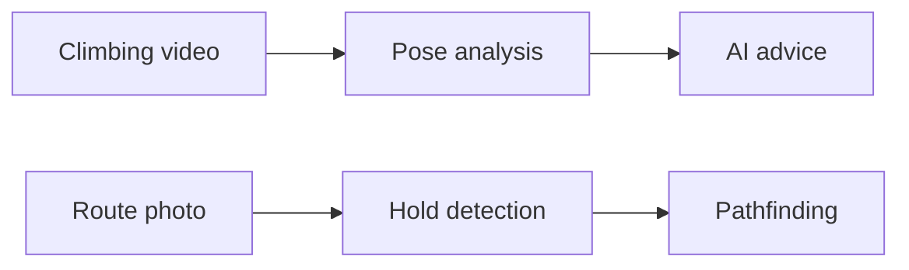

:::warning
**Version:** 0.1
:::

---

# Worker modules

The AI worker (`apps/ai`, Python 3.11) is split into four modules. Each module is a chain of small steps that you can run alone from the command line, without RabbitMQ, PostgreSQL or storage. The same steps run inside a job when the worker consumes a RabbitMQ queue. The pages below say, for each module, how it works, what to install and which commands to type.

:::subpages



*Summary: the pose module turns a video into a skeleton and metrics, the advice module turns those metrics into hints through an LLM. The hold module turns a route photo into holds and a wall plane, and the pathfinding module turns those holds into a list of postures.*

---

## Modules

| Module | CLI commands | Job (queue) | Result stored in |
| --- | --- | --- | --- |
| Pose analysis | `pose-skeleton`, `pose-filter`, `pose-metrics`, `pose-movements`, `pose-detect` | `pose.detect` (`poses.detect`) | `analyses.result` |
| AI advice | `pose-advice` | `pose.advice` (`poses.advice`) | `advices.result` |
| Hold detection | `holds-detect`, `holds-colors-eval` | `holds.detect` (`holds.detect`) | `holds` rows, `routes.wall_plane` |
| Pathfinding | `pathfinding-depth`, `pathfinding-wall`, `pathfinding-beta`, `pathfinding-pose`, `pathfinding`, `depth-eval` | `pathfinding.compute` (`pathfinding.compute`) | `ghosts.path` |

---

## Common prerequisites

All commands start from the root of the repository.

1. Install the tools: [uv](https://docs.astral.sh/uv/), [moon](https://moonrepo.dev) and Docker (Docker is only needed for the jobs, not for the CLI).
2. Create the environment file: `cp .env.example .env`, then edit it. The worker reads the `.env` at the root. Never commit it, and never paste its secrets in a page or a chat.
3. Install the Python dependencies and download the models:

```bash
moon run ai:install   # uv sync
moon run ai:setup     # downloads the MediaPipe model and the depth model if missing
```

`ai:setup` downloads `apps/ai/resources/pose_landmarker_full.task` (MediaPipe) and `apps/ai/resources/moge-2-vits-normal.onnx` (141 MB, depth model, from Hugging Face, no token). It skips a file that already exists. The hold model `apps/ai/resources/holds_seg.onnx` is versioned in git: nothing to download.

4. The CLI is run from `apps/ai`:

```bash
cd apps/ai
uv run worker --help
```

The same steps exist as moon tasks, but moon starts them inside `apps/ai`: relative paths in the arguments are relative to `apps/ai`, not to the root (`moon run ai:pose-detect -- --video resources/example-2.mp4 --out /tmp/result.json`).

Sample files used in these pages: `apps/ai/resources/example-2.mp4` (a 10 s climbing video) and `apps/ai/resources/voie.jpg` (a route photo).

---

## Running a job

A job needs the infrastructure and the worker. Do it once, then use the page of the module.

```bash
# From the repository root
moon run root:db-up        # starts the postgresql, rabbitmq and rustfs containers of docker-compose.yml
moon run server:migrate    # applies the SQL migrations (needs the migrate tool: moon run server:setup)
moon run ai:dev            # starts the worker (uv run worker), keep it running in its own terminal
```

Without the Go server, `apps/ai/src/producer.py` plays its role: it creates test rows, uploads the file and publishes the message. Run it in another terminal:

```bash
cd apps/ai
uv run python src/producer.py --help
```

Variables of `.env` that matter for the jobs (example values, copy the real ones from `.env.example`):

| Variable | Example | Role |
| --- | --- | --- |
| `POSTGRES_HOST`, `POSTGRES_PORT`, `POSTGRES_USER`, `POSTGRES_PASSWORD`, `POSTGRES_DB` | `localhost`, `5432`, `ascension`, `<password>`, `ascension` | Database |
| `RABBITMQ_HOST`, `RABBITMQ_PORT`, `RABBITMQ_USER`, `RABBITMQ_PASS` | `localhost`, `5672`, `ascension`, `<password>` | Broker |
| `RUSTFS_ENDPOINT`, `RUSTFS_ACCESS_KEY`, `RUSTFS_SECRET_KEY`, `RUSTFS_BUCKET` | `http://localhost:9000`, `ascension`, `<secret>`, `videos` | Object storage |

---

## Tests

Unit and functional tests need no infrastructure and no network:

```bash
cd apps/ai
uv run pytest -p no:cacheprovider -m "not e2e and not integration" -q
```

End-to-end tests use the real services (`moon run ai:e2e`). Set `TEST_POSTGRES_URL` to a disposable, migrated database first: see the README of `apps/ai`.

---

## Reference

The full reference of the worker is `apps/ai/README.md`. The design of the whole 2D pipeline is the parent page, [pipeline-2d-decomposition](../readme.md).
