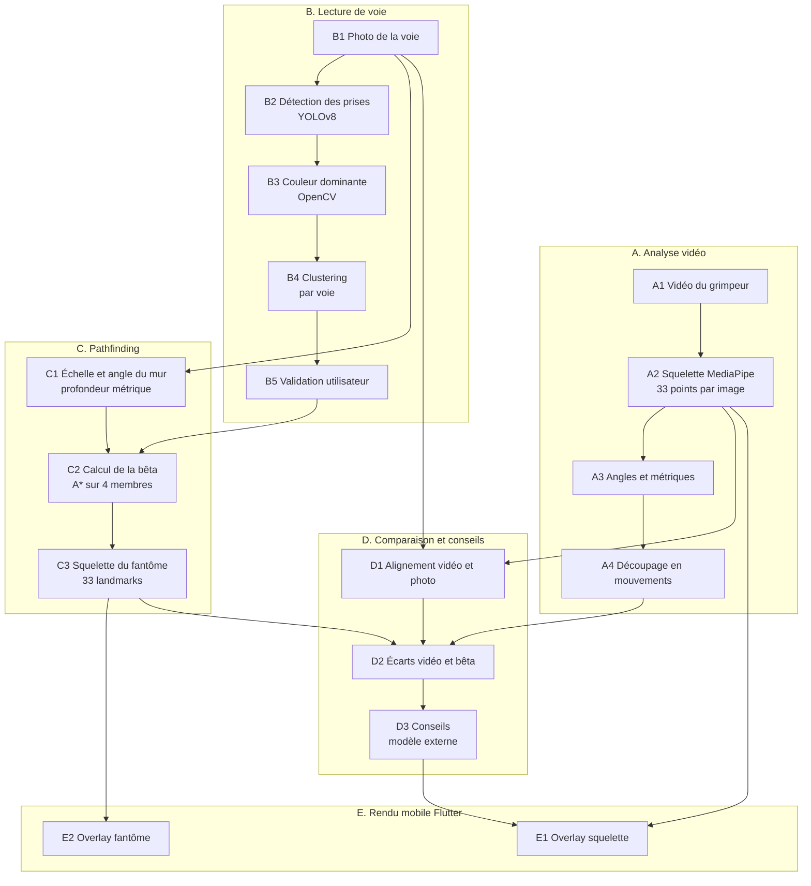
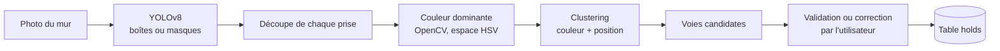
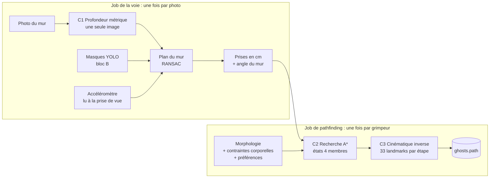

:::warning
**Version:** 0.3
:::

---

# Décomposition de la pipeline 2D

Ce document décompose la pipeline IA 2D d'Ascension en briques techniques. Il sert de support au suivi mensuel avec le mentor en vision par ordinateur (Ilyes TALBI). Il reprend le mémo du 14/09, la réunion de suivi du 29/09, le schéma de base de données et l'état du code (`apps/new_ai`).

Chaque brique indique son entrée, sa sortie, la technologie envisagée, son statut et ses risques. Les points à trancher avec le mentor sont regroupés en section 7.

---

## 1\. Vocabulaire commun

| Terme | Définition utilisée dans ce document |
| --- | --- |
| **Prise (hold)** | Objet fixé au mur et utilisable par un grimpeur (main ou pied). |
| **Voie (route)** | Ensemble des prises d'une même couleur, posé par l'ouvreur, à enchaîner du départ à la fin. |
| **Bêta** | Séquence de mouvements qui résout la voie : à chaque étape, quelle prise pour quelle main ou quel pied. |
| **Pathfinding** | Calcul de la bêta à partir des prises de la voie et de la morphologie du grimpeur. |
| **Squelette** | 33 points du corps par image, extraits par MediaPipe Pose. |
| **Mode fantôme** | Affichage de la bêta optimale en superposition sur la photo de la voie ou sur la vidéo du grimpeur. |
| **Clustering** | Regroupement automatique de prises similaires (couleur, position) pour retrouver les voies. |

---

## 2\. Vue d'ensemble

La pipeline compte cinq blocs. Le bloc A (vidéo) et le bloc B (photo) sont indépendants et tournent en parallèle, comme proposé par le mentor le 14/09. Le bloc C a besoin des prises validées du bloc B. Le bloc D croise le squelette du bloc A avec la bêta du bloc C pour produire les conseils. Le bloc E est le rendu côté client.

*Résumé du diagramme : la vidéo (A) et la photo (B) sont traitées en parallèle. Le pathfinding (C) tire l'échelle et l'angle du mur de la photo, calcule la bêta à partir des prises validées et la convertit en squelette. La comparaison (D) croise le squelette et la bêta pour générer les conseils. Le client Flutter affiche le squelette, le fantôme et les conseils (E).*

> **Écart avec la documentation existante** : [system-overview.md](../../../architecture/system-overview.md) décrit quatre étapes séquentielles (prises, squelette, conseils, fantôme). La version parallèle ci-dessus est plus proche de ce que le mentor a proposé et évite d'attendre la photo pour analyser la vidéo.

---

## 3\. Bloc A : analyse vidéo (pose)

| Brique | Entrée | Sortie | Technologie | Statut |
| --- | --- | --- | --- | --- |
| A1 Ingestion | Vidéo MP4 (10 à 60 s) téléversée sur MinIO par URL présignée | Fichier local temporaire dans le worker | Go (URL présignée), RabbitMQ, MinIO | Partiel : le handler existe, le téléchargement S3 est un TODO |
| A2 Squelette | Frames de la vidéo | 33 landmarks par image (`x`, `y`, `z`, `visibility`) | MediaPipe PoseLandmarker (modèle `full`) | Fait |
| A3 Angles et métriques | Landmarks | 10 angles articulaires par image, vitesse, extension des bras | Python (géométrie) | Partiel : angles faits, métriques à ajouter |
| A4 Découpage en mouvements | Série temporelle des landmarks | Liste de mouvements (quel membre bouge, début, fin) et de pauses | Règles sur la vitesse des poignets et chevilles | À explorer |

Points d'attention :

- La sortie de A2 et A3 est déjà validée par le schéma `AnalysisResult` et stockée dans `analyses.result` (JSONB).
- Le seuil de confiance MediaPipe est très bas (0,1) pour ne pas perdre de pose. Il faut donc filtrer ou lisser les landmarks peu visibles avant de calculer des angles.
- A4 est nécessaire pour comparer la vidéo à une bêta découpée en étapes (bloc D).

---

## 4\. Bloc B : lecture de voie (photo)

*Résumé du diagramme : YOLO détecte les prises, OpenCV extrait la couleur de chacune, le clustering les regroupe en voies candidates, puis l'utilisateur valide avant l'enregistrement.*

| Brique | Entrée | Sortie | Technologie | Statut |
| --- | --- | --- | --- | --- |
| B1 Photo | Photo prise dans l'app | Image + dimensions (`routes.image_width`, `image_height`) | Flutter, MinIO | Prévu |
| B2 Détection des prises | Image | Une boîte ou un masque par prise, avec un score de confiance | YOLOv8 (Ultralytics), entraîné sur nos données | À explorer : jeu de données en construction |
| B3 Couleur dominante | Pixels de chaque prise | Une couleur par prise (HSV ou Lab) | OpenCV, k-means sur les pixels du masque | À explorer |
| B4 Clustering | Couleur et position de chaque prise | Groupes de prises = voies candidates | k-means (conseil du mentor), DBSCAN ou HDBSCAN si le nombre de voies est inconnu | À explorer |
| B5 Validation | Voies candidates | Prises confirmées, corrigées ou ajoutées à la main | Flutter, table `holds` | Prévu : schéma DB déjà défini |

Points d'attention :

- Le schéma `holds` stocke un contour polygonal. Un modèle de segmentation (YOLOv8-seg) le fournit directement. Un modèle à boîtes englobantes ne donne qu'un rectangle.
- Les gros volumes (grands triangles) sont moins bien détectés que les prises vertes dans les tests de la réunion du 29/09.
- Les corrections de l'utilisateur sont conservées à côté des prédictions (`predicted_*`) pour alimenter une boucle d'apprentissage.
- La qualification des prises (type, difficulté) vient après la détection. Elle n'est pas nécessaire au premier prototype.

---

## 5\. Bloc C : pathfinding

Cette section décrit le plan v1 du pathfinding, arrêté le 25/11/2026 : contraintes produit, chaîne technique, modèle de données et ordre de réalisation.

Vocabulaire : le **pathfinding** est le calcul (module `_4_pathfinding` du worker, file `pathfinding.compute`, schémas `pathfinding_*`). Le **ghost** (fantôme) est la feature produit qui consomme ce calcul et l'affiche (Ghost Mode, quota, comparaisons) ; la table `ghosts` garde son nom et porte le job (`ghosts.id` est le `job_id`) et son résultat (`ghosts.path`).

Les commandes, l'installation et les jobs de chaque module du worker (pose, conseils, prises, pathfinding) sont décrits dans [Worker modules](worker-modules/readme.md).

> **État au 26/11/2026** : le calcul côté worker IA (`apps/ai`) est écrit et testé (C1, C2, C3, job de la voie, job de pathfinding, commandes de la CLI). Après calibration de C1, la pipeline réelle (vrais modèles de prises et de profondeur) a tourné de bout en bout sur une vraie photo de voie (`apps/ai/resources/voie.jpg`) : mur accepté, 39 prises, bêta jaune de 13 étapes, environ 5 s la commande complète sur un CPU de 24 coeurs. Ce résultat n'est **pas une validation** : une seule photo, échelle du mur probablement sous-estimée et non mesurée, 5 étapes sur 13 avec un appui à 7 à 21 cm de sa prise (faisabilité par paires). Le job de pathfinding entier (base, RabbitMQ) n'a tourné qu'avec une profondeur factice (test e2e). Le serveur Go et le mobile ne sont pas commencés. Le détail est en section 5.10 et en section 8.

L'intérêt de séparer détection (bloc B) et pathfinding (bloc C) est de donner au calcul de la bêta un ensemble de prises déjà réduit. Il se concentre alors sur l'ordre des mouvements, pas sur la vision.

### 5.1 Contraintes produit

- **Téléphone seul** : l'utilisateur prend une photo de la voie. Il ne mesure pas le mur, ne décrit pas son inclinaison et n'a besoin d'aucun capteur en plus (LiDAR, réalité augmentée). L'échelle et l'angle du mur viennent donc de la photo.
- **Prises de départ** : de 1 à 4 prises. Une même prise peut porter plusieurs marques : 2 flèches sur une prise veulent dire au moins 2 membres dessus. L'utilisateur valide ces marques dans l'interface.
- **Pieds libres** : un booléen sur la voie. S'il est vrai, toutes les prises détectées sur le mur peuvent servir de pied, même celles d'une autre couleur.
- **Prises interdites** : l'utilisateur les désélectionne à la validation (bloc B5). Le pathfinding ne les reçoit pas.
- **Bêta faisable** : le pathfinding propose une séquence faisable pour ce grimpeur, pas une bêta optimale unique.
- **Préférences** : `easy` (bêta la plus facile, valeur par défaut), `power` (moins de mouvements, plus longs, peu de replacements de pieds) ou `technique` (mouvements courts, plus de placements de pieds). C'est un paramètre de chaque demande (`preference` dans `pathfinding.compute.requested`), pas une donnée du profil. L'idée initiale d'un mode « point faible » n'est pas implémentée : `technique` est la seule préférence de travail.

### 5.2 Vue d'ensemble

*Résumé du diagramme : le job de la voie estime la profondeur de la photo, en déduit le plan du mur et place les prises en centimètres avec l'angle du mur. Le job de pathfinding cherche une bêta à partir de ces prises et du profil du grimpeur, puis la convertit en squelettes de 33 points stockés dans `ghosts.path`.*

### 5.3 Entrées et sorties

| Élément | Contenu | Source |
| --- | --- | --- |
| **Prises** | Contour, type, couleur. En v1 le type vaut `unknown` ou `volume` | `holds` (bloc B) |
| **Prises de la voie** | `ghost_holds` du fantôme. Vide : toutes les prises `usable` de la voie | `ghost_holds` (table existante, à remplir par le serveur) |
| **Marques de départ et d'arrivée** | `start_limbs` (1 à 4) et `finish_limbs` (1 à 2) par prise | Colonnes créées par la migration `20261125120000`, lues par le worker. Saisie dans l'interface : à faire |
| **Pieds libres** | `routes.feet_free` | Colonne créée, lue par le worker. Saisie dans l'interface : à faire |
| **Géométrie du mur** | Passage des pixels aux centimètres dans le plan du mur, angle du mur par rapport à la verticale | Brique C1, `routes.wall_plane` et `routes.wall_angle_deg` |
| **Morphologie** | `height_cm` (obligatoire), `arm_span_cm`, `dominant_hand`, `constraints` (zones `missing` ou `injured`) | `ghosts.morphology`, au format `ClimberMorphology`. La copie depuis `user_profiles` et `user_body_constraints` est à écrire côté serveur |
| **Préférences** | `easy`, `power` ou `technique` | `pathfinding.compute.requested` |
| **Sortie** | Liste d'étapes : prise par membre, centre de masse, 33 landmarks en pixels de la photo. Ou un échec qui explique pourquoi | `ghosts.path` (format `PathfindingResult`), `ghosts.error` |

### 5.4 C1 : échelle et angle du mur

Les modèles de profondeur métrique sur une seule image donnent une distance en mètres pour chaque pixel, sans mesure ni capteur dédié. La chaîne livrée (`apps/ai/src/worker/_4_pathfinding/_1_depth.py` et `_0_wall.py`) est la suivante :

1. Le modèle de profondeur calcule la carte de profondeur de la photo et estime la focale. Le worker ne lui passe pas de focale : il n'a pas de focale EXIF fiable. L'image est réduite à 640 px de grand côté avant le modèle, la profondeur est remise à la taille de la photo, et les pixels que le modèle juge invalides valent `NaN`. Avec la focale, la carte devient un nuage de points 3D.
2. Un plan est ajusté sur ce nuage par RANSAC (200 itérations), en excluant les pixels des prises détectées (polygones de leurs contours). Le seuil d'inlier est relatif : `RANSAC_REL_THRESHOLD` = 1,2 % de la profondeur médiane des points valides, avec un plancher de 2 cm (`RANSAC_MIN_THRESHOLD_M`), soit 5,5 cm pour une profondeur médiane de 4,56 m. Ce plan est le mur. Le calcul échoue (`ValueError`) s'il y a moins de 1000 points valides, ou si les inliers couvrent moins de 20 % de **l'image entière** (`MIN_WALL_COVERAGE` = 0,2), ce qui évite de compter contre le mur le sol et le plafond visibles sur la photo. `WallPlane.inlier_ratio` garde son sens : la part des points valides dans le seuil.
3. Le vecteur `gravity` (optionnel, envoyé par le mobile dans `holds.detect.requested`, lu de l'accéléromètre) donne la verticale. L'angle entre la verticale et le plan donne l'inclinaison du mur : 0 vertical, positif en dévers, négatif en dalle. Sans `gravity`, `angle_deg` vaut `null` et le pathfinding traite le mur comme vertical.
4. Une homographie, calculée analytiquement, passe des pixels de la photo aux centimètres dans le plan du mur (y vers le haut). Elle est stockée avec l'angle, la focale, la part d'inliers et le nom du modèle dans `routes.wall_plane` (type `WallPlane`) et `routes.wall_angle_deg`.

Modèles comparés sur dossier (licence, format, taille), pas sur une erreur mesurée :

| Modèle | Points forts | Licence | Décision |
| --- | --- | --- | --- |
| **MoGe-2 ViT-S** (Microsoft) | Points 3D métriques et focale estimée, ONNX officiel (`Ruicheng/moge-2-vits-normal-onnx`), exécutable sur CPU sans export, 141 Mo | MIT (dépôt et modèle PyTorch). La fiche Hugging Face du dépôt ONNX n'affiche pas de licence : à faire confirmer par l'équipe | **Retenu** |
| **Depth Anything V2** (variante métrique intérieure) | Le Small est léger | Small : Apache-2.0. Base et Large : non commerciales | Écarté : pas de focale estimée, pas d'ONNX officiel (exports tiers de provenance non vérifiée ou export à maintenir) |
| **Depth Pro** (Apple) | Très précis, estime aussi la focale | Licence Apple, non OSI, à relire | Écarté : licence incertaine pour un produit payant, environ 1,9 Go, coût CPU |

Le modèle retenu est téléchargé par `apps/ai/scripts/download-depth-model.sh` (vérification SHA-256, sans jeton), lancé par `moon run ai:setup` et par le `Dockerfile` du worker. Le fichier ONNX (`resources/moge-2-vits-normal.onnx`) n'est pas versionné ; son chemin se change avec la variable `DEPTH_MODEL_PATH`. Le post-traitement du modèle (focale et décalage de profondeur) est refait en numpy, sans nouvelle dépendance.

Points d'attention :

- **L'erreur d'échelle n'est pas mesurée.** L'objectif de 5 à 15 % reste à vérifier : aucune photo de mur avec des distances mesurées n'existe encore. L'outil est livré (`uv run worker depth-eval`), pas la mesure.
- **Les seuils de C1 sont calés sur une seule photo.** L'ancien critère (seuil absolu de 2 cm, au moins 40 % des points valides en inliers) faisait échouer le calcul du mur sur les six images de salle entière du deck (`docs/Ascension/resources/images/deck` : `climb_olivier`, `ghost_mode_1` à `4`, `pose_analysis`) avec une part d'inliers de 0,14 à 0,31 : sol, plafond et autres murs comptaient contre le mur, et 2 cm est trop strict pour le bruit d'un modèle monoculaire à plusieurs mètres. Les nouveaux seuils ont été choisis sur `apps/ai/resources/voie.jpg` (profondeur médiane 4,56 m, voie cadrée) : la couverture de l'image par les inliers monte de 0,26 (2 cm) à 0,46 (5,5 cm) puis plafonne (0,50 à 7 cm), et 5,5 cm n'absorbe ni le sol ni le plafond. Ils sont aussi testés sur des scènes synthétiques (murs à 3, 4,5 et 9 m, sol et plafond sur 44 % de l'image). Ils sont à revérifier sur d'autres voies : plus loin, plus près, en dévers. Relancé le 26/11/2026 avec le nouveau critère, `ghost-wall` accepte un mur sur `voie.jpg` et aussi sur les six images du deck ; je n'ai pas contrôlé ces six murs, dont quatre sont des visuels générés, et ils ne valent pas validation.
- **Résultat sur `voie.jpg`** (vrais modèles, CPU de 24 coeurs) : focale estimée 2381 px, 97 % de pixels valides, mur accepté (`inlier_ratio` 0,48), 39 prises détectées (38 `unknown`, 1 `volume`), dont 12 jaunes avec un doublon de détection (deux prises à la même position, l'une à la confiance 0,11). Avec `gravity` `0 1 0`, l'angle est de 0,7 degré. Le mur est en facettes (trois pans) : un seul plan est ajusté et sa normale bouge d'environ 2 degrés selon le seuil.
- **L'échelle est probablement sous-estimée, non mesurée.** Du haut du bloc au tapis, le mur mesure 3,4 à 3,5 m d'après le modèle, alors qu'un mur de bloc fait plutôt 4 à 4,5 m : sous-estimation estimée à 15 à 25 %, sans vérité terrain (le haut du mur peut aussi être hors de la photo). Les distances entre prises jaunes (2,6 m entre la plus basse et la plus haute) restent plausibles. Seul `worker depth-eval` sur des distances mesurées tranchera.
- Un essai ancien hors livrable (seuil abaissé à 0,2 sur l'ancien critère) avait donné un mur sur une image générée, avec des squelettes beaucoup trop grands : il ne vaut pas validation et le nouveau critère le remplace.
- La v1 suppose un mur plan. Les murs cassés (dièdre, dévers qui se prolonge en toit) demandent plusieurs plans et viendront ensuite.
- C1 dépend de la photo, pas du grimpeur. Elle tourne dans le job de la voie, à la suite de la détection des prises, et son résultat est stocké sur `routes`. Tous les fantômes de la voie le réutilisent. Un échec de C1 (modèle absent, plan introuvable) ne fait pas échouer la détection : `wall_plane` reste vide et le fantôme échoue ensuite avec « Wall geometry missing ». Seul un `gravity` mal formé fait échouer le job de la voie (« Invalid gravity »).
- Temps mesuré sur un CPU de 24 coeurs : environ 2 s pour le modèle sur une photo de 1880 x 2272, environ 4,4 s pour `worker pathfinding-wall`, environ 5 s pour `worker pathfinding` complète sur `voie.jpg`. Le temps sur le CPU du serveur n'est pas mesuré.

### 5.5 Marques de départ et d'arrivée

- Chaque prise porte un nombre de marques : `start_limbs` de 1 à 4 et `finish_limbs` de 1 à 2. Le total des marques de départ d'une voie est compris entre 1 et 4. Cette règle porte sur plusieurs lignes, elle est donc vérifiée par l'application.
- Dans l'interface de validation, un appui sur une prise fait défiler 0, 1 puis 2 marques. Un badge affiche le nombre. **À faire côté mobile** : le worker lit déjà les colonnes, aucune interface ne les écrit.
- Une marque indique combien de membres vont sur la prise, pas lesquels. Le pathfinding énumère toutes les répartitions possibles : les deux mains prennent d'abord les marques de départ, les marques restantes vont aux pieds. Chaque répartition est un point de départ de la recherche. Avec une seule marque, une main est posée et l'autre est libre.
- L'arrivée est atteinte quand chaque prise d'arrivée porte au moins `finish_limbs` mains.
- Sans aucune marque, la prise la plus basse de la voie reçoit 2 marques de départ et la plus haute 2 marques d'arrivée.
- La détection automatique des scotchs et étiquettes de départ n'est pas prévue en v1.

### 5.6 C2 : recherche de la bêta (A*)

Un **état** décrit le grimpeur à un instant donné : la prise occupée par chaque membre. Un **mouvement** fait passer d'un état au suivant, en général en changeant un seul membre. Une bêta est une suite d'états, du départ jusqu'à l'arrivée.

Exemple avec un départ à 2 flèches sur P1 :

| Étape | Main gauche | Main droite | Pied gauche | Pied droit | Mouvement |
| --- | --- | --- | --- | --- | --- |
| 0 | P1 | P1 | P2 | P3 | Départ |
| 1 | P1 | P1 | P2 | P5 | Le pied droit monte |
| 2 | P4 | P1 | P2 | P5 | La main gauche va chercher P4 |
| 3 | P4 | P6 | P2 | P5 | La main droite va chercher P6 |

Règles de la recherche :

- **Contraintes dures** : un mouvement change un seul membre. Il est refusé si l'état d'arrivée dépasse une portée, vérifiée **par paires** : main-main (0,8 de l'envergure), main-pied (0,9 de la taille) et pied-pied (0,6 de la taille), et si un pied passerait au-dessus des deux mains. Au moins un pied reste posé après le départ. Un membre `missing` (zone de `ghosts.morphology.constraints`) n'est jamais posé ; un membre `injured` ajoute une pénalité de coût à chacun de ses mouvements. Les zones de la tête, du cou, du torse et du bas du dos sont ignorées en v1.
- **Coût** : base, distance du mouvement, coût du type de prise (table par type), facteur d'angle du mur pour les mains (dévers plus cher, dalle neutre), coût d'un pied qui quitte sa prise ou reste sans prise. Les poids dépendent de la préférence (`easy`, `power`, `technique`). Les ratios de portée et les poids sont des valeurs raisonnables, non calibrées sur de vrais grimpeurs ni de vraies voies. Sur `voie.jpg`, la bêta jaune (12 prises jaunes détectées, la voie choisie avec l'option `--color yellow` de `ghost-beta` et `ghost`) fait 13 étapes : départ sur la prise jaune la plus basse avec les deux mains et pieds non posés, arrivée sur la plus haute avec les deux mains.
- **Algorithme** : A* (`heapq`) avec une heuristique admissible (vérifiée contre Dijkstra dans les tests). Les états symétriques en coût sont fusionnés. Mesures : 30 prises de main et 30 prises de pied, environ 1,2 s ; 76 prises sans sélection, 48 s. Au-delà de 100 000 états développés, la recherche s'arrête en échec. En pratique la voie est la sélection de l'utilisateur, plus petite que l'ensemble des prises de la photo.
- **Prise générique** : tant que le détecteur ne classe pas les prises, chaque prise est considérée comme bonne pour les mains et les pieds, tirable dans toutes les directions et assez grande pour deux mains. L'aire du contour en cm² sert d'indice : une très petite prise est plutôt un pied, un volume sert surtout à pousser ou à poser le pied. Le coût est lu dans une table par type de prise, où `unknown` vaut la prise générique. Les vrais types s'y brancheront sans changer l'algorithme.
- **Plusieurs bêtas** : non implémenté en v1, la recherche renvoie une seule séquence.
- **Échec explicite** : si aucune séquence n'existe, le message d'erreur indique entre quelles prises le passage manque (« No beta between holds A and B » : la prise la plus haute atteinte et la plus proche prise non atteinte). L'utilisateur peut alors corriger la détection (prise oubliée). Il est écrit dans `ghosts.error`.
- **Limite connue : faisabilité par paires.** Un état faisable par paires peut être inatteignable pour le corps entier (par exemple deux mains à 140 cm l'une au-dessus de l'autre, alors que deux bras verticaux ne dépassent pas environ 107 cm). Sur des murs aléatoires, 8 à 10 % des étapes sont dans ce cas : le fantôme dessine alors le membre tendu vers la prise, le poignet ou la cheville restant à jusqu'à environ 20 cm de la prise. Baisser le ratio main-main à 0,55 corrige les échelles denses mais casse des tests existants, et ne règle pas le cas général. Piste : tester la faisabilité conjointe du torse dans la recherche (mémoïsée), au prix de la marge de performance.
- **Limite connue : le sol n'est pas modélisé.** Au départ les pieds sont libres ; le premier mouvement pose un pied sur une prise, éventuellement celle d'une main.

### 5.7 C3 : du squelette d'appuis au fantôme

C2 ne donne que les 4 points d'appui de chaque étape. Pour dessiner un fantôme, C3 reconstruit une posture plausible par cinématique inverse, à partir des appuis, du centre de masse et de la morphologie.

La sortie suit le format des 33 landmarks MediaPipe. MediaPipe ne sert pas au calcul de la bêta, mais ce format commun apporte trois choses :

- le client Flutter dessine le fantôme (E2) avec le même rendu que le squelette de la vidéo (E1) ;
- la comparaison (bloc D) met face à face deux squelettes du même format ;
- les longueurs de segments du grimpeur peuvent être mesurées sur ses vidéos analysées par MediaPipe.

Réalisation v1 (`_3_pose.py`) : les proportions des segments sont des fractions de la taille (Drillis et Contini, reprises par Winter). Pour chaque étape, le centre du torse part du barycentre pondéré des appuis (mains 1, pieds 0,5), puis une boucle d'au plus 50 itérations le rapproche des appuis tendus et l'éloigne des membres trop repliés. Une correction finale prend le point le plus proche de l'intersection des disques de portée quand elle existe. Bras et jambes sont résolus par cinématique inverse à deux segments (loi des cosinus), coude et genou vers l'extérieur. Hors de portée, le membre est tendu vers l'appui. Un membre libre pend sous l'épaule ou la hanche. Le centre de masse vaut 0,6 du milieu des hanches plus 0,4 du milieu des épaules. Les landmarks sont convertis en pixels de la photo par l'inverse de l'homographie.

Limites : torse vertical, sans inclinaison ni collision ; posture en 2D (coudes et genoux seulement latéraux) ; plausibilité testée par propriétés géométriques (appuis atteints à moins de 1 cm quand c'est géométriquement possible), pas à l'oeil sur de vraies voies.

### 5.8 Approches pour la suite

La v1 est déterministe (A*). Les deux autres approches restent à évaluer sur les mêmes voies :

| Approche | Principe | Avantages | Limites |
| --- | --- | --- | --- |
| **Déterministe (v1)** | Recherche A* dans le graphe d'états à 4 membres, avec un coût fondé sur la portée, les prises et les contraintes du corps | Explicable, sans données d'entraînement, préférences faciles à exprimer par des poids | Règles de coût écrites à la main |
| **Modèle séquentiel (LSTM)** | Le modèle prédit la prochaine position des membres à partir de la position actuelle et de la position finale | Apprend des mouvements réels, intéressant pour la track technique | Besoin de données. Les préférences demandent de conditionner le modèle |
| **LLM en référence** | Claude reçoit l'image de la voie et propose une séquence | Test fait le 29/09 : résultat globalement cohérent | Ambiguïtés sur les prises et volumes, coût d'appel, non reproductible |

Sources de données pour un modèle appris :

- **Bêtas observées** : sur une vidéo, le squelette (bloc A) et les prises détectées donnent quel membre touche quelle prise et quand. Les vidéos collectées deviennent des bêtas annotées automatiquement. Le bloc D (D2) a de toute façon besoin de ce calcul.
- **Bêtas synthétiques** produites par l'A* de la v1.
- **Distillation** depuis un LLM vers un modèle open source (idée d'Ilyes).

### 5.9 Modèle de données et messages

La migration `20261125120000_add_pathfinding` (`apps/server/internal/outbound/postgres/migrations/`) ajoute :

| Table | Colonne | Rôle |
| --- | --- | --- |
| `holds` | `start_limbs SMALLINT` (1 à 4, nullable, contrainte `chk_holds_start_limbs`) | Nombre de marques de départ sur la prise |
| `holds` | `finish_limbs SMALLINT` (1 à 2, nullable, contrainte `chk_holds_finish_limbs`) | Nombre de marques d'arrivée sur la prise |
| `routes` | `feet_free BOOLEAN NOT NULL DEFAULT FALSE` | Toutes les prises du mur sont utilisables en pied |
| `routes` | `wall_angle_deg NUMERIC(5, 2)` (-90 à 90, nullable, contrainte `chk_routes_wall_angle`) | Angle du mur par rapport à la verticale (C1), vide sans `gravity` |
| `routes` | `wall_plane JSONB` | `WallPlane` : `homography` (3x3, pixels vers cm), `angle_deg`, `focal_px`, `inlier_ratio`, `model` (C1) |

La migration a été appliquée puis annulée (`down`) sur une base jetable, le schéma après `down` étant identique à celui d'avant. La levée des contraintes `CHECK` par des valeurs hors bornes n'a pas été testée.

Messages RabbitMQ et file du worker :

| Élément | Valeur |
| --- | --- |
| File | `pathfinding.compute` (et sa file morte `pathfinding.compute.dlq`), créée par le worker au démarrage |
| Clé de demande | `pathfinding.compute.requested`, payload `{job_id, preference?}` ; `job_id` est `ghosts.id` ; `preference` vaut `easy` (défaut), `power` ou `technique` |
| Clé de statut | `pathfinding.compute.status` |
| Demande de la voie | `holds.detect.requested` reçoit un champ optionnel `gravity` (3 nombres, repère caméra OpenCV : x droite, y bas, z avant) |

Le job de pathfinding réutilise les colonnes de `ghosts` (`status`, `progress`, `morphology`, `path`, `error`, `processing_time_ms`). `morphology` suit le schéma `ClimberMorphology` et `path` le schéma `PathfindingResult`. Les schémas sont dans `schemas/` (`pathfinding_compute_request`, `climber_morphology`, `pathfinding_result`, plus `WallPlane` dans `hold_detect_result`) ; les modèles Python et Go sont générés.

> **Note** : la section 7.3 de [database-schema.md](../../../architecture/specifications/database-schema.md) décrit `ghosts.morphology` (`ClimberMorphology`) et `ghosts.path` (`PathfindingResult`) au format livré. Le worker écrit `path` sans ses champs `null` : un membre libre ou un `wall_angle_deg` inconnu sont absents du JSON stocké, alors que le schéma les déclare obligatoires. Les lecteurs (serveur Go, mobile) doivent traiter une clé absente comme `null`.

### 5.10 Plan de réalisation v1 : état réel

Légende : **Fait** = écrit et couvert par des tests automatiques, **Partiel** = livré mais incomplet, **À faire** = non commencé. « Non validé sur du réel » veut dire que la brique n'a tourné que sur des données synthétiques ou factices.

| Étape du plan | État | Ce qui existe, ce qui manque |
| --- | --- | --- |
| 1. Banc d'essai de profondeur | Partiel | MoGe-2 ViT-S retenu sur la licence, le format et la focale estimée (section 5.4). Outil `uv run worker depth-eval` livré (tests unitaires avec un faux modèle). **Aucune erreur mesurée** : pas de photo de mur avec distances réelles, et les trois modèles n'ont pas été comparés sur une erreur d'échelle |
| 2. Contrat | Fait | Schémas `pathfinding_compute_request`, `climber_morphology`, `pathfinding_result`, champs `gravity` et `wall`, clés `pathfinding.compute.requested` et `pathfinding.compute.status`. Modèles Python et Go générés. Les modèles Python n'appliquent pas les tailles de tableaux des schémas : `gravity` et `homography` sont revérifiées à la main par le worker |
| 3. Migration | Fait | `20261125120000_add_pathfinding` (section 5.9), vérifiée sur une base jetable (`up`, `down`, `up`) |
| 3. Saisie des marques et de `feet_free` | À faire | Interface mobile et endpoints du serveur : rien |
| 4. C1 dans le job de la voie | Fait, validé sur une vraie voie, précision métrique non mesurée | `_0_wall.py`, `_1_depth.py`, `hold_detect_request.py`. Géométrie testée sur des scènes synthétiques (normale à moins de 1 degré, distances à 1 %). Mur accepté sur `voie.jpg` après calibration (section 5.4). Une seule photo, échelle probablement sous-estimée de 15 à 25 %, seuils à revérifier sur d'autres voies |
| 5. C2 | Fait, essayé sur une vraie voie | `_2_beta.py`, 24 tests sur des échelles synthétiques et murs aléatoires, puis une bêta jaune de 13 étapes sur `voie.jpg`. Pas encore sur 3 ou 4 voies réelles. Limites : sol non modélisé, portées par paires (5 étapes sur 13 avec un appui à 7 à 21 cm de sa prise sur `voie.jpg`), lenteur avec beaucoup de prises (section 5.6) |
| 6. C3 | Fait, rendu relu sur une vraie voie | `_3_pose.py`, cinématique inverse vers 33 landmarks (section 5.7). Sur `voie.jpg`, squelettes d'échelle crédible par rapport au mur et de proportions humaines ; les 13 étapes sont superposées sur une seule image, illisible en détail |
| 6. Rendu dans le client | À faire | Le rendu des squelettes sur la photo (`--render` de la CLI) est un outil de contrôle, pas le rendu mobile |
| Job de pathfinding | Fait, non validé sur du réel | Queue `pathfinding.compute`, handler `pathfinding_compute_request`, écriture de `ghosts.path`. Tourne de bout en bout dans le test e2e (`tests/e2e/test_e2e_pathfinding.py`) avec une profondeur factice (mur face caméra à 3 m) et un faux détecteur de prises. La chaîne de calcul seule (CLI `pathfinding`) a tourné avec les vrais modèles sur `voie.jpg`, sans base ni RabbitMQ |
| CLI | Fait | `pathfinding-depth`, `pathfinding-wall`, `pathfinding-beta`, `pathfinding-pose`, `pathfinding` (`pathfinding-beta` et `pathfinding` ont `--color` pour choisir la voie par la couleur des prises), `depth-eval`. Producteur : `seed-ghost` (crée une ligne `ghosts`) et `pathfinding` |
| Image Docker | Partiel | Le `Dockerfile` lance `scripts/download-depth-model.sh`. `docker build` n'a pas été lancé |
| Serveur Go | À faire | Création du fantôme, remplissage de `ghost_holds` et de `ghosts.morphology`, publication de `pathfinding.compute.requested`, consommation de `pathfinding.compute.status` |
| Mobile | À faire | Validation des marques et de `feet_free`, lecture de l'accéléromètre (`gravity`), rendu du fantôme |

Vérifications faites au moment de cette mise à jour (26/11/2026) : `ruff check src tests` sans erreur, 402 tests passés, 27 désélectionnés (`-m "not e2e and not integration"`), les six sous-commandes répondent à `--help`, `--color` figure dans l'aide de `pathfinding-beta`, et `pathfinding-wall` accepte un mur sur `voie.jpg` et sur les six images du deck (relancé). La commande `pathfinding --color yellow` sur `voie.jpg` donne 13 étapes (relancé). Non rejoué ici : les tests e2e et d'intégration (27 passés pendant l'intégration, sur des conteneurs PostgreSQL, RabbitMQ et RustFS jetables), `moon run ai:e2e`, `docker build`, la précision de l'échelle, la distance des appuis à leurs prises.

Prochaines étapes, dans l'ordre :

1. **Faisabilité conjointe du torse dans A\*** : remplacer les contrôles par paires par un test du corps entier (cause des appuis à 7 à 21 cm de leur prise sur `voie.jpg`), puis mesurer le temps de recherche avec beaucoup de prises (48 s pour 76 prises sans sélection).
2. **Départ avec pieds** : le départ par défaut ne pose que les deux mains, les pieds pendent. Selon le produit, poser les pieds au sol ou sur la prise basse (sol non modélisé).
3. **Dédoublonner les prises** quasi identiques (deux détections à la même position sur `voie.jpg`) : problème de détection, pas de C1.
4. **Rendu étape par étape** : les 13 squelettes superposés sur une image sont illisibles en détail. Un squelette par image ou une planche contact aide au contrôle, et le rendu mobile reste à écrire.
5. **Mesures pour `depth-eval`** : annoter 2 ou 3 voies photographiées de face avec des paires de pixels et la distance réelle mesurée (format décrit dans le README du worker), pour mesurer l'erreur d'échelle (échelle de `voie.jpg` probablement trop petite de 15 à 25 %) et revérifier les seuils de C1 sur d'autres voies, plus loin, plus près, en dévers.
6. **Serveur Go** : créer le fantôme avec sa morphologie, remplir `ghost_holds`, publier et consommer `pathfinding.compute.*`.
7. **Mobile** : validation des marques et de `feet_free`, `gravity` depuis l'accéléromètre, rendu du fantôme.
8. Lancer `docker build` du worker et mesurer le temps et la mémoire du job complet sur le serveur cible.

Limites connues de la v1 :

- Bêta optimiste tant que les types de prises ne sont pas détectés : une plate est traitée comme un bac et le sens de traction est ignoré. La prise générique est bonne pour les mains et les pieds, dans toutes les directions.
- Contraintes de blessure par membre ou par zone de bras et de jambe uniquement. Les contraintes par type de prise (éviter les réglettes, par exemple) attendent la classification.
- Mur plan uniquement.
- Sol non modélisé : les pieds sont libres au départ.
- Portées vérifiées par paires : environ 8 à 10 % des étapes sur des murs aléatoires sont inatteignables conjointement, le membre est alors dessiné tendu.
- Torse vertical, posture en 2D, `dominant_hand` lu mais non utilisé.
- Un seul fantôme par demande (pas de k meilleures bêtas).
- Un `gravity` mal formé fait échouer le job de la voie (« Invalid gravity »). Le champ est optionnel, mais une valeur invalide est refusée plutôt qu'ignorée.

---

## 6\. Blocs D et E : comparaison, conseils et rendu

### 6.1 Bloc D : comparaison et conseils

| Brique | Entrée | Sortie | Technologie | Statut |
| --- | --- | --- | --- | --- |
| D1 Alignement vidéo et photo | Une frame de la vidéo et la photo de la voie | Transformation qui place les pixels de la vidéo dans le repère de la photo | OpenCV : correspondance de points (ORB ou SIFT) puis homographie (RANSAC) | À explorer : risque principal |
| D2 Écarts | Squelette (A), mouvements (A4), bêta (C) | Écarts par étape : membre, distance, instant (`comparisons.metrics`) | Python, géométrie | À explorer |
| D3 Conseils | Angles, écarts, contexte de voie, morphologie | Conseils structurés (`analyses.hints` : catégorie, priorité, zones du corps, frames) | Modèle externe type Gemini, validé par le schéma `Hints` | Partiel : schéma fait, `PoseAdvice` vide |

Points d'attention :

- Le détecteur de prises tourne sur la photo uniquement. Pour comparer la vidéo à la bêta, il faut donc relier les deux repères (D1). Sans cela, on ne sait pas quelle prise le grimpeur touche.
- D1 est fragile si la caméra bouge ou si l'angle diffère de la photo. Deux alternatives : demander une photo cadrée comme la vidéo, ou comparer des séquences de mouvements sans repère commun en pixels.
- Le modèle externe ne doit recevoir que des données déjà calculées (angles, écarts), pas la vidéo brute, pour limiter le coût et les hallucinations.

### 6.2 Bloc E : rendu mobile

- Le client Flutter dessine le squelette, le fantôme et les conseils par-dessus la vidéo d'origine, à partir d'un JSON léger (rendu côté client, pas de ré-encodage vidéo).
- Le mode fantôme sans grimpe (F07) affiche la bêta sur la photo. Le mode fantôme en comparaison (F05) l'affiche sur la vidéo, avec un décalage temporel (`alignment.offset_ms`).

---

## 7\. Questions ouvertes pour le mentor

1. **YOLO : boîtes ou masques ?** Les jeux Roboflow trouvés (47 et 123 images) ne sont pas du même type. Le schéma de données attend un contour polygonal. La segmentation vaut-elle son coût d'annotation ?
2. **Combien d'images pour démarrer ?** Environ 300 images variées sont prévues. Est-ce suffisant pour des prises de formes et de couleurs très différentes (prises, volumes, triangles) ?
3. **Clustering :** le k-means impose de connaître le nombre de voies. Faut-il plutôt DBSCAN ou HDBSCAN, ou demander le nombre de voies à l'utilisateur ?
4. **Pathfinding :** déterministe ou LSTM en premier ? Comment obtenir des données d'entraînement (distillation depuis Claude, vidéos scrapées, bêtas synthétiques) ?
5. **Alignement vidéo et photo (D1) :** l'homographie est-elle réaliste en salle (caméra à la main, angle différent) ? Existe-t-il une approche plus robuste ?
6. **Pathfinding et analyse 2D :** nous le considérons nécessaire aux conseils (comparaison à la bêta). Peut-on livrer d'abord une analyse sans bêta (squelette, angles, règles) et ajouter la comparaison ensuite ?
7. **Évaluation :** quelles métriques retenir pour la track technique ? Par exemple mAP50 et rappel par couleur pour YOLO, pureté des clusters, taux de bêtas jugées valides par un grimpeur.
8. **Profondeur métrique (C1) :** une seule photo suffit-elle pour obtenir l'échelle et l'angle d'un mur d'escalade avec une erreur acceptable ? Quel modèle recommandez-vous, et comment gérer les murs non plans ?

---

## 8\. État d'avancement et prochaines étapes

| Brique | Statut |
| --- | --- |
| A2 Squelette, A3 angles | Fait |
| A1 Ingestion S3, A4 mouvements, D3 conseils | En cours ou à faire |
| B2 à B5 Lecture de voie | À explorer, données en cours de collecte |
| C1 Échelle et angle du mur | Fait, **validé sur une vraie voie** (`voie.jpg` : mur accepté, 39 prises, `inlier_ratio` 0,48), précision métrique **non mesurée** (échelle probablement sous-estimée de 15 à 25 %). Critère : seuil RANSAC relatif (1,2 % de la profondeur médiane, plancher 2 cm) et inliers couvrant au moins 20 % de l'image, calé sur cette seule photo. Modèle MoGe-2 ViT-S (MIT) |
| C2 Recherche A* de la bêta | Fait. Bêta jaune de 13 étapes sur `voie.jpg`. Limites : sol non modélisé (départ sans pieds), portées par paires (5 étapes sur 13 avec un appui à 7 à 21 cm de sa prise ; 8 à 10 % d'étapes inatteignables conjointement sur murs aléatoires), 48 s pour 76 prises sans sélection |
| C3 Squelette du fantôme | Fait (33 landmarks en pixels de la photo), torse vertical, échelle crédible sur `voie.jpg`, rendu superposé peu lisible |
| Job de la voie et job de pathfinding (worker) | Fait. La chaîne a tourné avec les vrais modèles sur `voie.jpg` (CLI `pathfinding`, environ 5 s) ; le job de pathfinding entier (base, RabbitMQ) n'est validé qu'avec une profondeur factice (test e2e) |
| C Serveur Go et mobile | À faire : création du fantôme, `ghost_holds`, `pathfinding.compute.*` ; validation des marques, accéléromètre, rendu du fantôme |
| D1, D2 Alignement et écarts | À explorer |
| E Rendu | Prévu côté mobile |

Prochaines étapes du pathfinding (détail en section 5.10) :

1. Tester la faisabilité conjointe du torse dans A\*.
2. Poser les pieds au départ.
3. Dédoublonner les prises.
4. Rendre le fantôme étape par étape.
5. Annoter des voies avec des distances mesurées pour `worker depth-eval`, et revérifier C1.
6. Écrire la partie serveur Go, puis la partie mobile.

Prochaines étapes décidées à la réunion du 29/09 :

- Mettre les images sur Google Drive et lancer l'entraînement YOLO avec Google Colab (Jundo).
- Évaluer les jeux Roboflow de 47 et 123 images pour la détection de prises (Jundo).
- Constituer un échantillon d'environ 300 images variées à annoter (équipe).
- Étudier l'annotation automatique par Claude ou par un script (Ilyes).
- Mettre à jour le script de collecte de vidéos YouTube et Instagram (Olivier).

---
