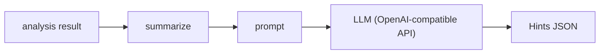

:::warning
**Version:** 0.2
:::

---

# AI advice

## What it does

It takes the result of a pose analysis (see [Pose analysis (MediaPipe)](pose-analysis.md)) and asks an LLM for coaching hints: a summary and a list of hints with a category, a priority, the body zones and the frames concerned. The text is written in French. The LLM never sees the video, only numbers.

---

## How it works



*Summary: the result is reduced to a short summary, written into a prompt, sent to an LLM, and the answer is validated as `Hints`.*

Code in `apps/ai/src/worker/_2_advice/pose_advice.py` and `apps/ai/src/services/llm.py`:

1. `summarize` keeps the measures and the per-limb measurement coverage (limbs that were seen on too few frames are flagged unreliable).
2. `build_prompt` writes the rules (use only the data, never invent holds) and the summary.
3. The `LLM` service calls any OpenAI-compatible API. The answer is validated against the `Hints` schema.

To change the model, change only the three `LLM_*` variables. No call to a real provider has been tested yet.

---

## Models and algorithms

**There is no model of our own here.** The advice comes from a large language model (LLM) that we call as a service: it is not trained or fine-tuned by us, and the module only does prompt engineering and validation around it.

| Part | Technique |
| --- | --- |
| Input | A numeric summary of the analysis (angles, speeds, measurement coverage per limb), not the video |
| Model | Any chat model behind an OpenAI-compatible API. The example configuration is Google's `gemini-3.5-flash-lite`, a small, fast and cheap model |
| Output control | JSON mode (`response_format: json_object`) makes the answer valid JSON, then it is validated against the `Hints` schema |
| Failure | Network errors, timeouts, 408, 429, 5xx, and empty or unparsable answers are transient: the caller retries them with `with_retry`. Anything else fails the job at once |

**Why numbers and not video.** The LLM only reads text. Giving it the video would need a multimodal model, which costs more and mixes two sources of error (the model looking at the pixels, and the coach reasoning on them). Here the pose model has already measured, and the LLM only reasons on measures. The weak spot moves to the prompt: it says to use only the given data and never to invent holds, and the summary flags a limb seen on too few frames as unreliable so that the LLM does not coach on a guess.

**What to remember.** The hints are as good as the metrics of the [pose module](pose-analysis.md). The sampling parameters (temperature and so on) are not set, so they are the provider's defaults, and the answers are not identical from one call to the next.

---

## Prerequisites

From the root of the repository:

1. Tools: `uv`, `moon`. Docker only for the job.
2. `cp .env.example .env`.
3. `moon run ai:install` (`moon run ai:setup` is not needed for the advice itself).
4. A pose result JSON: run `pose-detect` first (see the [pose page](pose-analysis.md)).
5. For a real call, three variables in `.env` (example values, use your own key and never share it):

| Variable | Example | Role |
| --- | --- | --- |
| `LLM_BASE_URL` | `https://generativelanguage.googleapis.com/v1beta/openai/` | Base URL of an OpenAI-compatible API |
| `LLM_API_KEY` | `<your key>` | API key (optional for a local server) |
| `LLM_MODEL` | `gemini-3.5-flash-lite` | Model name |

Without `LLM_BASE_URL` or `LLM_MODEL` the worker still starts, but the advice jobs end in `failed`. `--dry-run` needs none of them.

---

## Run it from the CLI

```bash
cd apps/ai
mkdir -p /tmp/ascension
uv run worker pose-detect --video resources/example-2.mp4 --out /tmp/ascension/result.json

# Dry run: writes the prompt only, no key, no network
uv run worker pose-advice --input /tmp/ascension/result.json --out /tmp/ascension/prompt.txt --dry-run

# Real call (needs the LLM_* variables in .env, or --base-url and --model)
uv run worker pose-advice --input /tmp/ascension/result.json --out /tmp/ascension/hints.json
```

The dry run prints `Wrote /tmp/ascension/prompt.txt`. For the sample video the file is about 12 KB of text that starts with `You are an expert climbing coach.`: read it to see exactly what the LLM would receive. The real call writes the `Hints` JSON to `hints.json`. It was not run for this page (no key): only the dry run is verified.

---

## Run it as a job

The job `pose.advice` is on the queue `poses.advice`. It needs a video whose analysis ended in `success`. Start the infrastructure and the worker as described in [Worker modules](readme.md), with the `LLM_*` variables set. Then:

```bash
cd apps/ai
uv run python src/producer.py seed --video resources/example-2.mp4       # prints job_id, object_key, video_id
uv run python src/producer.py detect --job-id <job_id> --object-key <object_key>
# wait for analyses.status = success, then:
uv run python src/producer.py advice --job-id <video_id>
```

Note that `--job-id` of `advice` is the **video id**, not the analysis id. Where to read the result: the row of `advices` whose id is the video id. `status` goes `started`, `running` (progress 90), `success` (progress 100) and `result` holds the hints. When the LLM fails or is not configured, only the advice ends in `failed` with a short `error`; the analysis is untouched. Run `advice` again to retry. The worker publishes `pose.advice.status`.

---

## Tests

```bash
cd apps/ai
uv run pytest -p no:cacheprovider -m "not e2e and not integration" -q tests/test_pose_advice.py tests/test_llm.py
```

Expected: `28 passed` in about 1 s. The LLM is simulated: no key needed.
