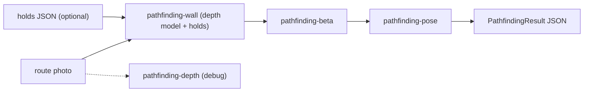

:::warning
**Version:** 0.4
:::

---

# Pathfinding

## What it does

It takes a route photo (and a climber's height and arm span) and returns the beta of the route as a list of steps. Each step says which hold is under each limb and gives the 33 landmarks of the climber in pixels of the photo, so the app can draw a "ghost" on the photo. Vocabulary: pathfinding is this computation (the Ghost Mode feature displays its result) and `pathfindings` is the table that stores the job and its result.

---

## How it works



*Summary: a depth model gives the distances in the photo, the wall plane turns photo pixels into centimetres, an A\* search finds the sequence of holds, and inverse kinematics draws a posture for each step. `pathfinding` runs the wall, beta and pose steps in one go; `pathfinding-depth` only exports the depth map for debugging.*

Code in `apps/ai/src/worker/_4_pathfinding/`:

1. `_1_depth.py`: metric depth model (MoGe-2 ViT-S, ONNX, CPU). Also `depth-eval`.
2. `_0_wall.py`: fits the wall plane (RANSAC on the pixels outside the holds), returns the homography photo pixels to cm and the wall angle. The angle needs an optional `--gravity` vector, without it the wall is treated as vertical.
3. `_2_beta.py`: A\* search over the state of the four limbs (hold under each hand and foot), with the climber's morphology, a preference (`easy`, `power`, `technique`) and the start and finish marks of the holds.
4. `_3_pose.py`: inverse kinematics, 33 MediaPipe landmarks per step.
5. `_4_pathfinding.py`: the chain, shared by the CLI and the job.

Known limits: the metric scale is not measured (it is probably 15 to 25 % too small on the sample photo), and the postures are simple 2D ones. See the "Known limits" section of `apps/ai/README.md`.

---

## Models and algorithms

| Step | Technique | Learned model? |
| --- | --- | --- |
| `_1_depth` | MoGe-2 ViT-S, metric monocular depth, ONNX Runtime on the CPU | Yes, not trained by us |
| `_0_wall` | RANSAC plane fit, homography | No |
| `_2_beta` | A\* search over the state of four limbs | No |
| `_3_pose` | Two-segment inverse kinematics | No |

Only the depth step learns anything. The beta and the postures are deterministic algorithms: the same input always gives the same output, and a wrong result can be debugged by reading a cost or a constraint.

**Depth from one photo.** MoGe-2 is a Vision Transformer (here the small variant, ViT-S). It cuts the photo into patches, turns them into tokens, and a transformer predicts for each pixel a 3D point. The distance is not measured: the model guesses it from what it learned about scenes, the sizes of things and the perspective. This is why a single photo gives centimetres at all, and also why the scale is the weak point: a guess is wrong by a factor, not by a few millimetres. The exported ONNX file only holds the raw forward pass. Its outputs are a point map known up to a shift of the depth and of the focal length, a validity mask, the normals and a metric scale. The worker redoes the post-processing of the reference code in numpy: it searches the shift that makes the points consistent with a pinhole camera (the focal length has a closed form for each shift, so only the shift is searched, on a log grid and then refined), and applies the scale. The photo is shrunk to 640 pixels on its long side and the model gets 1800 tokens, more tokens are finer and slower on the CPU. If the focal fit fails, a 69 degrees field of view (a typical phone) is used.

**Plane of the wall.** The depth map is turned into a cloud of 3D points with the focal length. RANSAC then repeats 200 times: draw three points, make a plane, count the points close to it. The plane with the most inliers is the wall. The holds are left out of the fit (they stick out of the wall), the distance counted as "close" is 1.2 % of the median depth (at least 2 cm, a depth model is noisy in proportion to the distance), and a fit is refused when its inliers cover less than 20 % of the image. The wall is assumed to be a plane: a corner or a curved wall is not handled. The result is a homography, a 3 x 3 matrix that moves a pixel of the photo to a point of the wall in centimetres, and back. The angle of the wall comes from the optional gravity vector.

**The beta is a shortest-path search.** A state is the hold under each of the four limbs, and a move changes one limb. A\* explores the states by increasing cost, guided by a heuristic that never over-estimates the remaining cost (a lower bound of the moves still needed to climb to the finish, counting the hands and the feet apart and using the cheapest possible moves), so that the first path found to the finish is the cheapest for the cost model. A move costs a base, plus a term that grows with the square of the distance covered (two short moves are cheaper than one long move), plus the cost of the hold type and size. Two kinds of rules:

- Hard rules: reach limits as fractions of the body, from Drillis and Contini (1966) and Winter: hand to hand at most 0.8 of the arm span, hand to foot at most 0.9 of the height, foot to foot at most 0.6 of the height.
- Costs, which the preference (`easy`, `power`, `technique`) changes through its weights: the distance covered (squared), the type and size of the hold, a foot leaving the wall, a foot left without a hold, a move of an injured limb, an overhanging wall.

The search stops after 100 000 explored states and fails with `search limit reached`, so a big route cannot block the worker. The reach limits are checked by pairs of limbs, not on the whole body at once: this is why a few steps put a limb a few centimetres from its hold.

**Postures by inverse kinematics.** For each step, the four contacts are known and the body has to be found. The torso position is fitted first (a weighted centre of the contacts, then up to 50 corrections so that each limb can reach its contact without folding or being fully stretched). Then each arm and leg is solved as two segments with the law of cosines: given the shoulder or hip, the hand or foot, and the two lengths, the bend of the elbow or knee follows. Segment lengths are fractions of the height (Drillis and Contini). A limb without a contact hangs a little bent. The head and the fingers are placed at fixed offsets from the body, to fill the 33 MediaPipe landmarks. The postures are plausible, not measured: there is no balance model and no force.

**The render.** `--render <path>` writes a folder named after the path without its extension: with `--render /tmp/ascension/route.jpg` you get `/tmp/ascension/route/step-01.jpg`, `step-02.jpg`, and so on, one picture per step. Each shows only the skeleton of its step, with the number of the step in the corner, and the colour goes from blue (start) to red (finish) so that the pictures can be compared side by side.

---

## Prerequisites

From the root of the repository:

1. Tools: `uv`, `moon`. Docker only for the job.
2. `cp .env.example .env`. Optional variable: `DEPTH_MODEL_PATH` (default `resources/moge-2-vits-normal.onnx`).
3. `moon run ai:install`, then `moon run ai:setup`: it downloads the depth model (141 MB, from Hugging Face without a token, SHA-256 checked, skipped if present) and checks the MediaPipe model.
4. The hold model `apps/ai/resources/holds_seg.onnx` is versioned in git. `pathfinding`, `pathfinding-wall` and `pathfinding-depth` need the depth model, and the first two also need the hold model (unless you pass `--holds`). `pathfinding-beta` and `pathfinding-pose` need no model.

---

## Run it from the CLI

The photo is `apps/ai/resources/voie.jpg`. `--gravity 0 1 0` says that the floor is down in the camera frame (a vertical wall), `--color yellow` selects the yellow holds as the route.

```bash
cd apps/ai
mkdir -p /tmp/ascension

# All at once (about 6 s with both models on a 24-core CPU)
uv run worker pathfinding --image resources/voie.jpg --out /tmp/ascension/pathfinding.json \
  --render /tmp/ascension/pathfinding.jpg --gravity 0 1 0 --color yellow
```

It prints `Wall: 0.7 deg, inliers 48%`, `Beta: 13 steps` and `Wrote ... (13 steps)`. `pathfinding.json` is a `PathfindingResult`: `image_width`, `image_height`, `wall_angle_deg` and `steps`. Each step has `index`, `moved_limb`, `holds` (hold id under each limb), `center_of_mass` and 33 `landmarks`. `--render /tmp/ascension/pathfinding.jpg` writes the folder `/tmp/ascension/pathfinding/` with one picture per step (`step-01.jpg` to `step-13.jpg`), each with only the skeleton of that step.

The same, step by step (the final JSON is identical to the one above):

```bash
uv run worker pathfinding-depth --image resources/voie.jpg --out /tmp/ascension/depth.npy --render /tmp/ascension/depth.png
uv run worker pathfinding-wall  --image resources/voie.jpg --out /tmp/ascension/holds_wall.json --gravity 0 1 0
uv run worker pathfinding-beta  --input /tmp/ascension/holds_wall.json --out /tmp/ascension/beta.json --color yellow
uv run worker pathfinding-pose  --input /tmp/ascension/beta.json --holds /tmp/ascension/holds_wall.json \
  --out /tmp/ascension/steps.json --render /tmp/ascension/steps.jpg --image resources/voie.jpg
```

- `pathfinding-depth` prints `focal 2381.4 px, depth median 4.56 m, 97% valid pixels` and writes the depth map in metres (`.npy`). It is a debugging step: `pathfinding-wall` computes the depth again itself.
- `pathfinding-wall` detects the holds and the wall plane, and writes the holds JSON with a `wall` key. Pass `--holds <holds-detect output>` to reuse holds you already have (their start and finish marks are kept).
- `pathfinding-beta` and `pathfinding-pose` only read that JSON: no model, no network.

Climber and route options of `pathfinding-beta` and `pathfinding` (defaults in brackets): `--height` (175) and `--arm-span` (178) in cm, `--morphology <ClimberMorphology JSON>` (overrides both and adds `missing` or `injured` limbs), `--preference easy|power|technique` (easy), `--feet-free` (every usable hold can hold a foot), `--color <name>` and `--selected <ids>` (which holds are the route; default all). On `voie.jpg`, `pathfinding-beta --color yellow --preference technique --feet-free` gives 27 steps instead of 13.

`depth-eval --dataset <folder>` measures the depth model on photos with known distances. The folder holds the photos and an `annotations.json`, with `a` and `b` in pixels of the photo:

```json
[{"image": "voie.jpg", "pairs": [{"a": [300, 2200], "b": [900, 1200], "distance_cm": 120}]}]
```

```bash
mkdir -p /tmp/ascension/depth-dataset
cp resources/voie.jpg /tmp/ascension/depth-dataset/
# write the annotations.json above in /tmp/ascension/depth-dataset/annotations.json, then:
uv run worker depth-eval --dataset /tmp/ascension/depth-dataset
```

It prints, per image then overall, the relative error of the 3D distance between the two pixels. No real annotated dataset exists in the repository: the `distance_cm` above is an invented value used only to check that the command runs (it printed `all: 1 pairs (0 skipped) ...`), so its error means nothing. Measure real distances on a wall to use it.

---

## Run it as a job

The job `pathfinding.compute` is on the queue `pathfinding.compute`. It needs a route that went through the hold job with success and a `wall_plane` (so the depth model must be installed when the hold job runs). Start the infrastructure and the worker as described in [Worker modules](readme.md). Then:

```bash
cd apps/ai
uv run python src/producer.py seed-route --image resources/voie.jpg        # prints route_id, object_key
uv run python src/producer.py holds --job-id <route_id> --object-key <object_key>
# wait for routes.status = success and routes.wall_plane filled, then:
uv run python src/producer.py seed-pathfinding --route-id <route_id>        # prints pathfinding_id
uv run python src/producer.py pathfinding --job-id <pathfinding_id> --preference easy
```

`seed-pathfinding` creates a `pending` row of `pathfindings` (height 175, arm span 178, options `--height` and `--arm-span`) with no `pathfinding_holds`: all the usable holds of the route are then the route. `pathfinding` publishes `pathfinding.compute.requested`; `--job-id` is the **pathfinding id** (`pathfindings.id`).

Where to read the result: the row of `pathfindings` whose id is `pathfinding_id`. `status` goes `started`, `running` (progress 10, 30), `success` (progress 100). `result` holds the `PathfindingResult`. On failure `error` is short and the message goes to `pathfinding.compute.dlq`: `Wall geometry missing` (no wall plane on the route), `No beta between holds A and B` (no passage between those holds), `Invalid pathfinding data`, `Pathfinding failed`. The worker also publishes `pathfinding.compute.status`.

---

## Tests

```bash
cd apps/ai
uv run pytest -p no:cacheprovider -m "not e2e and not integration" -q \
  tests/test_pathfinding_*.py tests/test_producer_pathfinding.py tests/functional/test_cli_pathfinding.py
```

Expected: `214 passed` in about 25 s. They need no infrastructure and no network. The end-to-end test is `tests/e2e/test_e2e_pathfinding.py` (`moon run ai:e2e`, real RabbitMQ, PostgreSQL and RustFS, see the README of `apps/ai`).

---

## Justification and next steps

:::info
**Pourquoi cette approche (à défendre)**

- **Un algorithme classique et vérifiable.** La bêta est un plus court chemin cherché avec A\* sur l'état des quatre membres. Si l'heuristique ne surestime jamais le coût restant, la première solution trouvée est la moins chère pour notre modèle de coût. Un test le prouve : il compare A\* à un Dijkstra pur (`use_heuristic=False`) et attend le même résultat.
- **Des paramètres sourcés.** Les portées (main-main 0,8 de l'envergure, main-pied 0,9 de la taille, pied-pied 0,6 de la taille) et les longueurs de segments viennent de Drillis et Contini (1966), repris par Winter. Aucun chiffre n'est inventé pour les contraintes dures.
- **La personnalisation est explicite.** La morphologie fixe les portées, les blessures ajoutent un coût (ou excluent le membre), la préférence (`easy`, `power`, `technique`) ne change que les poids. Un même algorithme sert donc les trois profils.
- **Déterministe et débuggable.** Même entrée, même sortie. Quand une étape surprend, on lit la contrainte ou le coût qui l'explique, ce qu'un modèle appris ne permet pas.
- **Borné.** La recherche s'arrête après 100 000 états : une grande voie ne bloque pas le worker, et l'erreur dit entre quelles prises elle a buté.

**Ce qu'il faut assumer**

- « Optimal » veut dire optimal pour *notre* modèle de coût, pas « la bêta qu'un coach choisirait ». Les poids sont des choix d'ingénierie, pas calibrés sur des grimpeurs.
- La profondeur vient d'une seule photo : l'échelle est une estimation du modèle, non mesurée (voir `depth-eval`).
- Les portées sont vérifiées par paires de membres, pas sur tout le corps à la fois : sur `voie.jpg`, 5 étapes sur 13 laissent un appui à 7 à 21 cm de sa prise.
- Le sol n'est pas modélisé, et il n'y a ni équilibre ni force dans les postures. Elles sont plausibles, pas mesurées.
- Il n'existe pas encore de vérité terrain : on sait que la bêta est cohérente, pas encore qu'elle est « bonne ».

**Pistes d'amélioration**

1. **Deux pieds sur la même prise, ou des pieds au-dessus des mains.** Aujourd'hui, `successors` et `valid` (`apps/ai/src/worker/_4_pathfinding/_2_beta.py`) interdisent les deux : deux pieds ne partagent jamais une prise, et un pied ne monte jamais au-dessus des deux mains. C'est une simplification de la v1, qui écarte des gestes réels : deux pieds sur un volume ou une grosse prise, un pied haut sur une dalle, un relevé de pied au-dessus des mains. Pour la lever :
    - autoriser deux pieds sur une prise assez grande (on a déjà `area_cm2`) ou de type `volume` ou `jug`, et laisser le pied monter au-dessus des mains tant que les portées sont respectées, avec un surcoût plutôt qu'une interdiction ;
    - refaire tourner le test qui compare A\* à Dijkstra, car les mouvements permis changent ;
    - re-mesurer le budget d'états explorés (`SEARCH_BUDGET` dans `tests/test_pathfinding_beta.py`), l'espace de recherche devenant plus grand.
2. **Portées sur le corps entier**, pas seulement par paires, pour supprimer les appuis à quelques centimètres de leur prise.
3. **Calibrer les poids** des préférences avec des grimpeurs ou un coach, et mesurer l'écart avec leurs bêtas.
4. **Mesurer l'échelle** de la profondeur avec `depth-eval` sur des distances réelles annotées.
5. **Modéliser le sol** (sortir du mur, réception) et ajouter un modèle d'équilibre avec centre de masse.
6. **Types de prises réels** (réglette, plat, poignée, bac) quand la détection les classera, pour donner leur vrai coût aux prises.
:::
