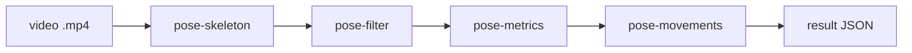

:::warning
**Version:** 0.2
:::

---

# Pose analysis (MediaPipe)

## What it does

It takes a climbing video and returns one JSON: the 33 body landmarks of every frame, joint angles, speeds, and a list of movements and pauses. The result is stored as `analyses.result` and is what the [AI advice](ai-advice.md) module reads.

---

## How it works



*Summary: four steps run one after the other, each reads the JSON of the previous one. `pose-detect` chains all four.*

Code in `apps/ai/src/worker/_1_mediapipe/`:

1. `_1_pose_skeleton.py`: MediaPipe PoseLandmarker extracts 33 landmarks per frame (`x`, `y`, `z`, `visibility`).
2. `_2_pose_filter.py`: drops low-visibility points, fills short gaps (5 frames), smooths (window 5), computes the joint angles.
3. `_3_pose_metrics.py`: speeds in torso lengths per second, arm extension (`--bent-arm`).
4. `_4_pose_movements.py`: cuts the speed signal into movements and pauses.
5. `_0_pose_detect.py`: chains the four steps.

Limit: the hands are often not visible on `example-2.mp4`, so the movements of the hands are unreliable on that video.

---

## Models and algorithms

| Step | Technique | Learned model? |
| --- | --- | --- |
| `pose-skeleton` | MediaPipe PoseLandmarker (BlazePose family), neural network on the CPU | Yes, not trained by us |
| `pose-filter` | Linear interpolation of short gaps, centred moving average | No |
| `pose-metrics` | Geometry: joint angles, distances normalised by the torso length | No |
| `pose-movements` | Speed thresholds with hysteresis | No |

**The model.** The PoseLandmarker bundle (`.task` file) holds TensorFlow Lite networks in two stages. A detector first finds the person in the frame, then a landmark network looks at the crop and regresses 33 body keypoints. For each keypoint it returns `x` and `y` (normalised in the image), `z` (a relative depth, with the hips as origin) and `visibility` (the probability that the point is seen and not guessed behind something). It is a general-purpose pose model: we do not train or fine-tune it on climbing.

**Video mode.** We run it in `VIDEO` mode, which needs increasing timestamps. After the first detection the pose is tracked from one frame to the next and the detector only runs again when the track is lost, which is faster and steadier than detecting on each frame. The three confidence thresholds are set to 0.1 on purpose: a climber with a twisted or inverted body is often scored low, so the model keeps its guess and `pose-filter` decides later what to trust (`--min-visibility`, 0.5 by default). Three sizes of the model are in `apps/ai/resources/`: `lite` (5.8 MB), `full` (9.4 MB, the default) and `heavy` (31 MB). A heavier one is more accurate and slower. Choose it with `POSE_MODEL_PATH`.

**What the rest does.** Everything after the model is plain signal processing, with no learning: the metrics only use `x` and `y` (the 2D image), and speeds are measured in torso lengths per second so that they do not depend on how far the camera is. A movement starts when the speed goes above 0.8 and ends when it falls below 0.4 (two thresholds, so that a speed hovering around one value does not cut a movement into pieces).

**What to remember.** The quality of everything downstream depends on the keypoints. A limb hidden by the body, the wall or a bad angle gives a wrong or missing point, and the 2D view cannot tell a limb close to the camera from a far one.

---

## Prerequisites

From the root of the repository:

1. Tools: `uv` and `moon`. Docker is not needed for the CLI.
2. `cp .env.example .env` (the CLI does not need any variable).
3. `moon run ai:install` then `moon run ai:setup`. The pose model `apps/ai/resources/pose_landmarker_full.task` is versioned in git, `ai:setup` only checks it (and downloads the depth model of the pathfinding, which this module does not use).

---

## Run it from the CLI

```bash
cd apps/ai
mkdir -p /tmp/ascension

# All four steps at once (about 12 s on a laptop CPU for the 10 s sample video)
uv run worker pose-detect --video resources/example-2.mp4 --out /tmp/ascension/result.json

# Or step by step
uv run worker pose-skeleton  --video resources/example-2.mp4 --out /tmp/ascension/skeleton.json
uv run worker pose-filter    --input /tmp/ascension/skeleton.json --out /tmp/ascension/filtered.json
uv run worker pose-metrics   --input /tmp/ascension/filtered.json --out /tmp/ascension/metrics.json
uv run worker pose-movements --input /tmp/ascension/metrics.json  --out /tmp/ascension/movements.json
```

Each command prints `Wrote <file>` when it ends. Add `--render /tmp/ascension/result.mp4` to `pose-skeleton` or `pose-detect` to also write the video with the skeleton drawn.

What you get for `example-2.mp4`: `result.json` holds `frames` (309), `fps` (about 30), `width` 480, `height` 854, `metrics`, `movements` (14) and `pauses` (0). The content of `movements.json` is the same as `result.json` (same data, the file layout can differ).

Useful options (defaults in brackets): `pose-filter --min-visibility (0.5) --max-gap (5) --window (5)`, `pose-metrics --bent-arm (0.8)`, `pose-movements --move-speed (0.8) --stop-speed (0.4) --merge-gap (150) --min-move (100) --min-pause (500)`.

The same chain exists as a moon task. Paths are relative to `apps/ai` there:

```bash
moon run ai:pose-detect -- --video resources/example-2.mp4 --out /tmp/ascension/result.json
```

---

## Run it as a job

Start the infrastructure and the worker as described in [Worker modules](readme.md) (`moon run root:db-up`, `moon run server:migrate`, `moon run ai:dev`). The job is `pose.detect` on the queue `poses.detect`. Then, in another terminal:

```bash
cd apps/ai
uv run python src/producer.py seed --video resources/example-2.mp4
# prints job_id=..., object_key=..., video_id=...
uv run python src/producer.py detect --job-id <job_id> --object-key <object_key>
```

`seed` creates a test user, a video and a `pending` analysis, creates the bucket `videos` if needed and uploads the video to RustFS. `detect` publishes `pose.detect.requested`.

Where to read the result: the row of `analyses` whose id is `job_id`. `status` goes `started`, `running` (progress 5 to 85), `success` (progress 100), or `failed` with a short `error`. `result` holds the JSON of the CLI. The worker also publishes `pose.detect.status` on the `events` exchange.

---

## Tests

```bash
cd apps/ai
uv run pytest -p no:cacheprovider -m "not e2e and not integration" -q \
  tests/test_pose.py tests/test_pose_movements.py tests/functional/test_cli.py
```

Expected: `27 passed` (the functional tests run the CLI on the sample video, about 45 s).
