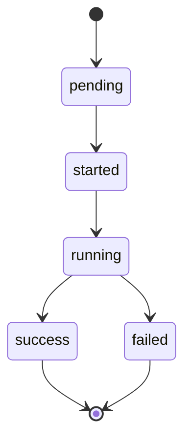

:::success
**Version:** 1.8
:::

---

# Server API Routes Reference

This document lists every HTTP route exposed by the Ascension backend server, with request/response examples, rate limits, and authentication requirements.

---

## Base URL

| Environment | URL |
| --- | --- |
| Local development | `http://localhost:8080` |
| Docker (Android emulator) | `http://10.0.2.2:8080` |
| Production | Configured via `PORT` environment variable |

All routes are prefixed with `/v1` except `/healthz`.

---

## Response Format

- **Successful responses** return the payload directly as a JSON object or array.
- **Error responses** always return a JSON object with an `error` key matching the `response.Error` struct:

```json
{
  "error": "email already exists"
}

```

---

## Authentication & Authorization

Protected endpoints require a valid JWT bearer token in the `Authorization` header:

```http
Authorization: Bearer <access_token>

```

Authentication is enforced via `middleware.AuthMiddleware` (`internal/inbound/http/middleware/auth.go`). The middleware validates the JWT token, checks allowed user roles, and attaches the parsed `model.User` to the Gin context at key `macro.Me` (`"me"`).

| Access Level | Routes | Required Role |
| --- | --- | --- |
| **Public** | `/healthz`, `/v1/auth/register`, `/v1/auth/login`, `/v1/auth/refresh` | None |
| **Authenticated** | `DELETE /v1/auth/logout`, `/v1/videos/*`, `/v1/analysis/*`, `/v1/sessions/*`, `/v1/profile/*`, `/v1/friends/*`, `GET /v1/users/search`, `GET /v1/feed` | `user` or `admin` |
| **Admin Only** | `/v1/users/*`, except `GET /v1/users/search` | `admin` |

---

## Rate Limiting

Rate limiting is enforced per client IP via `middleware.RateLimiter`:

| Route / Group | Rate Limit |
| --- | --- |
| `POST /v1/auth/register` | 5 requests / minute |
| `POST /v1/auth/login` | 10 requests / minute |
| `DELETE /v1/auth/logout` | 10 requests / minute |
| `PUT /v1/auth/refresh` | 10 requests / minute |
| `/v1/users/*` | None |
| `/v1/videos/*` | 10 requests / minute |
| `/v1/analysis/*` | 10 requests / minute |
| `/v1/profile/*` | 10 requests / minute |
| `/v1/sessions/*` | 10 requests / minute |
| `/v1/friends/*` | 10 requests / minute |
| `GET /v1/users/search` | 30 requests / minute |
| `GET /v1/feed` | 30 requests / minute |

Excess requests receive `429 Too Many Requests`.

---

## Auth

All auth endpoints live under `/v1/auth`.

### POST /v1/auth/register — Register a new account

Creates a new user account, hashes the password with bcrypt, creates a refresh session, and issues tokens.

**Rate limit:** 5 req/min.\
**Authentication:** None.

**Request body:**

```json
{
  "username": "climber42",
  "first_name": "Alex",
  "last_name": "Honnold",
  "email": "alex@example.com",
  "password": "securepassword123",
  "remember": true
}

```

| Field | Type | Rules |
| --- | --- | --- |
| `username` | string | Required, 6–24 characters |
| `first_name` | string | Required |
| `last_name` | string | Required |
| `email` | string | Required, valid email format |
| `password` | string | Required, 8–64 characters |
| `remember` | boolean | Optional (extends session expiration) |

**Responses:**

| Status | Meaning | Body |
| --- | --- | --- |
| `200 OK` | Account created and user logged in | `LoginResponse` |
| `400 Bad Request` | Validation failed | `{"error": "<msg>"}` |
| `409 Conflict` | Email or username already exists | `{"error": "<msg>"}` |

**Example response (200):**

```json
{
  "refresh_token": "a1b2c3d4...",
  "access_token": "eyJhbGciOiJIUzI1NiIsInR5cCI6IkpXVCJ9...",
  "token_type": "Bearer",
  "expires_in": 900,
  "user": {
    "ID": "018e6e5a-1234-7abc-8def-0123456789ab",
    "Username": "climber42",
    "FirstName": "Alex",
    "LastName": "Honnold",
    "Email": "alex@example.com",
    "Role": "user",
    "Status": "active"
  }
}

```

---

### POST /v1/auth/login — Log in

Authenticates a user via their identifier (email or username) and password.

**Rate limit:** 10 req/min.\
**Authentication:** None.

**Request body:**

```json
{
  "identifier": "climber42",
  "password": "securepassword123",
  "remember": false
}

```

| Field | Type | Rules |
| --- | --- | --- |
| `identifier` | string | Required (username or email) |
| `password` | string | Required |
| `remember` | boolean | Optional |

**Responses:**

| Status | Meaning | Body |
| --- | --- | --- |
| `200 OK` | Successfully authenticated | `LoginResponse` |
| `400 Bad Request` | Validation failed | `{"error": "<msg>"}` |
| `401 Unauthorized` | Invalid credentials | `{"error": "<msg>"}` |

---

### DELETE /v1/auth/logout — Log out

Revokes the caller's active refresh session.

**Rate limit:** 10 req/min.\
**Authentication:** Required (`Authorization: Bearer <jwt>`).

**Responses:**

| Status | Meaning | Body |
| --- | --- | --- |
| `200 OK` | Session successfully revoked | empty |
| `401 Unauthorized` | Missing or invalid token | empty |

---

### PUT /v1/auth/refresh — Refresh access token

Generates a new access token using a valid refresh token.

**Rate limit:** 10 req/min.\
**Authentication:** None.

**Request body:**

```json
{
  "refresh_token": "a1b2c3d4e5f6..."
}

```

| Field | Type | Rules |
| --- | --- | --- |
| `refresh_token` | string | Required |

**Responses:**

| Status | Meaning | Body |
| --- | --- | --- |
| `200 OK` | New access token issued | `AccessTokenResponse` |
| `400 Bad Request` | Missing token | `{"error": "<msg>"}` |
| `401 Unauthorized` | Invalid, expired, or revoked refresh token | `{"error": "<msg>"}` |

**Example response (200):**

```json
{
  "access_token": "eyJhbGciOiJIUzI1NiIsInR5cCI6IkpXVCJ9...",
  "token_type": "Bearer",
  "expires_in": 900
}

```

---

## Users (Admin Only)

All endpoints under `/v1/users` require the `admin` role (`authMW(model.UserRoleAdmin)`).

**Rate limit:** none.

### POST /v1/users — Create a user

**Request body:**

```json
{
  "username": "coach_john",
  "first_name": "John",
  "last_name": "Doe",
  "email": "john@example.com",
  "password": "initialpassword123",
  "role": "coach"
}

```

| Field | Type | Rules |
| --- | --- | --- |
| `username` | string | Required, 6–24 characters |
| `first_name` | string | Required |
| `last_name` | string | Required |
| `email` | string | Required, valid email format |
| `password` | string | Required, 8–64 characters |
| `role` | string | Required (`"user"`, `"admin"`, `"coach"`, `"gym"`) |

**Responses:**

| Status | Meaning | Body |
| --- | --- | --- |
| `201 Created` | User created successfully | `{"id": "<uuid>"}` |
| `400 Bad Request` | Validation failed | `{"error": "<msg>"}` |
| `409 Conflict` | Email or username already exists | `{"error": "<msg>"}` |

---

### GET /v1/users — List all users

Returns all registered users.

**Responses:**

| Status | Meaning | Body |
| --- | --- | --- |
| `200 OK` | Success | Array of `response.User` |

---

### GET /v1/users/:id — Get user by ID

**Responses:**

| Status | Meaning | Body |
| --- | --- | --- |
| `200 OK` | User found | `response.User` |
| `400 Bad Request` | Invalid UUID format | `{"error": "<msg>"}` |
| `404 Not Found` | User does not exist | `{"error": "<msg>"}` |

---

### PUT /v1/users/:id — Partially update user

Allows updating any subset of a user's fields. All fields in the body are optional.

**Request body:**

```json
{
  "first_name": "Jonathan",
  "role": "admin",
  "status": "active"
}

```

**Responses:**

| Status | Meaning | Body |
| --- | --- | --- |
| `200 OK` | User updated successfully | `{"id": "<uuid>"}` |
| `400 Bad Request` | Validation error | `{"error": "<msg>"}` |
| `404 Not Found` | User does not exist | `{"error": "<msg>"}` |

---

### DELETE /v1/users/:id — Delete user

Permanently deletes the specified user.

**Responses:**

| Status | Meaning | Body |
| --- | --- | --- |
| `200 OK` | User deleted | empty |
| `404 Not Found` | User does not exist | `{"error": "<msg>"}` |

---

## Videos

**Rate limit:** 10 req/min.\
**Authentication:** Required (`user` or `admin`).

### POST /v1/videos/upload-url — Get a presigned upload URL

Generates a presigned PUT URL allowing direct upload from the mobile client to Object Storage (RustFS / OVHcloud S3).

**Request body (JSON):**

```json
{
  "content_type": "video/mp4",
  "size": 52428800,
  "visibility": "private",
  "climbing_session_id": null,
  "title": "Send of Sector 4",
  "retained": false
}

```

| Field | Type | Rules |
| --- | --- | --- |
| `content_type` | string | Required (`video/mp4`, `video/webm`, `video/quicktime`, `video/x-msvideo`) |
| `size` | int | Required, size in bytes (maximum 1 GB) |
| `visibility` | string | Required (`"private"`, `"friends"`, `"public"`) |
| `climbing_session_id` | UUID | Optional parent climbing session ID, must be one of the caller's sessions |
| `title` | string | Optional video title |
| `retained` | boolean | Optional flag to bypass the default 7-day deletion policy |

**Responses:**

| Status | Meaning | Body |
| --- | --- | --- |
| `200 OK` | Presigned URL generated | `{"video_id": "<uuid>", "upload_url": "<presigned-url>", "expires_at": "<time>"}` |
| `400 Bad Request` | Validation failed | `{"error": "<msg>"}` |
| `422 Unprocessable Entity` | `climbing_session_id` is not one of the caller's sessions | `{"error": "<msg>"}` |

---

### PUT /v1/videos/upload-done/:id — Complete upload

Notifies the server that the mobile client has finished uploading the file to object storage. The server verifies the object in storage, extracts metadata, and marks the video as completed.

**Responses:**

| Status | Meaning | Body |
| --- | --- | --- |
| `204 No Content` | Upload verified and completed | empty |
| `400 Bad Request` | Invalid UUID | `{"error": "<msg>"}` |
| `404 Not Found` | Video not found | `{"error": "<msg>"}` |

---

### GET /v1/videos/download-url/:id — Get download URL

Generates a time-limited presigned GET URL to stream or download the video.

**Responses:**

| Status | Meaning | Body |
| --- | --- | --- |
| `200 OK` | Download URL generated | `{"download_url": "<presigned-url>", "expires_at": "<time>"}` |
| `404 Not Found` | Video not found | `{"error": "<msg>"}` |

---

## Analyses

**Rate limit:** 10 req/min.\
**Authentication:** Required (`user` or `admin`).

### POST /v1/analysis — Trigger an analysis

Creates a pending analysis record and publishes a `pose.detect.requested` job on the RabbitMQ `events` exchange, with the body `{"job_id": "<analysis id>", "object_key": "<video object key>"}` (`schemas/pose_detect_request.schema.json`). The AI worker consumes it from the `poses.detect` queue.

**Request body:**

```json
{
  "video_id": "018e6e5a-1234-7abc-8def-0123456789ab",
  "type": "2d",
  "visibility": "private"
}

```

| Field | Type | Rules |
| --- | --- | --- |
| `video_id` | UUID string | Required, ID of a completed video |
| `type` | string | Required (`"2d"` or `"3d"`) |
| `visibility` | string | Required (`"private"`, `"friends"`, `"public"`) |

**Responses:**

| Status | Meaning | Body |
| --- | --- | --- |
| `202 Accepted` | Job successfully queued | `AnalysisResponse` |
| `400 Bad Request` | Validation failed | `{"error": "<msg>"}` |
| `404 Not Found` | Video does not exist | `{"error": "<msg>"}` |

---

### GET /v1/analysis — List analyses

Returns one page of the analyses of the caller's videos, newest first, in or outside a climbing session. Each item is an analysis summary, as in `GET /v1/sessions/:id`; `climbing_session_id` is `null` for an analysis outside any session.

**Query parameters:**

| Parameter | Type | Rules |
| --- | --- | --- |
| `limit` | int | Optional, 1 to 100, defaults to 20 |
| `offset` | int | Optional, 0 or more, defaults to 0 |

**Responses:**

| Status | Meaning | Body |
| --- | --- | --- |
| `200 OK` | Page returned | `{"analyses": [AnalysisSummary], "total": <int>, "limit": <int>, "offset": <int>}` |
| `400 Bad Request` | Invalid `limit` or `offset` | `{"error": "<msg>"}` |

---

### GET /v1/analysis/:id — Get analysis details & progress

Returns the current progress, status, and results of an analysis.

**Responses:**

| Status | Meaning | Body |
| --- | --- | --- |
| `200 OK` | Analysis found | `AnalysisResponse` |
| `404 Not Found` | Analysis does not exist | `{"error": "<msg>"}` |

**Example response (200):**

```json
{
  "id": "018e6e5a-abcd-7ef0-1234-567890abcdef",
  "video_id": "018e6e5a-1234-7abc-8def-0123456789ab",
  "type": "2d",
  "status": "success",
  "visibility": "private",
  "progress": 100,
  "result": {
    "fps": 30.0,
    "width": 1080,
    "height": 1920,
    "frames": [...]
  },
  "advice": null,
  "hints": {
    "items": [
      {
        "title": "Arm extension",
        "category": "technique",
        "priority": 4,
        "frame_end": 154,
        "body_zones": ["left_elbow", "left_shoulder"],
        "description": "The left arm stays bent close to the body..."
      }
    ]
  },
  "error": null,
  "processing_time_ms": 14250,
  "started_at": "2026-09-22T10:15:00Z",
  "completed_at": "2026-09-22T10:15:14Z"
}

```

**Analysis Status Lifecycle:**

An analysis starts as `pending`, moves to `started` then `running` while the worker processes it, and ends as `success` or `failed`.



The statuses are written by the AI worker (`schemas/job_status.schema.json`). `hints` holds the structured advice written by the worker; `advice` is the legacy free-text field and stays `null`.

---

## Climbing Sessions

**Rate limit:** 10 req/min.\
**Authentication:** Required (`user` or `admin`).

A climbing session groups the videos and analyses of one outing. Every route only sees the caller's own sessions: a session owned by another user answers `404 Not Found`. The link is held by the video (`videos.climbing_session_id`): an analysis belongs to the session of its video, and an analysis outside any session is allowed. A video joins a session when it is uploaded (`climbing_session_id` of `GET /v1/videos/upload-url`) or later with `POST /v1/sessions/:id/analyses`.

**`ClimbingSession` object:**

```json
{
  "id": "018e6e5a-5555-7abc-8def-0123456789ab",
  "gym_id": null,
  "title": "Arkose Nation",
  "started_at": "2026-11-12T18:00:00Z",
  "ended_at": null,
  "overall_score": null,
  "technique_score": null,
  "power_score": null,
  "endurance_score": null,
  "scored_at": null,
  "notes": "Worked on heel hooks",
  "visibility": "private",
  "created_at": "2026-11-12T18:00:02Z",
  "updated_at": "2026-11-12T18:00:02Z"
}

```

The scores and `scored_at` are read-only: they are computed from the analyses of the session.

### POST /v1/sessions — Start a climbing session

Creates a climbing session for the caller. Every field is optional, and the body can be empty.

**Request body (JSON):**

```json
{
  "title": "Arkose Nation",
  "notes": "Worked on heel hooks",
  "gym_id": null,
  "started_at": "2026-11-12T18:00:00Z",
  "visibility": "private"
}

```

| Field | Type | Rules |
| --- | --- | --- |
| `title` | string | Optional, 1 to 255 characters (not blank) |
| `notes` | string | Optional, up to 5000 characters |
| `gym_id` | UUID | Optional, ID of an existing gym |
| `started_at` | RFC 3339 timestamp | Optional, defaults to the current time |
| `visibility` | string | Optional (`"private"`, `"friends"`, `"public"`), defaults to `"private"` |

**Responses:**

| Status | Meaning | Body |
| --- | --- | --- |
| `201 Created` | Session started | `ClimbingSession` |
| `400 Bad Request` | Malformed JSON or timestamp | `{"error": "<msg>"}` |
| `422 Unprocessable Entity` | Invalid title, notes, visibility, or unknown gym | `{"error": "<msg>"}` |

---

### GET /v1/sessions — List climbing sessions

Returns one page of the caller's sessions, most recent `started_at` first.

**Query parameters:**

| Parameter | Type | Rules |
| --- | --- | --- |
| `limit` | int | Optional, 1 to 100, defaults to 20 |
| `offset` | int | Optional, 0 or more, defaults to 0 |

**Responses:**

| Status | Meaning | Body |
| --- | --- | --- |
| `200 OK` | Page returned | `{"sessions": [ClimbingSession], "total": <int>, "limit": <int>, "offset": <int>}` |
| `400 Bad Request` | Invalid `limit` or `offset` | `{"error": "<msg>"}` |

`total` is the number of sessions of the caller, across all pages.

---

### GET /v1/sessions/:id — Get a climbing session and its analyses

Returns the session with a summary of the analyses linked to it, newest first. The full analysis, with its `result` and `advice`, is read from `GET /v1/analysis/:id`.

**Example response (200):**

```json
{
  "id": "018e6e5a-5555-7abc-8def-0123456789ab",
  "title": "Arkose Nation",
  "started_at": "2026-11-12T18:00:00Z",
  "ended_at": null,
  "visibility": "private",
  "analyses": [
    {
      "id": "018e6e5a-abcd-7ef0-1234-567890abcdef",
      "video_id": "018e6e5a-1234-7abc-8def-0123456789ab",
      "climbing_session_id": "018e6e5a-5555-7abc-8def-0123456789ab",
      "type": "2d",
      "status": "pending",
      "visibility": "private",
      "progress": 0,
      "started_at": null,
      "completed_at": null,
      "created_at": "2026-11-12T18:20:00Z"
    }
  ]
}

```

The other `ClimbingSession` fields are also present; they are left out of this example.

**Responses:**

| Status | Meaning | Body |
| --- | --- | --- |
| `200 OK` | Session found | `ClimbingSession` with an `analyses` array |
| `400 Bad Request` | Invalid UUID | `{"error": "<msg>"}` |
| `404 Not Found` | Unknown session, or another user's session | `{"error": "climbing session not found"}` |

---

### GET /v1/sessions/active — Get the ongoing climbing session

Returns the caller's most recently started session that has no `ended_at`, with its analyses, in the same format as `GET /v1/sessions/:id`.

**Responses:**

| Status | Meaning | Body |
| --- | --- | --- |
| `200 OK` | Ongoing session found | `ClimbingSession` with an `analyses` array |
| `204 No Content` | Every session of the caller has ended | empty |

---

### POST /v1/sessions/:id/analyses — Add an analysis to a climbing session

Links one of the caller's analyses to the session, for instance an analysis made outside any session. The link is held by the video of the analysis, so every analysis of that video joins the session. An analysis already in another session is moved, and adding an analysis already in the session changes nothing.

**Request body (JSON):**

```json
{
  "analysis_id": "018e6e5a-abcd-7ef0-1234-567890abcdef"
}

```

| Field | Type | Rules |
| --- | --- | --- |
| `analysis_id` | UUID | Required, ID of one of the caller's analyses |

**Responses:**

| Status | Meaning | Body |
| --- | --- | --- |
| `204 No Content` | Analysis added to the session | empty |
| `400 Bad Request` | Invalid UUID or missing `analysis_id` | `{"error": "<msg>"}` |
| `404 Not Found` | Unknown session or analysis, or one owned by another user | `{"error": "<msg>"}` |

---

### PUT /v1/sessions/:id — Update or end a climbing session

Partially updates the title, the notes and the end time. An absent field is left unchanged and `null` clears it: `"ended_at": null` reopens an ended session. An empty object returns the session unchanged.

**Request body (JSON):**

```json
{
  "title": "Evening bloc",
  "notes": null,
  "ended_at": "2026-11-12T20:30:00Z"
}

```

| Field | Type | Rules |
| --- | --- | --- |
| `title` | string or null | Optional, 1 to 255 characters (not blank) |
| `notes` | string or null | Optional, up to 5000 characters |
| `ended_at` | RFC 3339 timestamp or null | Optional, not before `started_at` |

**Responses:**

| Status | Meaning | Body |
| --- | --- | --- |
| `200 OK` | Session updated | `ClimbingSession` |
| `400 Bad Request` | Invalid UUID, malformed JSON or timestamp | `{"error": "<msg>"}` |
| `404 Not Found` | Unknown session, or another user's session | `{"error": "climbing session not found"}` |
| `422 Unprocessable Entity` | Invalid title or notes, or `ended_at` before `started_at` | `{"error": "<msg>"}` |

---

### DELETE /v1/sessions/:id — Delete a climbing session

Deletes the session. Its videos and their analyses are kept, outside any session: `videos.climbing_session_id` is set to `null`.

**Responses:**

| Status | Meaning | Body |
| --- | --- | --- |
| `204 No Content` | Session deleted | empty |
| `400 Bad Request` | Invalid UUID | `{"error": "<msg>"}` |
| `404 Not Found` | Unknown session, or another user's session | `{"error": "climbing session not found"}` |

---

## Body Constraints

**Rate limit:** 10 req/min (shared with `/v1/profile`).\
**Authentication:** Required (`user` or `admin`).

The missing or injured body zones declared on the interactive skeleton of the morphological profile (F01). They are used by the analysis, the Ghost Mode, the advice and the training programs. A constraint is **active** while `ended_at` is `null`, and a user has at most one active constraint per zone. Every route only sees the caller's own constraints: another user's constraint answers `404 Not Found`.

**`BodyConstraint` object:**

```json
{
  "id": "018e6e5a-7777-7abc-8def-0123456789ab",
  "zone": "left_knee",
  "type": "injured",
  "note": "Sprain, no heel hooks",
  "started_at": "2026-10-01T00:00:00Z",
  "ended_at": null,
  "created_at": "2026-11-13T09:12:00Z",
  "updated_at": "2026-11-13T09:12:00Z"
}

```

| Field | Values |
| --- | --- |
| `zone` | `head`, `neck`, `torso`, `lower_back`, then `left_` / `right_` + `shoulder`, `upper_arm`, `elbow`, `forearm`, `wrist`, `hand`, `fingers`, `hip`, `thigh`, `knee`, `shin`, `ankle`, `foot` (30 zones, as the `body_zone` database enum) |
| `type` | `injured` (an injury: it ends when it heals) or `missing` (a missing limb or body part: it never ends) |

`started_at` and `ended_at` are dates: only their day is stored.

### GET /v1/profile/constraints — List the active constraints

Returns the caller's active constraints, from head to feet.

**Responses:**

| Status | Meaning | Body |
| --- | --- | --- |
| `200 OK` | Active constraints, possibly none | `{"constraints": [BodyConstraint, ...]}` |

---

### POST /v1/profile/constraints — Declare a constraint on a zone

Declares a constraint on a zone. When the zone already has an active constraint, it is replaced: its type and note take the new values, and its start date changes only when `started_at` is given.

**Request body (JSON):**

```json
{
  "zone": "left_knee",
  "type": "injured",
  "note": "Sprain, no heel hooks",
  "started_at": "2026-10-01T00:00:00Z"
}

```

| Field | Type | Rules |
| --- | --- | --- |
| `zone` | string | Required, one of the 30 zones |
| `type` | string | Required, `injured` or `missing` |
| `note` | string | Optional, up to 1000 characters. Omitted on a replacement, it is cleared |
| `started_at` | RFC 3339 date-time | Optional, defaults to today. Not later than tomorrow |

**Responses:**

| Status | Meaning | Body |
| --- | --- | --- |
| `201 Created` | New active constraint on the zone | `BodyConstraint` |
| `200 OK` | The active constraint of the zone was replaced | `BodyConstraint` |
| `400 Bad Request` | Malformed body, `zone` or `type` missing | `{"error": "<msg>"}` |
| `422 Unprocessable Entity` | Unknown zone or type, note too long, start in the future | `{"error": "<msg>"}` |

---

### DELETE /v1/profile/constraints/:id — Remove a constraint

Removes one of the caller's active constraints:

- an `injured` constraint is **resolved**: `ended_at` is set to today and the constraint stays in the history, which the training programs use;
- a `missing` constraint is **deleted**: it never ends, so removing it means it was declared by mistake.

**Responses:**

| Status | Meaning | Body |
| --- | --- | --- |
| `204 No Content` | Constraint resolved or deleted | empty |
| `400 Bad Request` | Invalid UUID | `{"error": "<msg>"}` |
| `404 Not Found` | Unknown or already resolved constraint, or another user's constraint | `{"error": "body constraint not found"}` |
| `422 Unprocessable Entity` | The injury starts after today, so it cannot end today | `{"error": "<msg>"}` |

---

## Community

**Rate limit:** 10 req/min on `/v1/friends/*`, 30 req/min on `GET /v1/users/search` and on `GET /v1/feed`.\
**Authentication:** Required (`user` or `admin`).

Friendships, the user search and the feed of the community features (F11). A friendship is symmetric: one side sends a request, the other accepts it. The `friendships` table holds one row per pair of users, whichever side asked.

Privacy rules applied by every route:

- A user who is not active (deactivated account) never appears: not in the search, the friends, the requests or the feed, and a request to them answers `404 Not Found`.
- A **blocked** pair hides everything in both directions, public sessions included. A request to or from a blocked user answers `404 Not Found`, so a blocked user cannot tell they were blocked. No route blocks a user yet: the rule is ready for it.
- What any user sees of another one is their `id` and `username`. The first and last names are shown to friends only, in `GET /v1/friends`.

**`Friendship` object** (returned when a request is sent or accepted):

```json
{
  "id": "018e6e5a-8888-7abc-8def-0123456789ab",
  "requester_id": "018e6e5a-1111-7abc-8def-0123456789ab",
  "addressee_id": "018e6e5a-2222-7abc-8def-0123456789ab",
  "status": "pending",
  "responded_at": null,
  "created_at": "2026-11-13T09:12:00Z"
}

```

`status` is `pending` until the addressee answers, then `accepted`; `responded_at` is set on acceptance.

### POST /v1/friends/requests/:userId — Send a friend request

Sends a friend request from the caller to the user `:userId`.

**Responses:**

| Status | Meaning | Body |
| --- | --- | --- |
| `201 Created` | Request sent, pending | `Friendship` |
| `400 Bad Request` | Invalid UUID | `{"error": "<msg>"}` |
| `404 Not Found` | Unknown or deactivated user, or blocked pair | `{"error": "user not found"}` |
| `409 Conflict` | Already friends, request already sent, or request already received from this user (accept it instead) | `{"error": "friendship already exists: <reason>"}` |
| `422 Unprocessable Entity` | Request to yourself | `{"error": "<msg>"}` |

---

### GET /v1/friends/requests — List the pending requests

Returns the pending requests the caller received (to accept or decline) and sent, newest first. `user` is the other side of the request.

**Response `200 OK`:**

```json
{
  "incoming": [
    {
      "id": "018e6e5a-8888-7abc-8def-0123456789ab",
      "user": { "id": "018e6e5a-1111-7abc-8def-0123456789ab", "username": "alice" },
      "created_at": "2026-11-13T09:12:00Z"
    }
  ],
  "outgoing": []
}

```

---

### PUT /v1/friends/requests/:id — Accept or decline a request

Answers a pending request addressed to the caller. Only the addressee can answer.

**Request body (JSON):**

```json
{ "action": "accept" }

```

| Field | Type | Rules |
| --- | --- | --- |
| `action` | string | Required, `accept` or `decline` |

A declined request is **deleted**: nothing is kept, and either side can send a new request later.

**Responses:**

| Status | Meaning | Body |
| --- | --- | --- |
| `200 OK` | Request accepted | `Friendship` with `status: "accepted"` |
| `204 No Content` | Request declined and deleted | empty |
| `400 Bad Request` | Invalid UUID, malformed body or `action` missing | `{"error": "<msg>"}` |
| `404 Not Found` | Unknown request, already answered, or not addressed to the caller | `{"error": "friend request not found"}` |
| `422 Unprocessable Entity` | Unknown `action` | `{"error": "<msg>"}` |

---

### GET /v1/friends — List friends

Returns one page of the caller's friends, by username.

**Query parameters:** `limit` (1 to 100, default 20) and `offset` (default 0).

**Response `200 OK`:**

```json
{
  "friends": [
    {
      "friendship_id": "018e6e5a-8888-7abc-8def-0123456789ab",
      "user": {
        "id": "018e6e5a-2222-7abc-8def-0123456789ab",
        "username": "bob",
        "first_name": "Bob",
        "last_name": "Martin"
      },
      "since": "2026-11-13T10:00:00Z"
    }
  ],
  "total": 1,
  "limit": 20,
  "offset": 0
}

```

`400 Bad Request` answers an invalid `limit` or `offset`.

---

### GET /v1/users/search — Search users by username

Finds the active users whose username contains `q`, other than the caller: the exact match first, then the usernames starting with `q`, then the others, each group by username. Each result carries its relation to the caller, so the app can show the right button.

**Query parameters:**

| Parameter | Rules |
| --- | --- |
| `q` | Required, 2 to 30 characters, letters, digits and `_` only (the characters of a username). Trimmed and lowercased |
| `limit`, `offset` | Pagination, as `GET /v1/friends` |

**Response `200 OK`:**

```json
{
  "users": [
    {
      "id": "018e6e5a-2222-7abc-8def-0123456789ab",
      "username": "bob",
      "relation": "request_received",
      "friendship_id": "018e6e5a-8888-7abc-8def-0123456789ab"
    }
  ],
  "total": 1,
  "limit": 20,
  "offset": 0
}

```

| `relation` | Meaning | `friendship_id` |
| --- | --- | --- |
| `none` | No link | `null` |
| `request_sent` | The caller sent a pending request | The request |
| `request_received` | The user sent a pending request: `PUT /v1/friends/requests/:id` with this id answers it | The request |
| `friends` | Accepted friendship | The friendship |

`422 Unprocessable Entity` answers a missing, too short, too long or invalid `q`.

---

### GET /v1/feed — Get the feed of climbing sessions

Returns one page of the climbing sessions other users share with the caller, most recent first. The caller's own sessions are listed by `GET /v1/sessions`.

| Session `visibility` | Shown to |
| --- | --- |
| `private` | Nobody but its author |
| `friends` | Friends of the author (accepted friendship only, not a pending request) |
| `public` | Everyone, with `scope=all` |

**Query parameters:**

| Parameter | Rules |
| --- | --- |
| `scope` | Optional. `all` (default): every public session and the sessions friends share. `friends`: only the sessions friends share, public or friends-only |
| `limit`, `offset` | Pagination, as `GET /v1/friends` |

**Response `200 OK`:**

```json
{
  "sessions": [
    {
      "id": "018e6e5a-9999-7abc-8def-0123456789ab",
      "author": { "id": "018e6e5a-2222-7abc-8def-0123456789ab", "username": "bob" },
      "gym_id": null,
      "title": "Evening bouldering",
      "started_at": "2026-11-12T18:00:00Z",
      "ended_at": "2026-11-12T20:00:00Z",
      "overall_score": 72.5,
      "technique_score": 70,
      "power_score": 80,
      "endurance_score": 65,
      "scored_at": "2026-11-12T20:05:00Z",
      "visibility": "friends",
      "created_at": "2026-11-12T18:00:00Z"
    }
  ],
  "total": 1,
  "limit": 20,
  "offset": 0
}

```

The session `notes` are never in the feed: they stay private to their author.

| Status | Meaning |
| --- | --- |
| `400 Bad Request` | Invalid `limit` or `offset` |
| `422 Unprocessable Entity` | Unknown `scope` |

---

## Health

### GET /healthz — Liveness probe

Simple unauthenticated liveness check, also answered to `HEAD` (`curl -I`). Used by the container healthcheck and the production monitoring.

**Responses:**

| Status | Meaning |
| --- | --- |
| `200 OK` | Server is running and healthy (empty body) |

---

## HTTP Status Codes Reference

| HTTP Status | Ascension Usage |
| --- | --- |
| `200 OK` | Request succeeded with response body |
| `201 Created` | Resource created successfully |
| `202 Accepted` | Async task successfully queued for processing |
| `204 No Content` | Success with no response body |
| `400 Bad Request` | Request binding or format validation failed |
| `401 Unauthorized` | Missing, expired, or invalid JWT token |
| `403 Forbidden` | Valid token but insufficient role privileges |
| `404 Not Found` | Requested entity not found |
| `409 Conflict` | Unique constraint violation (duplicate email or username), or a friendship that already exists |
| `422 Unprocessable Entity` | Domain validation rules rejected the input |
| `429 Too Many Requests` | IP rate limit exceeded |
| `500 Internal Server Error` | Unexpected internal failure |
