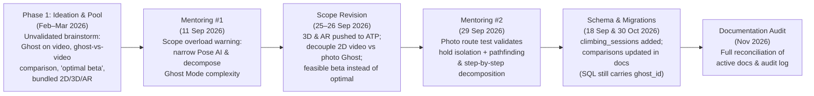
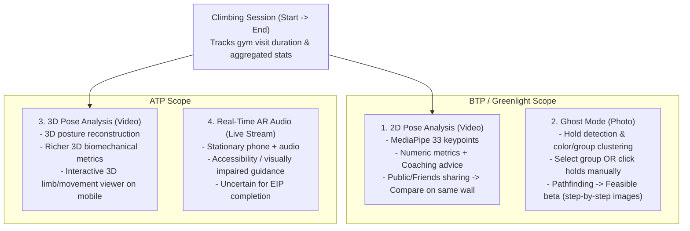

:::success
**Version:** 1.0
:::

---

# Audit: Product & Technical Scope Pivot (Ideation to Decoupled Architecture)

---

## Context & Root Cause

During Ascension's **Prototype Pool** phase (February–March 2026), the team brainstormed an ambitious feature set before validating computer-vision, pathfinding, and mobile rendering constraints against production feasibility. In that initial ideation model:

- **Ghost Mode** was envisioned as a multi-purpose feature running both on a **route photo** and directly on top of a **climbing video** (assuming an empty-wall segment in the video could be screenshotted for hold extraction), rendering a ghost climber avatar over the user's video to show the *"optimal beta"* and enabling direct **video-vs-ghost comparisons**.
- **2D Pose, 3D Pose, Hold Qualification, and Real-Time AR Audio** were bundled together in feature descriptions without realistic milestone staging or compute/latency validation.
- **Climbing Sessions (`climbing_sessions`)** did not yet exist as an explicit user-facing workout container tying multiple climbs, videos, and analyses to a single gym visit.

As backend, AI, and mobile engineering matured—and following external technical mentoring in **September 2026**—the team performed a major architectural and product pivot to make Ascension technically deliverable for **BTP / Greenlight** and **ATP** milestones. However, several active documents were only partially updated while older assumptions remained embedded across specifications, AI pipeline docs, roadmaps, and database ERDs, creating contradictions for readers, evaluators, and new contributors.

This audit documents the rationale behind the pivot, establishes the canonical **4 analysis types + Climbing Sessions** model, inventories legacy references in frozen archives vs. reconciled active docs, and flags remaining code/SQL mismatches.

---

## Chronological Evolution Timeline

*Summary:* Ascension moved from an unconstrained brainstorming scope in early 2026 to a feasibility-driven, decoupled architecture in September 2026 after mentoring feedback. While database and core specs partially adopted the changes in September–October 2026, a full documentation reconciliation in November 2026 was required to eliminate lingering contradictions across AI, developer, user, and administrative docs.

---

## Before vs. After Scope Comparison

| Domain | Phase 1: Initial Ideation (Prototype Pool) | Phase 2: Canonical Target Scope | Rationale for Pivot |
| --- | --- | --- | --- |
| **Ghost Mode Input** | Empty-wall frame extracted from video OR photo; ghost overlay on video. | **Strictly photo-only** (route photo with no climber). | Extracting reliable empty frames from handheld climbing videos and aligning camera perspective across frames is brittle; a clean photo isolates hold geometry reliably. |
| **Ghost Mode Output** | *"Optimal beta"* overlay on video or route photo. | **A feasible/possible beta** adapted to morphology, displayed as **step-by-step movement images** on the initial photo. | *"Optimal"* is ill-defined in climbing (varies by style, strength, risk tolerance). Computing a biomechanically *feasible* sequence is tractable and genuinely helpful. |
| **Ghost Hold Selection** | Ambiguous mix of full auto qualification or pure manual fallback. | **BTP:** automatic hold detection & grouping (user picks color/group OR manually choose holds). **ATP:** richer hold qualification (type, usability). | Grouping holds by color/cluster with manual selection override delivers an intuitive UX immediately in BTP without blocking on hold-type difficulty classification. |
| **Comparison (F05)** | Compare user climbing video against Ghost avatar (`ghost_id`). | **Strictly video-vs-video user comparison** on the **same wall/route** (respecting `public` / `friends` visibility). | Comparing a dynamic climber video against synthetic photo-based ghost steps across different camera angles is invalid; comparing two real ascents on the same wall yields meaningful kinematic deltas. |
| **2D vs. 3D Pose AI** | Combined without clear milestone split; speculative SAM3D video extraction. | **2D Pose (BTP):** 33 MediaPipe keypoints + numeric metrics + LLM advice. **3D Pose (ATP):** 3D posture extraction + interactive 3D mobile scene (orbit/zoom). | Stabilizing a reliable end-to-end 2D pipeline for Greenlight de-risks delivery while isolating heavy 3D reconstruction & interactive Flutter 3D rendering for ATP. |
| **Real-Time AR Audio** | Listed alongside core video features. | **ATP (uncertain for EIP completion):** stationary phone streaming real-time pose tracking with audio (accessibility focus). | Real-time edge/stream inference and audio feedback latency require dedicated R&D after core async pipelines stabilize; delivery before EIP end remains uncertain. |
| **Climbing Sessions** | Absent from early product scope; climbs were standalone videos. | **Climbing Sessions (`climbing_sessions`):** user starts a gym session, all analyses link to it, and ending shows duration + aggregated session stats. | Matches real climber behavior at a gym and enables fatigue/session tracking, aggregated progress metrics, and links to training logs. |
| **Training Routines** | Personalized training programs & exercise logs. | **Unchanged** (personalized goals, programs, sessions, exercise logs). | Core value remained technically sound and independent of computer-vision pipelines. |

---

## Target Product Model: 4 Analysis Types & Sessions

Ascension structures all AI coaching capabilities into **4 strictly distinct analysis workflows** plus a cross-cutting **Climbing Sessions** container:

*Summary:* Climbing sessions group video-based climb analyses during a gym visit. **2D Pose Analysis** and **Ghost Mode** form the core BTP/Greenlight deliverables, **3D Pose Analysis** extends the video workflow in ATP, and **Real-Time AR Audio** targets ATP accessibility pending R&D capacity.

### 1. 2D Pose Analysis (BTP / Greenlight)

- **Input:** Climbing video recorded by the user (10–45 s), optionally attached to an active `climbing_session`.
- **Pipeline:** Direct upload to S3 (RustFS in dev, OVHcloud S3 in prod) -> RabbitMQ job -> MediaPipe 2D skeleton extraction (33 keypoints/frame) -> kinematic metrics (joint angles, speeds, pauses, center of mass) -> coaching advice informed by climber morphology.
- **Output:** Lightweight JSON rendered client-side over the original video in Flutter.
- **Social Comparison (F05):** When an analysis has `public` or `friends` visibility, another climber who also analyzed an ascent on the **same wall/route** can compare both 2D pose analyses side by side.

### 2. Ghost Mode (BTP / Greenlight)

- **Input:** Single **photograph of a climbing route** (no climber in frame).
- **Hold Selection UX:** Automatic hold detection and route/color grouping; the climber can select one or more hold groups (e.g., red holds, green holds) **or** manually select individual holds.
- **Pathfinding & Output:** Combining usable holds and the climber's morphology/body constraints, the pathfinder computes **a feasible climbing beta** (not claiming mathematical optimality) and generates **step-by-step guidance images** derived from the initial photo. Mobile displays the steps sequentially.
- **Strict Boundaries:** Never runs on climbing videos, never overlays an avatar onto a user's video, and never feeds into `comparisons`.

### 3. 3D Pose Analysis (ATP)

- **Input & Flow:** Same user workflow as 2D Pose Analysis (video upload within or outside a session).
- **Enhancement:** Extracts 3D posture data and richer spatial metrics (depth, hip-to-wall distance, 3D joint angles), unlocking an **interactive 3D scene** on mobile (orbit, zoom, limb/movement inspection).

### 4. Real-Time AR Audio Analysis (ATP — Uncertain for EIP Completion)

- **Target Use Case:** Assisted climbing and accessibility (specifically supporting visually impaired climbers).
- **Workflow:** Stationary smartphone observes the wall in real time, tracks pose live, and speaks movement/hold cues through earphones during the ascent.
- **Delivery Status:** Scoped for ATP after core BTP pipelines stabilize; inclusion before the final EIP defense remains subject to latency/accuracy validation and schedule capacity.

### Climbing Sessions System

- **Workflow:** On arriving at a gym (or outdoor crag), the user starts a **Climbing Session** (`climbing_sessions`). Every pose analysis launched during that session is automatically linked to it. When the user ends the session, the app computes total training duration and aggregates session-level statistics (attempt count, scores, links to `training_logs`).

---

## Audit Findings: Legacy Artifacts, Reconciled Docs & Code Drift

### 1. Frozen Historical Documents (Left Untouched)

The following files carry `DON'T EDIT THIS FILE !` headers or constitute immutable historical records (academic submissions, dated team memos, meeting minutes, sent questionnaires). They **were intentionally preserved untouched** and reflect earlier project phases:

- `docs/Ascension/administrative/prototype-pool/**` (February–March 2026 ideation/pool deliverables)
- `docs/Ascension/administrative/memo/**` (Dated weekly meeting memos)
- `docs/Ascension/administrative/rncp/block-1/**` and `docs/Ascension/resources/rncp/rncp.md` (Submitted RNCP dossier)
- `docs/Ascension/resources/follow-up/mentoring/**` and `pedagogical/**` (Dated mentoring/pedagogical meeting minutes)
- `docs/Ascension/administrative/eip-objectives-delivery/complementary-C/questionnaire-for-lionel-reveret.md` (Historical questionnaire already sent to the external expert; question 9 reflects pre-pivot video/photo alignment thinking)

### 2. Active Documentation Reconciled (November 2026)

All living documentation was updated to reflect the canonical model above:

- **Project & AI Agent Instructions:** `README.md`, `.agents/instructions.md` (symlinked by `AGENTS.md`, `CLAUDE.md`, `GEMINI.md`), `docs/Ascension/developer/agents/pre-prompt-en.md`, `docs/Ascension/developer/agents/pre-prompt-fr.md`.
- **Top-Level & User Docs:** `docs/Ascension/readme.md`, `docs/Ascension/user/readme.md`, `docs/Ascension/developer/glossary.md`.
- **Architecture & Specifications:** `docs/Ascension/developer/architecture/globale-architecture.md`, `docs/Ascension/developer/architecture/specifications/database-schema.md`, `docs/Ascension/developer/architecture/specifications/api-specification.md`.
- **AI Worker Docs:** `docs/Ascension/developer/apps/ai/overview.md`, `docs/Ascension/developer/apps/ai/pipeline-details.md`, `docs/Ascension/developer/apps/ai/pipeline-2d-decomposition.md` (removed Ghost-on-video & video-vs-ghost comparison Bloc D, standardized on feasible beta).
- **Administrative & EIP Deliverables:** `docs/Ascension/administrative/readme.md`, `docs/Ascension/administrative/features-catalog.md`, `docs/Ascension/administrative/functional-roadmap.md`, `docs/Ascension/administrative/action-plan.md`, `docs/Ascension/administrative/beta-test-plan.md`, `docs/Ascension/administrative/acceptance-test-plan.md`, `docs/Ascension/administrative/pricing-subscriptions.md`, `docs/Ascension/administrative/infrastructure-needs.md`, `docs/Ascension/administrative/eip-objectives-delivery/mandatory-2/architecture-and-data-diagrams.md`, and `docs/Ascension/drafts/Schèmas Ascension.md`.

### 3. Code & Database Migration Drift (Flagged for Engineering)

No source code or SQL migrations were altered during this documentation audit. The following technical item requires a dedicated backend PR:

- **`comparisons` SQL Migration Mismatch (`apps/server/internal/outbound/postgres/migrations/20260918214857_create_comparaisons_table.up.sql`):**
  - **Current SQL:** References `analysis_id` and legacy `ghost_id` (alongside filename typo `comparaisons`).
  - **Target Spec (`database-schema.md` §7.5 & `api-specification.md`):** `comparisons` compares **two video analyses** (`base_analysis_id` and `compared_analysis_id`) with zero foreign key to `ghosts`.
  - **Recommended Action:** Create a follow-up migration altering `comparisons` to drop `ghost_id` and align columns with `base_analysis_id` / `compared_analysis_id` before implementing comparison handlers.
- **API Endpoints Coverage:** Ensure Go handlers and OpenAPI/API docs expose full `climbing_sessions` CRUD (`POST /v1/sessions`, `PATCH /v1/sessions/{id}/end`, `GET /v1/sessions/{id}`) and hold group selection payloads on Ghost requests.
