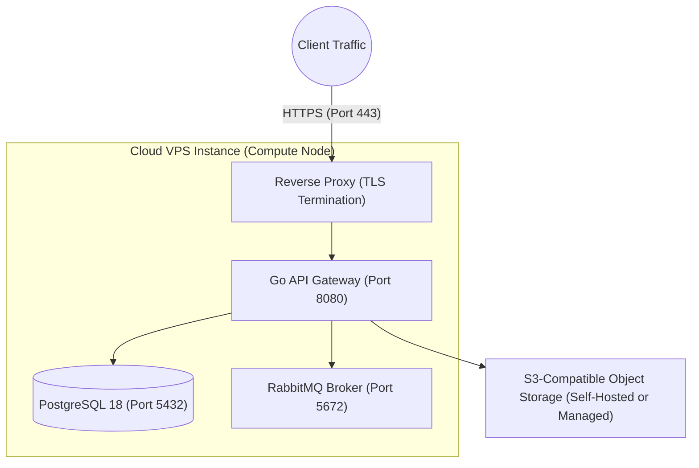

:::success
**Version:** 1.1
:::

---

# Cloud Hosting & Infrastructure Benchmark: Initial Hetzner Selection & OVHcloud Transition

This benchmark evaluates cloud infrastructure providers for the Ascension platform. It analyzes the compute, bandwidth, and storage requirements for hosting the API Gateway, PostgreSQL, RabbitMQ, and object storage, presents the team's initial skill baseline, compares three major cloud providers, and documents both the initial selection of Hetzner Cloud and the subsequent institutional transition to OVHcloud.

---

## 1\. Context & Infrastructure Workload

The Ascension backend infrastructure must reliably host five interconnected services:

- **API Gateway**: Go/Gin container handling client REST/WebSocket traffic.
- **Relational Database**: PostgreSQL 18 storing user, session, and biomechanical telemetry.
- **Message Broker**: RabbitMQ 4.x managing asynchronous video analysis queues.
- **Object Storage**: S3-compatible engine (`RustFS` in dev / managed S3 object storage in prod) hosting climbing videos and extracted frames.
- **Reverse Proxy & Monitoring**: Traefik/Caddy/Nginx with SSL termination and metric scrapers.

Because Ascension handles continuous video uploads (50 MB to 2 GB) and streams high-definition playback back to mobile clients, **network egress bandwidth** and **compute memory ratios** directly dominate infrastructure costs.

*Figure: Containerized backend topology hosted on a European cloud VPS paired with S3-compatible object storage.*

---

## 2\. Team Competencies Baseline

At the beginning of the infrastructure evaluation phase, the team had the following technical profile:

| Domain | Team Proficiency Level | Practical Context |
| --- | --- | --- |
| **Cloud Infrastructure (AWS / GCP)** | No prior experience | Zero baseline; discovering cloud provider pricing models and architectures. |
| **Linux Sysadmin & Docker** | Basic / Intermediate | Comfortable deploying multi-container Docker Compose environments locally. |
| **Networking & Reverse Proxies** | Basic knowledge | Familiar with DNS records, port forwarding, and TLS certificates. |

With zero institutional ties to proprietary cloud ecosystems (such as AWS proprietary IAM or Lambda), the team prioritized transparent billing, predictability, and sovereign European data compliance.

---

## 3\. Compared Solutions

Three cloud hosting providers were evaluated across comparable compute tiers:

1. **Hetzner Cloud (Germany & Finland)**:
   - Leading European cloud provider known for high-performance bare metal and virtual servers at disruptive, developer-friendly price points.
2. **OVHcloud (France)**:
   - European cloud hyperscaler emphasizing data sovereignty, predictable European billing, and anti-DDoS protection.
3. **Amazon Web Services (AWS - Frankfurt / Ireland)**:
   - Global hyperscale market leader offering comprehensive managed services (EC2, ECS, RDS, S3) with granular enterprise configurability.

---

## 4\. Evaluation Methodology & Test Protocols

Providers were evaluated across three real-world deployment scenarios corresponding to Ascension's development roadmap:

- **Scenario 1: MVP & Development Stage** (1 shared virtual server: 4 vCPU, 8 GB RAM, 80 GB NVMe).
- **Scenario 2: Production Launch** (2 dedicated virtual servers: 1 API/DB node + 1 Video/Storage node).
- **Scenario 3: Scale Stage (~1,000 active users)** (Separation of database, storage, and worker nodes with 1 TB monthly video egress).

### Key Evaluation Criteria

- **Compute Unit Cost**: Monthly price for equivalent vCPU and RAM allocations.
- **Outbound Bandwidth (Egress) Pricing**: Cost of delivering gigabytes of climbing videos back to mobile users.
- **Object Storage Cost**: Monthly cost per terabyte of stored video footage.
- **Data Privacy & GDPR**: Server geographic locations, legal compliance, and immunity from foreign extraterritorial surveillance (e.g. US CLOUD Act).
- **Console & Tooling Ergonomics**: Simplicity of provisioning, API accessibility, and predictable invoice generation.

---

## 5\. Comparative Evaluation Matrix

| Criterion | Hetzner Cloud (DE/FI) | OVHcloud (FR) | AWS (Frankfurt) | Winner |
| --- | --- | --- | --- | --- |
| **VM (4 vCPU / 8 GB RAM / month)** | **~15 €** (CX31 tier) | ~22 € | ~60 € (t4g.xlarge / c6g) | **Hetzner** |
| **VM (8 vCPU / 16 GB RAM / month)** | **~45 €** (CPX41 tier) | ~65 € | ~180 € (c6i.2xlarge) | **Hetzner** |
| **Included Bandwidth / month** | **20 TB included** | 100 Mbps unmetered | 100 GB free tier only | **Hetzner / OVH** |
| **Egress Bandwidth (per TB over)** | **~1.00 € / TB** | Flat unmetered rate | **~90.00 € / TB ($0.09/GB)** | **Hetzner / OVH** |
| **Object Storage (1 TB / month)** | **~10 €** | ~12 € | ~23 € (S3 Standard) | **Hetzner** |
| **Datacenter Location & GDPR** | **Germany / Finland (EU)** | France (EU) | Ireland / Germany (EU region) | **All GDPR compliant** |
| **Extraterritorial Jurisdiction** | European Sovereign entity | European Sovereign entity | Subject to US CLOUD Act | **Hetzner / OVH** |
| **Management Ergonomics** | Minimal, modern UI & CLI | Traditional web manager | Complex IAM & billing matrix | **Hetzner** |
| **Total MVP Monthly Infrastructure** | **~15 - 30 € / month** | ~35 - 50 € / month | ~120 - 250 € / month | **Hetzner** |

---

## 6\. Initial Decision: Hetzner Cloud

At the conclusion of the initial benchmark phase, **Hetzner Cloud** was initially selected as the target infrastructure provider for Ascension's staging and production environments.

### Key Justifications

1. **4x Compute Cost Reduction**:
   - For a comparable 4 vCPU / 8 GB RAM virtual machine, Hetzner charges approximately **15 €/month**, compared to roughly **60 €/month** on AWS.
   - For a student engineering startup budget, this differential represents annual savings exceeding **2,500 €/year** while delivering dedicated, high-clock NVMe compute performance.
2. **Predictable Video Egress (Avoiding AWS Bandwidth Traps)**:
   - Ascension's video analysis workload generates heavy outbound video traffic. On AWS, serving 5 TB of video per month incurs over 400 € in egress bandwidth fees alone. Hetzner includes **20 TB of free monthly egress** with every instance, eliminating the risk of catastrophic unexpected billing spikes.
3. **European Sovereignty & GDPR Compliance**:
   - Climber video recordings and morphological metrics represent sensitive personal biometric data under GDPR. Hetzner's datacenters in Nuremberg and Helsinki ensure that all customer data remains strictly within European jurisdiction without exposure to US extraterritorial data retrieval.
4. **Developer Experience for a Small Team**:
   - Hetzner's modern web console, Terraform provider, and REST API allow our 5-person team to provision, snapshot, and manage servers in minutes without navigating the Byzantine complexity of AWS IAM policies.

---

## 7\. Institutional Constraint & Pivot to OVHcloud

### 7.1 Epitech Infrastructure Allocation Constraint

During the EIP cloud resource allocation phase, **Epitech** mandated that student projects select their hosting infrastructure exclusively from **OVHcloud**'s VPS catalog using the school's budget.

While Hetzner remained optimal on raw self-funded pricing, pivoting to **OVHcloud** preserved the project's core architectural non-negotiables established in this benchmark: **100% European data sovereignty (GDPR)**, **immunity from the US CLOUD Act**, and **unmetered/predictable bandwidth** without AWS egress traps.

### 7.2 Selected Production Stack (Current Architecture)

To maximize performance and storage elasticity within the allocated OVHcloud catalog, the team opted for a decoupled architecture (detailed in [Infrastructure Architecture](../infrastructure.md)):

- **Compute & Services Server — OVHcloud VPS-4**:
  - **Specifications**: 8 vCores, 24 GB RAM, 200 GB SSD NVMe, 3 Gbps unmetered bandwidth.
  - **Location**: Milan Datacenter (Italy - `IT-MIL`).
  - **Role**: Single high-capacity compute node managed via **Coolify**, hosting the Go API Gateway, Python AI Workers (Pose & Ghost Mode), PostgreSQL 18, RabbitMQ 4.x, and CI/CD tooling (Jenkins, SonarQube, n8n).
- **Media Storage — OVHcloud Object Storage Standard**:
  - **Location**: Gravelines Datacenter (France - `GRA`).
  - **Role**: Managed, elastic S3-compatible object storage hosting climbing ascent videos and route photos with free ingress, free egress, and included API transactions — replacing the need for a second fixed-disk VPS and preventing the 200 GB NVMe disk on the VPS-4 from filling up. (In local/development environments, **RustFS** provides identical S3 API parity; see [Object Storage Benchmark](./object-storage.md).)
- **Domain & TLS**: Official domain `ascension-eip.fr` with Anycast DNS, DNSSEC, and automated Let's Encrypt TLS termination.

### 7.3 Outcome Validation

This transition to **OVHcloud VPS-4 + OVHcloud Object Storage Standard** satisfies Epitech's institutional requirements while delivering stronger isolation and scalability than an all-in-one VPS setup: heavy video storage and bandwidth scale elastically in Gravelines at negligible cost (~0.01 €/GB/month, zero egress fees), leaving the VPS-4's 24 GB RAM and 8 vCores fully dedicated to backend APIs, AI inference, and CI/CD pipelines.
