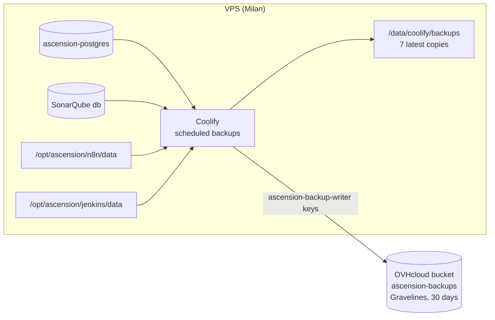

:::success
**Version:** 1.1
:::

---

# Backup and Restore Guide

This guide describes what is backed up on the production VPS, where the backups go, how to check them and how to restore each one. Every backup is scheduled by Coolify and copied to a dedicated OVHcloud Object Storage bucket in Gravelines, away from the VPS in Milan.

:::warning
This guide never holds a password or a secret. The keys of the backup bucket live in Coolify (_S3 Storages › ascension-backups_) and in the team's password storage, never in the repository.
:::

---

## 1\. What is backed up

| Resource | Content | Kind | Schedule (UTC) | Retention |
| --- | --- | --- | --- | --- |
| `ascension-postgres` | Application database `ascension` | `pg_dump` (custom format) | `0 2 * * *` | 7 on the VPS, 30 days on S3 |
| SonarQube, database `db` | SonarQube database | `pg_dump` (custom format) | `10 2 * * *` | 7 on the VPS, 30 days on S3 |
| n8n, `/opt/ascension/n8n/data` | SQLite database, settings | Directory archive (`.tar.gz`), n8n stopped for a few seconds | `20 2 * * *` | 7 on the VPS, 30 days on S3 |
| Jenkins, `/opt/ascension/jenkins/data` | Configuration, jobs and build history, credentials and their keys, users, plugins | Directory archive (`.tar.gz`), Jenkins keeps running | `30 2 * * *` | 7 on the VPS, 30 days on S3 |
| Coolify instance | Coolify database: every resource and its environment variables | Coolify instance backup, also taken before each Coolify update | `40 2 * * *` | 7 on the VPS, 30 days on S3 |

What is **not** backed up, on purpose:

- **The videos:** they already live in the OVHcloud bucket `ascension-videos`, see the [S3 Object Storage Guide](./s3-object-storage-guide.md).
- **RabbitMQ:** it only holds jobs in transit. A lost job is a failed analysis that the user can run again.
- **The SonarQube data directory** (`/opt/ascension/sonarqube/data`): Elasticsearch indexes, rebuilt from the database on start.
- **The Jenkins caches** (`/opt/ascension/jenkins/cache`): Go modules, `uv`, `pub`, SDKs and the workspaces, filled again by the next builds (see section 6).
- **The code and the n8n workflow:** they are in the repository.

The diagram below shows the flow: every night, Coolify dumps the databases and archives the directories on the VPS, keeps a local copy, and uploads it to the bucket in Gravelines.



---

## 2\. Backup storage

| Item | Value |
| --- | --- |
| Bucket | `ascension-backups`, OVHcloud Public Cloud project `Ascension Storage`, Standard (S3 API), Gravelines (GRA) 1-AZ |
| Endpoint, region | `https://s3.gra.io.cloud.ovh.net`, `gra` |
| Encryption | SSE-OMK (server side) |
| Versioning, Object Lock | Disabled: the retention of Coolify deletes the old backups |
| Owner | User `ascension-backups`. Its key is never downloaded nor used |
| Keys used by Coolify | User `ascension-backup-writer`, restricted by [infra/ovh/ascension-backups-policy.json](https://github.com/Ascension-EIP/Ascension/blob/dev/infra/ovh/ascension-backups-policy.json) |
| Coolify storage | _S3 Storages › ascension-backups_ (UUID `sq061cd7ngu0cs3sqhkgoi50`) |

The two users follow the rule of the videos bucket: OVHcloud ignores every user policy, even an explicit `Deny`, for the owner of a bucket. So the owner's key gives full control of the bucket and is never used. OVHcloud does not allow deleting it, but its secret can only be read from the OVHcloud console. The `ascension-backup-writer` user owns nothing and its policy only allows the objects of `ascension-backups`: it cannot list the other buckets, read the videos, nor change the configuration of the bucket.

The backups of the VPS and the videos use separate keys: the keys of the API cannot reach the backups, and the keys of the backups cannot reach the videos.

Objects are stored under the same path as on the VPS:

| Backup | Object key prefix |
| --- | --- |
| Databases | `data/coolify/backups/databases/root-team-0/<resource>-<uuid>/` |
| Directories | `data/coolify/backups/volumes/root-team-0/<storage uuid>/` |

---

## 3\. Checking the backups

In Coolify, each resource shows its own backups:

| Resource | Where |
| --- | --- |
| `ascension-postgres` | _Projects › Ascension › production › ascension-postgres › Backups_ |
| SonarQube, n8n, Jenkins | The service › _Backups_ |
| Coolify instance | _Settings › Backup_ |

Each schedule lists its executions with their status, size and date, and has a **Back Up Now** button. A backup counts as successful when its status is `success` and the S3 upload is checked.

A failed backup, or a schedule without a successful backup for 2 days, sends an alert to the team's Discord alerts channel. The alerts are set in Coolify › _Notifications › Discord_, see the [Production Environment](./production.md), section 3.6.

To list the bucket from a computer, with the keys of `ascension-backup-writer` in an env file:

```bash
docker run --rm --env-file backup-writer.env amazon/aws-cli:2.27.0 \
  --endpoint-url https://s3.gra.io.cloud.ovh.net \
  s3 ls --recursive s3://ascension-backups/
```

`backup-writer.env` holds `AWS_ACCESS_KEY_ID`, `AWS_SECRET_ACCESS_KEY` and `AWS_DEFAULT_REGION=gra`. Delete it once done.

---

## 4\. Restoring

:::danger
A restore replaces the current data. Before restoring production, take a fresh backup with **Back Up Now**, so the restore can itself be undone.
:::

### 4.1 A database (application or SonarQube)

From Coolify, on the database (`ascension-postgres`, or the `db` of SonarQube):

1. _Backups_ › **Import Backup**.
2. Choose the backup: an execution kept on the VPS, or a file of the bucket (S3 source `ascension-backups`).
3. Start the import, then restart the service that uses the database (the API, or SonarQube).

To restore a dump elsewhere, for instance to check it or to recover a single table:

```bash
# Download the dump (path from section 2 or from the Coolify execution)
docker run --rm --env-file backup-writer.env -v "$PWD:/r" amazon/aws-cli:2.27.0 \
  --endpoint-url https://s3.gra.io.cloud.ovh.net \
  s3 cp s3://ascension-backups/<object key>.dmp /r/app.dmp

# Throwaway PostgreSQL 18, then restore
docker run -d --name restore-pg -e POSTGRES_USER=ascension -e POSTGRES_PASSWORD=restore \
  -e POSTGRES_DB=ascension -v "$PWD:/r:ro" postgres:18
docker exec restore-pg pg_restore -U ascension -d ascension --no-owner /r/app.dmp
```

### 4.2 Jenkins or n8n

Coolify does not restore a directory: the archive is put back by hand on the VPS.

```bash
# 1. Stop the service in Coolify (Jenkins or n8n), then keep the current directory aside
sudo mv /opt/ascension/jenkins/data /opt/ascension/jenkins/data.before-restore

# 2. Download the archive from the bucket, or take the local copy in
#    /data/coolify/backups/volumes/root-team-0/<storage uuid>/
sudo install -d -o ubuntu -g ubuntu -m 755 /opt/ascension/jenkins/data
sudo tar -xzf <archive>.tar.gz -C /opt/ascension/jenkins/data

# 3. Start the service in Coolify, check it, then delete data.before-restore
```

For n8n, use `/opt/ascension/n8n/data`. Its credentials are encrypted with `N8N_ENCRYPTION_KEY`, kept in the environment variables of the service: restore the Coolify instance first if they are lost (see the [n8n guide](./n8n-technology-watch-guide.md), section 7).

For Jenkins, the archive holds `secrets/master.key` and `secrets/hudson.util.Secret`: without them the credentials cannot be decrypted. The empty `ci-cache` and `workspace` folders of the archive are only mount points: the caches are filled again by the next builds.

### 4.3 The Coolify instance

The Coolify backup holds the Coolify database: projects, resources, domains and every environment variable, so every secret of production. They are encrypted with the `APP_KEY` of Coolify, in `/data/coolify/source/.env` on the VPS.

:::warning
Without the `APP_KEY`, a backup of Coolify cannot be read. It is kept in the team's password storage. If it changes, store the new value there.
:::

To rebuild a lost server: install Coolify on the new server, put back the `APP_KEY` in `/data/coolify/source/.env`, restore the backup of the Coolify database, then restore the databases and the directories (sections 4.1 and 4.2).

---

## 5\. Restore test

The full chain was tested on 13 November 2026, from the bucket, away from production:

| Backup | Test | Result |
| --- | --- | --- |
| `ascension-postgres` (92 KB) | Download from S3, `pg_restore` in a throwaway PostgreSQL 18, row count of every table compared with production | Restored without error, 27 tables, same counts and same migration as production |
| Jenkins (247 MB) | Download from S3, throwaway `jenkins/jenkins:lts-jdk21` started on the extracted directory | Started without error, jobs `ascension-ai`, `ascension-mobile` and `ascension-server` loaded, 103 plugins loaded, none failed |
| n8n (3.2 MB) | Backup with the service stopped, then restarted | Archive uploaded, n8n healthy again |
| SonarQube database (7.7 MB), Coolify instance (852 KB) | First backup | Uploaded to the bucket |

Run the same test again after any change of the backup schedules, and at least before each EIP milestone.

---

## 6\. Jenkins caches

To keep the backup small, the caches of Jenkins live outside its data directory, in two extra mounts of the Jenkins service:

| Host path | Path in Jenkins |
| --- | --- |
| `/opt/ascension/jenkins/data` | `/var/jenkins_home` (backed up, about 350 MB) |
| `/opt/ascension/jenkins/cache/ci-cache` | `/var/jenkins_home/ci-cache` (not backed up, about 5 GB) |
| `/opt/ascension/jenkins/cache/workspace` | `/var/jenkins_home/workspace` (not backed up) |

The build steps start with `--volumes-from` the Jenkins container, so they get the same mounts at the same paths: nothing changes for the pipelines. See the [Jenkins & SonarQube Administration Guide](../../git/jenkins-sonarqube-administration-guide.md), section 7.

---

## 7\. Troubleshooting

| Symptom | Cause and fix |
| --- | --- |
| Execution `failed`, `AccessDenied` on upload | The keys of _S3 Storages › ascension-backups_ are wrong, or the policy of `ascension-backup-writer` was replaced. Import [infra/ovh/ascension-backups-policy.json](https://github.com/Ascension-EIP/Ascension/blob/dev/infra/ovh/ascension-backups-policy.json) again, then **Validate** the storage in Coolify |
| Execution `success` but nothing in the bucket | S3 is not enabled on the schedule (**Enable S3** button still shown) |
| The bucket keeps growing | Check the S3 retention of each schedule: 30 days to keep, 0 backups to keep and 0 GB mean "only the age counts" |
| n8n down after its backup | The service did not restart after the copy: start it from Coolify |
| Jenkins build fails with a missing cache folder | The cache mounts were removed from the Jenkins service: add them back (section 6) |
