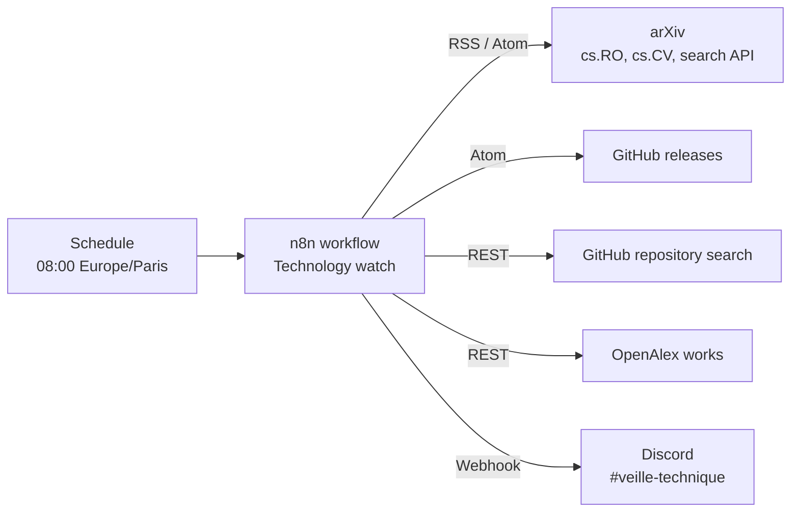

:::success
**Version:** 1.0
:::

---

# n8n Technology Watch Guide

This guide describes the self-hosted n8n instance that runs Ascension's technology watch: deployment, accounts, the watch workflow, how to change it, maintenance and troubleshooting. The watch supports the first mandatory objective of the EIP Technical Track, described in [Caractérisation du point dur et dispositif de veille opérationnel](../../../administrative/eip-objectives-delivery/mandatory-1/hard-problem-characterization-and-technology-watch.md).

:::warning
This guide never holds a password or a token. The Discord webhook URL is stored in an n8n credential, the encryption key in the Coolify environment variables, and the passwords in the team's password storage, never in the repository.
:::

---

## 1\. Components

| Component                    | Location                                                                                                                       | Role                                                                     |
| ---------------------------- | ------------------------------------------------------------------------------------------------------------------------------ | ------------------------------------------------------------------------ |
| n8n Community Edition 2.47.5 | `https://n8n.ascension-eip.fr`                                                                                                 | Runs the watch workflow every morning                                    |
| Coolify service `n8n`        | Project `Ascension`, environment `production`                                                                                  | Deploys the container, routes the domain through Traefik, keeps the keys |
| Workflow `Technology watch`  | [technology-watch-workflow.json](https://github.com/Ascension-EIP/Ascension/blob/dev/infra/n8n/technology-watch-workflow.json) | Collects, filters and posts the watch entries                            |
| Discord channel              | `#veille-technique`                                                                                                            | Receives the daily digest through a webhook                              |

n8n runs as a Docker container on the production VPS, deployed and managed through **Coolify** like Jenkins and SonarQube, with Traefik as the reverse proxy and HTTPS termination.

The diagram below shows the daily run: the schedule starts the workflow, which reads the arXiv, GitHub and OpenAlex sources, keeps the new entries that match the keywords, and posts them to Discord.



---

## 2\. Deployment

### 2.1 Coolify service

The service is a Docker Compose service named `n8n` (UUID `cyhrddq3q1fjcacytghlqfq9`). Its compose file is versioned in [infra/n8n/docker-compose.yml](https://github.com/Ascension-EIP/Ascension/blob/dev/infra/n8n/docker-compose.yml): any change made in Coolify must be reported in this file, and the other way round.

| Setting       | Value                                                                                      |
| ------------- | ------------------------------------------------------------------------------------------ |
| Image         | `n8nio/n8n:2.47.5`, pinned to an exact version                                             |
| Domain        | `https://n8n.ascension-eip.fr`, proxied by Cloudflare (`A` record to the VPS)              |
| Internal port | `5678`, declared by the `SERVICE_URL_N8N_5678` variable                                    |
| Data          | Bind mount `/opt/ascension/n8n/data` → `/home/node/.n8n` (owner `1000:1000`), like Jenkins |
| Database      | SQLite, in the data directory: one workflow does not need PostgreSQL                       |
| Healthcheck   | `GET http://127.0.0.1:5678/healthz` every 30 seconds                                       |

### 2.2 Environment variables

Coolify generates `SERVICE_URL_N8N`, `SERVICE_FQDN_N8N` and `SERVICE_PASSWORD_64_N8NENCRYPTION` on the first deployment and keeps them in the service environment variables.

| Variable                                                 | Value                                  | Why                                                             |
| -------------------------------------------------------- | -------------------------------------- | --------------------------------------------------------------- |
| `N8N_ENCRYPTION_KEY`                                     | `${SERVICE_PASSWORD_64_N8NENCRYPTION}` | Encrypts the credentials in the database                        |
| `N8N_HOST`, `N8N_EDITOR_BASE_URL`, `WEBHOOK_URL`         | Generated from the domain              | Correct links in the editor and in the webhooks                 |
| `N8N_PROXY_HOPS`                                         | `1`                                    | n8n sits behind Traefik and reads the client IP from its header |
| `GENERIC_TIMEZONE`, `TZ`                                 | `Europe/Paris`                         | The schedule fires at 08:00 Paris time, summer and winter       |
| `EXECUTIONS_DATA_PRUNE`, `EXECUTIONS_DATA_MAX_AGE`       | `true`, `336`                          | Execution history is kept 14 days, so the database stays small  |
| `N8N_DIAGNOSTICS_ENABLED`, `N8N_PERSONALIZATION_ENABLED` | `false`                                | No telemetry sent to n8n, no onboarding survey                  |

:::danger
Never change or delete `SERVICE_PASSWORD_64_N8NENCRYPTION`. Without the original key, n8n can no longer decrypt the stored credentials and the Discord credential has to be created again.
:::

### 2.3 Updating n8n

1. Read the release notes of the target version on [the n8n GitHub releases](https://github.com/n8n-io/n8n/releases), especially the breaking changes.
2. Change the image tag in `infra/n8n/docker-compose.yml`, then in Coolify (_Service › Edit Compose File_), and redeploy.
3. Wait for the container to be [healthy](status:success), open the editor, and run the workflow once with **Execute workflow**.
4. Open a pull request with the new tag.

---

## 3\. Accounts

- The owner account belongs to Christophe VANDEVOIR (infrastructure). It was created right after the first deployment, so nobody else could claim the instance.
- Other members are invited from _Settings › Users › Invite_. Without SMTP, n8n shows an invitation link to copy and send by hand.
- Give the **Member** role: members can edit and run the workflow. Only the owner manages users and credentials.

---

## 4\. Credentials

| Name                        | Type            | Content                                        | Used by                          |
| --------------------------- | --------------- | ---------------------------------------------- | -------------------------------- |
| `Discord #veille-technique` | Discord Webhook | Webhook URL of the `#veille-technique` channel | Node `Post to #veille-technique` |

The workflow export only refers to the credential by its ID (`AscDiscordVeille`) and name, never by its content.

### 4.1 Renewing the Discord webhook

1. In Discord, open _Edit Channel › Integrations › Webhooks_ on `#veille-technique` and create a new webhook (or copy the URL of the existing one).
2. In n8n, open _Credentials › Discord #veille-technique_, paste the new URL in **Webhook URL** and save.
3. Run the workflow once and check that the message arrives.
4. Delete the old webhook in Discord.

---

## 5\. The watch workflow

### 5.1 Steps

| Step                     | Nodes                                                              | What it does                                                                                                     |
| ------------------------ | ------------------------------------------------------------------ | ---------------------------------------------------------------------------------------------------------------- |
| 1\. Trigger              | `Every day at 08:00`, `Run manually`                               | Starts the run every morning, or on demand from the editor                                                       |
| 2\. Settings             | `Watch settings`                                                   | Holds the keywords, the sources and the limits                                                                   |
| 3\. Sources polling      | `List feeds` › `Read feeds`, `List APIs` › `Call APIs`             | Reads every RSS / Atom feed and calls every JSON API, 1.5 seconds apart. A failing source never stops the others |
| 4\. Normalization        | `Normalize feed entries`, `Normalize API results`, `Merge sources` | Turns every entry into the same shape: source, type, title, link, authors, summary, date                         |
| 5\. Filtering            | `Filter by keywords`                                               | Keeps fresh entries matching the keywords, removes the duplicates of the run                                     |
| 6\. Deduplication        | `Skip already posted`                                              | Drops the entries already posted on a previous day (history of 10,000 keys)                                      |
| 7\. Discord notification | `Build Discord messages` › `Post to #veille-technique`             | Ranks the entries, packs them into embeds and posts them                                                         |

### 5.2 Sources

| Source                   | URL                                               | Kept when                                                                                                      |
| ------------------------ | ------------------------------------------------- | -------------------------------------------------------------------------------------------------------------- |
| arXiv `cs.RO`, `cs.CV`   | `https://rss.arxiv.org/rss/<category>`            | Matches a keyword, published in the last 7 days                                                                |
| arXiv search             | `https://export.arxiv.org/api/query`              | Matches a keyword, published in the last 7 days. Covers every category                                         |
| GitHub releases          | `https://github.com/<owner>/<repo>/releases.atom` | Published in the last 3 days. Only the newest release of each repository                                       |
| GitHub repository search | `https://api.github.com/search/repositories`      | Repository created in the last 2 days, matching a keyword                                                      |
| OpenAlex                 | `https://api.openalex.org/works`                  | Matches a keyword, published in the last 30 days. Datasets are skipped. One call for every search, 100 results |

Monitored repositories: `google-ai-edge/mediapipe`, `opencv/opencv`, `ultralytics/ultralytics` (stack of the AI workers) and `OpenBeta/open-tacos` (climbing data).

:::note
**Why OpenAlex instead of Google Scholar:** Google Scholar has no RSS feed and no API: its alerts are only sent by email. OpenAlex is a free and open index of scholarly works (more than 250 million) with a public API, keyword search on titles and abstracts, and publication date filters. It covers the papers Scholar would find, without a mailbox to read or a scraper to maintain. No API key is needed for a few calls a day.
:::

:::note
The arXiv RSS feeds are rebuilt every weekday at 05:00 UTC and are empty on Saturday and Sunday. The arXiv search query catches climbing papers in any category, even on days when the feeds are empty.
:::

### 5.3 Keywords and ranking

| List       | Keywords                                                                                   | Effect                                                   |
| ---------- | ------------------------------------------------------------------------------------------ | -------------------------------------------------------- |
| `core`     | climbing, bouldering, boulderer, climber(s), climbing hold, hold detection, route setting  | The entry is kept, up to 15 a day                        |
| `related`  | pathfinding, path finding, motion planning, contact planning, multi-contact                | The entry is kept, up to 5 a day, after the core entries |
| `excluded` | hill climbing, hill-climbing                                                               | Removed from the text before matching                    |
| `boost`    | hold, route, beta, pose, detection, segmentation, biomechanics, computer vision, neural... | Only used to rank: technical subjects first              |

Keywords match whole words, without case. An entry scores two points per `core` keyword, one per `related` or `boost` keyword. The releases of the monitored repositories are always posted, without keyword.

### 5.4 Discord message

- The first message starts with `Veille technique du <date> : <N> nouveautés`, followed by the number of matches left out by the daily limits.
- Each entry is an embed with its title and link, authors, the start of the summary (350 characters), the source and the matched keywords. Colors: blue for papers, green for releases, yellow for repositories.
- Embeds are packed by 10 and under 5,500 characters per message, below the Discord limits (10 embeds, 6,000 characters).
- When a source fails, the message ends with `Sources en erreur : ...`. This warning is posted even on a day without new entries.
- No new entry and no failure: nothing is posted.

---

## 6\. Changing the watch

1. Open the workflow in n8n and edit the **Watch settings** node only: keywords, monitored repositories, searches and limits are all there.
2. Click **Execute workflow** to try the change. A manual run also posts to Discord and fills the deduplication history.
3. Click **Publish** so the scheduled run uses the new version.
4. Export the workflow and update the repository:

   ```bash
   sudo docker exec n8n-cyhrddq3q1fjcacytghlqfq9 n8n export:workflow --id=AscTechWatch0001 --pretty --output=/tmp/wf.json
   sudo docker cp n8n-cyhrddq3q1fjcacytghlqfq9:/tmp/wf.json ./technology-watch-workflow.json
   ```

5. Replace `infra/n8n/technology-watch-workflow.json` with the export and open a pull request.

---

## 7\. Backup and restore

| What                      | Where                                      | How to restore                                                      |
| ------------------------- | ------------------------------------------ | ------------------------------------------------------------------- |
| Workflow                  | `infra/n8n/technology-watch-workflow.json` | `n8n import:workflow --input=<file>` in the container, then publish |
| Database (users, history) | `/opt/ascension/n8n/data/database.sqlite`  | Stop the service, put the directory back, start the service         |
| Encryption key            | Coolify service environment variables      | Needed with the database: without it, the credentials are lost      |
| Discord webhook           | n8n credential                             | Create a new webhook in Discord (see section 4.1)                   |

To restore the workflow from the repository:

```bash
sudo docker cp infra/n8n/technology-watch-workflow.json n8n-cyhrddq3q1fjcacytghlqfq9:/tmp/wf.json
sudo docker exec n8n-cyhrddq3q1fjcacytghlqfq9 n8n import:workflow --input=/tmp/wf.json
sudo docker exec n8n-cyhrddq3q1fjcacytghlqfq9 n8n publish:workflow --id=AscTechWatch0001
```

---

## 8\. Troubleshooting

| Symptom                                      | Cause and fix                                                                                                                                                                                                                                                       |
| -------------------------------------------- | ------------------------------------------------------------------------------------------------------------------------------------------------------------------------------------------------------------------------------------------------------------------- |
| No message this morning                      | Normal when nothing new matched. Check _Executions_: the run must be [Succeeded](status:success)                                                                                                                                                                    |
| `Sources en erreur : GitHub search`          | GitHub limits unauthenticated searches to 10 a minute per IP. One failure is harmless; if it lasts, add a GitHub token as a header in **Call APIs**                                                                                                                 |
| `Sources en erreur : OpenAlex`               | OpenAlex answers `429` to calls sent too close together, which is why every search goes in one call. It also shares a free daily budget between all keyless clients of an IP. If it lasts, create a free key and add `api_key` to the OpenAlex URL in **List APIs** |
| `Sources en erreur : GitHub <owner>/<repo>`  | The repository was renamed or deleted: update `githubReleases` in **Watch settings**                                                                                                                                                                                |
| The run fails on `Post to #veille-technique` | Webhook deleted or invalid: renew it (see section 4.1)                                                                                                                                                                                                              |
| Entries posted twice                         | The same paper under two different titles, or a run that failed in Discord after its retries: the posting is retried 3 times, every 5 seconds                                                                                                                       |

:::warning
**Skip already posted** saves the entries before they are posted. If Discord still fails after the 3 retries, the entries of that run are considered posted and are not sent again the next day. To send them anyway, add a temporary **Remove Duplicates** node with the **Clear Deduplication History** operation, run it once, delete it, then run the workflow: every entry still inside the source time windows is posted again.
:::

---

## 9\. Security notes

- The owner account is the only one that sees the credentials. Keep it to the infrastructure maintainer.
- n8n Code nodes run in the isolated task runner shipped with n8n 2. They have no access to the environment variables, so the encryption key cannot be read from a workflow.
- The workflow only calls public, read-only sources and one Discord webhook. Never add a credential with write access to GitHub or to the production database to this instance without a review.
