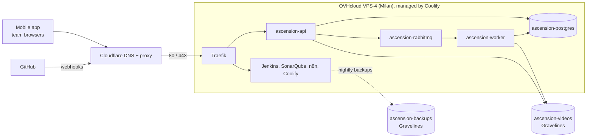

:::success
**Version:** 3.0
:::

---

# Production Environment

This runbook explains how the production of Ascension is set up and how to work with it: reaching the VPS and Coolify, deploying, restarting and reading the logs of a service, changing a secret, backing up and restoring, and updating the server. The choice of the architecture itself is described in [Infrastructure Architecture](../infrastructure.md).

:::warning
This page never holds a password, a key or the IP address of the VPS. They live in the team's password storage, in the environment variables of Coolify and in the OVHcloud console, never in the repository, which is public.
:::

---

## 1\. How production is set up

Everything runs on one OVHcloud VPS-4 in Milan (8 vCores, 24 GB RAM, Ubuntu 26.04), managed by **Coolify**. Coolify builds and starts every container, configures the Traefik reverse proxy and its Let's Encrypt certificates, keeps the secrets and schedules the backups. The videos live outside the VPS, in OVHcloud Object Storage in Gravelines. The DNS of `ascension-eip.fr` is on Cloudflare, with proxied records.

The diagram below shows the path of a request: Cloudflare forwards it to Traefik on the VPS, which routes it by domain to the right container. The containers reach the database and the broker on the internal `coolify` Docker network, and the videos and the backups in the Gravelines buckets.



All the resources are in the Coolify project **Ascension**, environment **production**:

| Resource | Kind in Coolify | Domain or internal host | Data | Guide |
| --- | --- | --- | --- | --- |
| `ascension-api` | Application (compose), branch `main` | `https://api.ascension-eip.fr` | None (stateless) | [API Deployment Guide](./api-deployment-guide.md) |
| `ascension-worker` | Application (compose), branch `main` | None, internal only | None (stateless) | [AI Worker Deployment Guide](./worker-deployment-guide.md) |
| `ascension-postgres` | Database, `postgres:18-alpine` | `i8hc7tklpho8bwo92gzdnzrl:5432` | Docker volume `postgres-data-i8hc7tklpho8bwo92gzdnzrl`, managed by Coolify | This page, section 5 |
| `ascension-rabbitmq` | Service, `rabbitmq:4.4.0-management-alpine` | `rabbitmq-qqu2ictjftetdiyyif9ffctg:5672` | Jobs in transit only | [AI Worker Deployment Guide](./worker-deployment-guide.md) |
| Jenkins | Service | `https://jenkins.ascension-eip.fr` | `/opt/ascension/jenkins/data`, caches in `/opt/ascension/jenkins/cache` | [Jenkins & SonarQube Administration Guide](../../git/jenkins-sonarqube-administration-guide.md) |
| SonarQube | Service, with its own PostgreSQL | `https://sonarqube.ascension-eip.fr` | `/opt/ascension/sonarqube/data` | [Jenkins & SonarQube Administration Guide](../../git/jenkins-sonarqube-administration-guide.md) |
| n8n | Service, `n8nio/n8n:2.47.5` | `https://n8n.ascension-eip.fr` | `/opt/ascension/n8n/data` | [n8n Technology Watch Guide](./n8n-technology-watch-guide.md) |
| Coolify | Installed on the host | `https://coolify.ascension-eip.fr` | `/data/coolify` | This page |
| Object Storage | OVHcloud buckets `ascension-videos` and `ascension-backups` | `https://s3.gra.io.cloud.ovh.net` | Videos, backups | [S3 Object Storage Guide](./s3-object-storage-guide.md) |

The data of the tools follows one convention: a bind mount under `/opt/ascension/<service>/`, so it is easy to find, to back up and to move. Only the databases created by Coolify keep their Docker volume.

From the Internet, the VPS only answers on SSH (22), HTTP (80) and HTTPS (443). PostgreSQL, RabbitMQ and the Coolify ports stay internal.

---

## 2\. Access

### 2.1 SSH

Each team member has a personal Linux account on the VPS, named after the first 3 letters of the first name and the first 4 letters of the last name (for instance `chr_vand`), with `sudo`. Never share an account and never log in as another member.

Log in with an SSH key, by the IP address of the VPS (team password storage, or the OVHcloud console › _Bare Metal Cloud › VPS_). Cloudflare proxies the domains, so `ascension-eip.fr` does not lead to the SSH port.

To add your key:

1. Create a key if you have none: `ssh-keygen -t ed25519 -C "<your name>"`.
2. Send the **public** key (`~/.ssh/id_ed25519.pub`) to a member who already has access. Never send the private key.
3. That member adds it to your account:

```bash
sudo install -d -m 700 -o <user> -g <user> /home/<user>/.ssh
echo '<public key>' | sudo tee -a /home/<user>/.ssh/authorized_keys
sudo chown <user>:<user> /home/<user>/.ssh/authorized_keys
sudo chmod 600 /home/<user>/.ssh/authorized_keys
```

Then add the VPS to your `~/.ssh/config`:

```text
Host ascension-vps
    HostName <vps-ip>
    User <user>
    IdentityFile ~/.ssh/id_ed25519
```

and log in with `ssh ascension-vps`. Every command of this page that starts with `sudo` runs on the VPS.

### 2.2 Coolify

The web interface is `https://coolify.ascension-eip.fr`. Its login is in the team's password storage.

| Need | Where |
| --- | --- |
| Every resource of production | _Projects › Ascension › production_ |
| Backups of the Coolify instance, updates | _Settings_ |
| S3 destinations of the backups | _S3 Storages_ |
| API token for a script | _Keys & Tokens › API tokens_ (abilities _read_, _write_, _deploy_ as needed) |

The Coolify API answers on `https://coolify.ascension-eip.fr/api/v1` with a token in the `Authorization: Bearer` header. Create a token for a task and delete it when the task is done.

### 2.3 Other consoles

| Console | Used for |
| --- | --- |
| OVHcloud | The VPS (reboot, rescue mode, snapshots) and the Public Cloud project `Ascension Storage` (buckets and their users) |
| Cloudflare | DNS records of `ascension-eip.fr` |
| GitHub, repository settings | Webhooks to Coolify (automatic deployments), and the GitHub App of Jenkins (CI) |

---

## 3\. Deploying, restarting and reading the logs

### 3.1 How a change reaches production

- **API and AI worker:** they deploy themselves. A push to `main` (release from `staging`) sends a GitHub webhook to Coolify, which builds the compose file of the application and replaces its containers. Nothing to do by hand.
- **Tools and data services** (PostgreSQL, RabbitMQ, Jenkins, SonarQube, n8n): their compose file is stored in Coolify (the n8n one is also versioned in `infra/n8n/`). A change is made in Coolify, then the service is restarted.

### 3.2 Actions on a resource

Open the resource in _Projects › Ascension › production_:

| Action | Button | Effect |
| --- | --- | --- |
| Deploy the latest code | **Redeploy** (application) | Builds the image again from the branch, then replaces the containers |
| Apply a new variable or a new compose file | **Redeploy** (application) or **Restart** (service, database) | Recreates the containers with the new configuration |
| Restart without change | **Restart** | Restarts the containers, same image and configuration |
| Stop | **Stop** | Stops the containers. The data is kept |
| Follow a deployment | _Deployments_ (application) | Build and start logs of each deployment, with its commit |

To roll back an application, revert the faulty commit on `main`: the push deploys the previous code (see the [API Deployment Guide](./api-deployment-guide.md), section 2.3).

### 3.3 Logs

- **In Coolify:** the resource › _Logs_ shows the live output of each container.
- **On the VPS:** each container name contains the UUID of its resource in Coolify:

```bash
# Containers of a resource and their health
sudo docker ps --filter name=<uuid> --format '{{.Names}} {{.Status}}'

# Last lines, then follow
sudo docker logs --tail 100 -f <container>
```

| Resource | UUID |
| --- | --- |
| `ascension-api` | `xwraxbcreb0niv0lhfobogs9` |
| `ascension-worker` | `vbqckodgvkbiuadqxswr1zvx` |
| `ascension-postgres` | `i8hc7tklpho8bwo92gzdnzrl` |
| `ascension-rabbitmq` | `qqu2ictjftetdiyyif9ffctg` |
| Jenkins | `26gf8t8lwp6qnarlolqnhkuw` |
| SonarQube | `7lslat4tmau1eufkztvsflu2` |
| n8n | `cyhrddq3q1fjcacytghlqfq9` |

### 3.4 A shell in a container

Use the resource › _Terminal_ in Coolify, or `sudo docker exec -it <container> sh` on the VPS. For the database:

```bash
sudo docker exec -it i8hc7tklpho8bwo92gzdnzrl psql -U ascension -d ascension
```

### 3.5 Checking that production is healthy

```bash
# API: must answer HTTP/2 200
curl -IL https://api.ascension-eip.fr/healthz

# Tools: must answer 200
curl -s -o /dev/null -w '%{http_code}\n' https://jenkins.ascension-eip.fr/login
curl -s https://sonarqube.ascension-eip.fr/api/system/status   # "status":"UP"
curl -s -o /dev/null -w '%{http_code}\n' https://n8n.ascension-eip.fr/healthz
```

On the VPS, `sudo docker ps --format '{{.Names}} {{.Status}}'` must show every container `Up`, and `healthy` for those with a healthcheck. The worker has no healthcheck yet: check that it consumes its queues with the commands of the [AI Worker Deployment Guide](./worker-deployment-guide.md), section 4.

---

## 4\. Secrets

### 4.1 Where they live

| Secret | Where |
| --- | --- |
| Variables of every resource (database and broker passwords, S3 keys, JWT and session secrets, LLM key, n8n encryption key) | Coolify › the resource › _Environment Variables_. Coolify stores them encrypted in its database |
| `APP_KEY` of Coolify, which encrypts the variables above | `/data/coolify/source/.env` on the VPS, and a copy in the team's password storage |
| Logins of Coolify, Jenkins, SonarQube and n8n | Team's password storage |
| S3 keys | OVHcloud console (users of the project `Ascension Storage`), then copied into Coolify |
| GitHub webhook secrets | Coolify (_Webhooks_ of the application) and the repository settings |

A secret never goes into the repository, a commit, an issue, a pull request or a Discord message.

### 4.2 Changing a secret

1. Change it at its source when it has one: OVHcloud for an S3 key, the Gemini console for the LLM key, the database itself for a database password (see the table below).
2. Update the variable in Coolify › the resource › _Environment Variables_, and in every other resource that uses it (the API and the worker share the database, broker and S3 variables).
3. **Redeploy** the applications, **Restart** the services: a running container keeps its old values until then.
4. Check the resource (section 3.5), then update the team's password storage.

| Secret | Before changing it |
| --- | --- |
| `AUTH_JWT_SECRET`, `AUTH_SESSION_SECRET` (API) | Every user is logged out at once. Change them only on purpose |
| Password of `ascension-postgres` | Change it in Coolify on the database, then in the variables of the API and of the worker, and restart all three |
| Password of `ascension-rabbitmq` | Same: the service, then the API and the worker |
| S3 keys of `ascension-app` | Generate the new keys in OVHcloud, update the API and the worker, then delete the old keys (see the [S3 Object Storage Guide](./s3-object-storage-guide.md), section 2.3) |
| S3 keys of `ascension-backup-writer` | Update _S3 Storages › ascension-backups_ in Coolify and **Validate** it |
| `LLM_API_KEY` (worker) | No side effect: the next analysis uses the new key |
| `N8N_ENCRYPTION_KEY` | **Never change it**: the credentials stored in n8n become unreadable |
| `APP_KEY` of Coolify | **Never change it by hand**: every variable stored in Coolify becomes unreadable |

---

## 5\. Backups

Every night, Coolify backs up the application database (02:00 UTC), the SonarQube database (02:10), n8n (02:20), Jenkins (02:30) and its own database (02:40) to the bucket `ascension-backups` in Gravelines. It keeps 7 copies on the VPS and 30 days in the bucket.

Each resource shows its backups in Coolify (_Backups_, or _Settings › Backup_ for Coolify itself), with a **Back Up Now** button. Take a backup by hand before any risky operation: an update, a migration by hand, a restore.

The details, and how to restore each backup, are in the [Backup and Restore Guide](./backup-and-restore-guide.md).

---

## 6\. Updating

### 6.1 The operating system

Security updates install themselves every day (`unattended-upgrades`). The other updates, and the reboot they sometimes need, are done by hand:

1. Check that no Jenkins build is running, and warn the team on Discord.
2. Take a backup of the databases (**Back Up Now**, section 5).
3. On the VPS:

```bash
sudo apt update && sudo apt full-upgrade
# A reboot is needed when this file exists
test -f /var/run/reboot-required && cat /var/run/reboot-required.pkgs
sudo reboot
```

4. Docker and Coolify start again on their own, and every container restarts with them. A few minutes later, check production (section 3.5).

### 6.2 Coolify

Coolify updates itself every night at 00:58 UTC (_Settings › Updates_), and backs up its database before each update. Read the release notes before a major version, and check production the next morning.

### 6.3 The tools and data services

| Service | How to update |
| --- | --- |
| Jenkins (`jenkins/jenkins:lts-jdk21`), SonarQube (`sonarqube:community`) | Their tags follow the latest release: **Pull latest and restart** in Coolify, after a backup. Update the Jenkins plugins from Jenkins. For SonarQube, follow the upgrade procedure of the [administration guide](../../git/jenkins-sonarqube-administration-guide.md), section 8: a database migration cannot be started from `/setup` |
| n8n (`n8nio/n8n:2.47.5`) | Change the version in `infra/n8n/docker-compose.yml` with a pull request, then in the compose file of the service in Coolify, and restart it |
| `ascension-postgres`, `ascension-rabbitmq` | Patch versions only, after a backup. A major PostgreSQL version needs a dump and a restore: plan it as a task of its own |

Docker images that are no longer used are deleted every night at 00:00 UTC by Coolify.

---

## 7\. Related documentation

| Page | Content |
| --- | --- |
| [Infrastructure Architecture](../infrastructure.md) | Why one VPS and Object Storage, sizing, costs |
| [API Deployment Guide](./api-deployment-guide.md) | Variables, automatic deployment and troubleshooting of the API |
| [AI Worker Deployment Guide](./worker-deployment-guide.md) | Variables, resource limits and troubleshooting of the worker |
| [S3 Object Storage Guide](./s3-object-storage-guide.md) | Videos bucket, keys and policy |
| [Backup and Restore Guide](./backup-and-restore-guide.md) | Backups and restores |
| [n8n Technology Watch Guide](./n8n-technology-watch-guide.md) | The technology watch workflow |
| [Jenkins & SonarQube Guide](../../git/jenkins-sonarqube-guide.md) | Using the CI on pull requests |
| [Jenkins & SonarQube Administration Guide](../../git/jenkins-sonarqube-administration-guide.md) | Administering Jenkins and SonarQube |
| [Development Environment Setup](./development.md) | The local environment |
