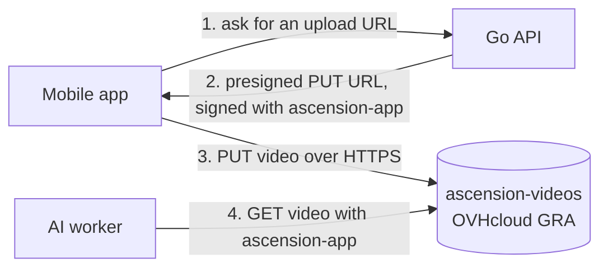

:::success
**Version:** 1.1
:::

---

# S3 Object Storage Guide

This guide describes the production object storage of Ascension: the OVHcloud bucket that holds the climbing videos, its access keys and policy, the configuration of the API and the AI worker, and how to check and maintain it.

:::warning
This guide never holds an access key or a secret key. They are stored in the team's password storage and in the Coolify environment variables, never in the repository.
:::

---

## 1\. Components

| Component               | Value                                                                      | Role                                          |
| ----------------------- | -------------------------------------------------------------------------- | --------------------------------------------- |
| Public Cloud project    | `Ascension Storage` (`1a9cc0d793944e33b4b5bd2f601a8b9a`)                   | Holds the bucket and its users                |
| Bucket                  | `ascension-videos`, S3 API, Gravelines (GRA), 1-AZ, Standard storage class | Climbing videos uploaded by the mobile app    |
| Endpoint and region     | `https://s3.gra.io.cloud.ovh.net`, region `gra`                            | Used by the API and the worker                |
| Encryption              | SSE-OMK (keys managed by OVHcloud)                                         | Every object is encrypted at rest             |
| User `ascension-videos` | Bucket owner, **no S3 key**                                                | Owns the bucket, never used by an application |
| User `ascension-app`    | S3 keys, restricted by a policy                                            | The only keys used by the API and the worker  |

The diagram below shows who talks to the bucket: the API only signs URLs, the mobile app sends and reads the video directly with them, and the worker downloads the video to analyse it.



---

## 2\. Access keys and policy

### 2.1 Why two users

The user that creates a bucket becomes its owner, with the `FULL_CONTROL` ACL. OVHcloud does not restrict a bucket owner with a user policy: even explicit `Deny` statements are ignored for it. The owner keys could therefore list, reconfigure or delete the bucket.

So the bucket owner, `ascension-videos`, has no S3 key at all, and the applications use a second user, `ascension-app`, which owns nothing and only gets what its policy allows.

### 2.2 Policy of `ascension-app`

The policy is versioned in [infra/ovh/ascension-videos-policy.json](https://github.com/Ascension-EIP/Ascension/blob/dev/infra/ovh/ascension-videos-policy.json) and imported on the user (_Object Storage › Users › … › Import JSON file_). An import replaces the previous policy.

| Statement                  | Effect                                                                                                                                   |
| -------------------------- | ---------------------------------------------------------------------------------------------------------------------------------------- |
| `AscensionVideosBucket`    | Allow listing `ascension-videos`, reading its location and its multipart uploads                                                         |
| `AscensionVideosObjects`   | Allow reading, writing and deleting objects, and handling multipart uploads                                                              |
| `DenyAccountActions`       | Deny listing every bucket and creating buckets                                                                                           |
| `DenyBucketAdministration` | Deny deleting the bucket and changing its configuration (ACL, CORS, versioning, lifecycle, encryption, replication, lock, website, tags) |
| `DenyObjectAdministration` | Deny object ACLs, retention and legal holds                                                                                              |

For a user that owns nothing, the `Allow` statements alone already restrict it: everything else is implicitly denied. The `Deny` statements are a second barrier.

### 2.3 Renewing the keys

1. In _Object Storage › Users_, open `…` on `ascension-app` and generate new S3 credentials.
2. Download them, store them in the team's password storage.
3. Update `MINIO_ID` / `MINIO_SECRET` of the API and `RUSTFS_ACCESS_KEY` / `RUSTFS_SECRET_KEY` of the worker in Coolify, and redeploy both.
4. Check an upload (see section 4), then delete the old credentials of the user.
5. Delete the downloaded credential file from your machine.

---

## 3\. Application configuration

The API (Go, AWS SDK for Go v2) and the worker (Python, boto3) read different variable names. The table gives the names set in Coolify: the compose file of the API maps its `MINIO_*` variables to the `STORAGE_*` names the server reads (`STORAGE_ENDPOINT`, `STORAGE_REGION`, `STORAGE_BUCKET`, `STORAGE_ID`, `STORAGE_SECRET`), see the [API Deployment Guide](./api-deployment-guide.md).

| Setting    | API                                              | Worker                                            |
| ---------- | ------------------------------------------------ | ------------------------------------------------- |
| Endpoint   | `MINIO_ENDPOINT=https://s3.gra.io.cloud.ovh.net` | `RUSTFS_ENDPOINT=https://s3.gra.io.cloud.ovh.net` |
| Region     | `MINIO_REGION=gra`                               | `RUSTFS_REGION=gra`                               |
| Bucket     | `MINIO_BUCKET=ascension-videos`                  | `RUSTFS_BUCKET=ascension-videos`                  |
| Access key | `MINIO_ID`                                       | `RUSTFS_ACCESS_KEY`                               |
| Secret key | `MINIO_SECRET`                                   | `RUSTFS_SECRET_KEY`                               |

- The endpoint is written without a final `/`.
- The endpoint is written with its scheme: `https://` uses HTTPS, `http://` does not. The API has no TLS setting of its own since `v0.3.0` (`MINIO_SSL` is no longer read).
- The region is part of every signature, presigned URLs included. With a wrong region, OVHcloud rejects the requests with `AuthorizationHeaderMalformed` or `SignatureDoesNotMatch`.
- In development, the same variables point to the local RustFS container (`http://rustfs:9000`). Its region can be any value: the defaults in `.env.example` keep working.
- The mobile app sends the video with a native HTTP client, not from a browser, so the bucket needs no CORS rule.

---

## 4\. Checking the storage

The checks below use the AWS CLI with the `ascension-app` keys in the environment (`AWS_ACCESS_KEY_ID`, `AWS_SECRET_ACCESS_KEY`).

```bash
export AWS_DEFAULT_REGION=gra
S3="aws s3api --endpoint-url https://s3.gra.io.cloud.ovh.net"

# Allowed: write, read and delete an object of the bucket
echo ok > /tmp/check.txt
$S3 put-object --bucket ascension-videos --key integration-check/check.txt --body /tmp/check.txt
$S3 get-object --bucket ascension-videos --key integration-check/check.txt /tmp/check-back.txt
$S3 delete-object --bucket ascension-videos --key integration-check/check.txt

# Denied: must answer AccessDenied
$S3 list-buckets
$S3 get-bucket-acl --bucket ascension-videos
```

| Operation                                                 | Expected result                       |
| --------------------------------------------------------- | ------------------------------------- |
| `put-object`, `get-object`, `delete-object` in the bucket | [Allowed](status:success)             |
| `list-objects-v2`, `get-bucket-location` on the bucket    | [Allowed](status:success)             |
| `list-buckets`                                            | [AccessDenied](status:danger)         |
| `get-bucket-acl`, `get-bucket-versioning` on the bucket   | [AccessDenied](status:danger)         |
| Any call with the `ascension-videos` owner keys           | [AccessDenied](status:danger): no key |

:::danger
Only check the denials with read operations such as `list-buckets` or `get-bucket-acl`. A write test (`put-bucket-versioning`, `delete-bucket`...) changes or deletes the real bucket if the policy is not applied.
:::

The last end-to-end check, on 12 November 2026, ran the real code against the bucket with the `ascension-app` keys: presigned upload and download URLs of the API in HTTPS, download by the worker, deletion by the API, and every denial above.

---

## 5\. Troubleshooting

| Symptom                                                        | Cause and fix                                                                                             |
| -------------------------------------------------------------- | --------------------------------------------------------------------------------------------------------- |
| `AuthorizationHeaderMalformed` or `SignatureDoesNotMatch`      | Wrong region: set `MINIO_REGION=gra` and `RUSTFS_REGION=gra`                                              |
| Presigned URLs start with `http://`                            | The endpoint is written with `http://`: write `https://` in `MINIO_ENDPOINT`                              |
| `AccessDenied` on an upload                                    | Keys of another user, or a policy that lost the `s3:PutObject` statement: re-import the versioned policy  |
| The policy changes nothing                                     | The keys belong to the bucket owner: use the `ascension-app` keys (see section 2.1)                       |

:::note
The bucket versioning shows **Suspended** instead of never enabled, after a test on 12 November 2026. A suspended bucket keeps no version: an upload replaces the object, as without versioning.
:::
