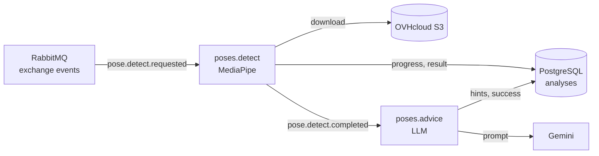

:::success
**Version:** 1.0
:::

---

# AI Worker Deployment Guide

This guide describes how the AI worker runs in production: the Coolify application that builds it, its resource limits, its variables, the message contract it consumes, and how to check and troubleshoot it. The API side is described in the [API Deployment Guide](./api-deployment-guide.md).

:::warning
This guide never holds a password or a key. They live in the Coolify environment variables of the application and in the team's password storage, never in the repository.
:::

---

## 1\. Components

| Component           | Value                                                                                                                        | Role                                                 |
| ------------------- | ---------------------------------------------------------------------------------------------------------------------------- | ---------------------------------------------------- |
| Coolify application | `ascension-worker` (UUID `vbqckodgvkbiuadqxswr1zvx`), project `Ascension`, environment `production`                          | Builds and runs the worker                           |
| Source              | `https://github.com/Ascension-EIP/Ascension`, branch `main`, base directory `/apps/ai`                                       | Code deployed in production                          |
| Compose file        | [apps/ai/docker-compose.coolify.yml](https://github.com/Ascension-EIP/Ascension/blob/dev/apps/ai/docker-compose.coolify.yml) | One `worker` service built from `apps/ai/Dockerfile` |
| RabbitMQ            | `ascension-rabbitmq`, exchange `events`                                                                                      | Analysis jobs and their status events                |
| PostgreSQL 18       | `ascension-postgres`, table `analyses`                                                                                       | Progress, result and advice of every analysis        |
| Object Storage      | OVHcloud bucket `ascension-videos`                                                                                           | Videos downloaded for the analysis                   |
| LLM                 | Gemini, through its OpenAI-compatible endpoint                                                                               | Advice written after the pose analysis               |

The worker has no domain: nothing reaches it from the Internet. It only opens connections to RabbitMQ, PostgreSQL, OVHcloud and the LLM.

The diagram below shows how one analysis flows through the worker: a `pose.detect.requested` job starts the pose analysis, its completion event starts the advice, and every step writes its progress in the `analyses` row.



---

## 2\. Deployment

### 2.1 Automatic deployment

The worker follows the same path as the API: a push to `main` reaches Coolify through the repository's GitHub webhook, and Coolify rebuilds and restarts the `worker` container. The worker and the API share that webhook, so both applications use the same webhook secret in Coolify.

A restart is safe: a job is acknowledged only once processed. A job interrupted by a restart goes back to the queue and runs again, and a job already marked `success` is ignored.

### 2.2 Resource limits

The worker shares the VPS (8 vCPU, 22 GB) with the API, Jenkins and SonarQube. The compose file caps it:

| Limit           | Value | Why                                                                                            |
| --------------- | ----- | ---------------------------------------------------------------------------------------------- |
| `cpus`          | `3`   | MediaPipe uses every core it gets: Jenkins builds keep 5 cores                                 |
| `mem_limit`     | `4g`  | About 250 MB at rest and during the analysis of a short video                                  |
| `memswap_limit` | `4g`  | Equal to the memory limit: no swap, an overflow stops the container instead of slowing the VPS |

To change them, edit `apps/ai/docker-compose.coolify.yml`: the next deployment applies them.

---

## 3\. Configuration

### 3.1 Variables

| Variable                                                             | Value                                                                              |
| -------------------------------------------------------------------- | ---------------------------------------------------------------------------------- |
| `POSTGRES_HOST`, `POSTGRES_DB`, `POSTGRES_USER`, `POSTGRES_PASSWORD` | Same database as the API (`i8hc7tklpho8bwo92gzdnzrl`)                              |
| `RABBITMQ_HOST`, `RABBITMQ_USER`, `RABBITMQ_PASS`                    | Same broker as the API (`rabbitmq-qqu2ictjftetdiyyif9ffctg`)                       |
| `RUSTFS_ENDPOINT`, `RUSTFS_REGION`, `RUSTFS_BUCKET`                  | `https://s3.gra.io.cloud.ovh.net`, `gra`, `ascension-videos`                       |
| `RUSTFS_ACCESS_KEY`, `RUSTFS_SECRET_KEY`                             | Keys of the OVHcloud user `ascension-app`, as for the API                          |
| `LLM_API_KEY`                                                        | Gemini API key                                                                     |
| `LLM_BASE_URL`, `LLM_MODEL`                                          | Optional: Gemini OpenAI-compatible endpoint and `gemini-3.1-flash-lite` by default |

Without `LLM_API_KEY`, the analysis still ends in `success`, without advice. A new key is applied by a redeployment.

### 3.2 Message contract

The contract is versioned in the `schemas/` folder of the repository.

| Routing key                                | Queue          | Body                   | Published by                         |
| ------------------------------------------ | -------------- | ---------------------- | ------------------------------------ |
| `pose.detect.requested`                    | `poses.detect` | `{job_id, object_key}` | The API, when an analysis is created |
| `pose.detect.completed`                    | `poses.advice` | `{job_id}`             | The worker, after the pose analysis  |
| `pose.advice.requested`                    | `poses.advice` | `{job_id}`             | Anyone, to compute the advice again  |
| `pose.detect.status`, `pose.advice.status` | none yet       | `{job_id, status}`     | The worker, at every step            |

`job_id` is the `id` of the `analyses` row, which the API creates before publishing. A job that fails for good goes to `poses.detect.dlq` or `poses.advice.dlq`.

---

## 4\. Checking the worker

On the VPS:

```bash
# Running, with its limits (NanoCpus 3000000000, Memory 4294967296)
C=$(sudo docker ps --format '{{.Names}}' | grep worker-vbqckodgvkbiuadqxswr1zvx)
sudo docker inspect -f '{{.State.Status}} {{.HostConfig.NanoCpus}} {{.HostConfig.Memory}}' $C

# One consumer on each queue
sudo docker exec rabbitmq-qqu2ictjftetdiyyif9ffctg rabbitmqctl list_queues name consumers messages
```

The first deployment, on 12 November 2026, was checked end to end: a real climbing video uploaded through the production API, a `pose.detect.requested` job published on `events`, then the analysis in the database: 309 frames, movements, Gemini advice, status `success` after 23 seconds. The test account, video, object and analysis were deleted afterwards.

---

## 5\. Troubleshooting

| Symptom                                        | Cause and fix                                                                                        |
| ---------------------------------------------- | ---------------------------------------------------------------------------------------------------- |
| An analysis stays `pending`                    | No job reached `poses.detect`: see the known issue above, or check the consumers with `list_queues`  |
| An analysis ends `failed`                      | Read its `error` column and the worker logs. The failed job is in the matching `.dlq` queue          |
| `success` without advice                       | `LLM_API_KEY` missing or refused: check the logs around `POSE_ADVICE_REQUEST`, set the key, redeploy |
| The container restarts with exit code `137`    | It hit the memory limit: raise `mem_limit` in the compose file                                       |
| `AuthorizationHeaderMalformed` on the download | Wrong `RUSTFS_REGION`: see the [S3 Object Storage Guide](./s3-object-storage-guide.md)               |
