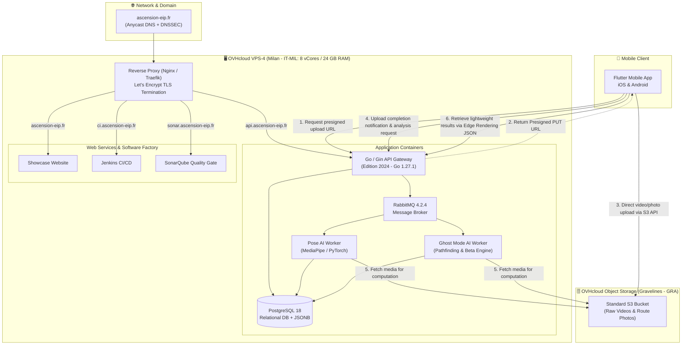

:::success
**Version:** 1.0
:::

---

# Ascension Infrastructure Architecture

This document describes the hosting and infrastructure architecture for the **Ascension** platform. It formalizes resource sizing, geographical service locations, network data flows, and technical decisions established with the EIP Epitech advisors.

---

## 1. Overview of Selected Infrastructure

Following pedagogical reviews and cloud resource allocation via **OVHcloud**, the project architecture adopted **Option B (1 High-Capacity VPS + Managed Object Storage)**, coupled with the official domain name.

This topology optimizes cost, resilience, and computational performance by decoupling heavy processing workloads (AI inference, API handling, CI/CD compilation) from large binary media storage (climbing ascent videos and route photos).

### 1.1 Deployed Resources Summary

| Component | Provider / Plan | Specifications | Location | Roles & Responsibilities |
| :--- | :--- | :--- | :--- | :--- |
| **Compute & Services Server** | OVHcloud VPS-4 (2027) | 8 vCores, 24 GB RAM, 200 GB SSD NVMe, 3 Gbps | **Milan (Italy - IT-MIL)** | Hosts all application containers: Go API Gateway, Python AI Workers (Pose & Ghost Mode), PostgreSQL 18, RabbitMQ, Jenkins CI/CD, SonarQube, and public Showcase Website. |
| **Media Object Storage** | OVHcloud Object Storage Standard | Unlimited elastic storage, S3-compatible, free inbound/outbound traffic & API requests | **Gravelines (France - GRA)** | Secure, durable storage for raw climbing videos and boulder/route photos. Direct uploads via presigned URLs. |
| **Official Domain Name** | OVHcloud Domain (.fr) | `ascension-eip.fr` (with DNSSEC security extension) | Global / Anycast DNS | Secure entry point (HTTPS / TLS 1.3), routing across application subdomains, and automated SSL termination. |

---

## 2. Global Architecture Diagram

The diagram below illustrates communication between mobile clients, the `ascension-eip.fr` domain, the Milan compute server, and the Gravelines object storage:

*Data flow summary: The Flutter mobile app connects to the API Gateway through the secured subdomains of `ascension-eip.fr` hosted on the Milan VPS. When recording a climb, the app obtains a presigned URL from the API and uploads media directly to the Gravelines Object Storage bucket. AI workers consume tasks from RabbitMQ, retrieve media from the bucket, and store analysis metrics in PostgreSQL 18. The mobile client then fetches mathematical keypoint trajectories as lightweight JSON to render overlays locally.*

---

## 3. Infrastructure Components Breakdown

### 3.1 Compute & Services Server — VPS-4 (Milan)

The single VPS server hosts all application services, databases, and continuous integration tools within an isolated Docker Compose environment.

#### Hardware Specifications
- **Model:** OVHcloud VPS-4 (2027 Lineup)
- **Location:** Milan Datacenter (Italy - `IT-MIL`)
- **Processor:** 8 virtual cores (vCores)
- **Memory:** 24 GB RAM
- **Storage:** 200 GB SSD NVMe
- **Network:** 3 Gbps unmetered bandwidth

#### Service Distribution and Memory Sizing
The 24 GB RAM and 8 vCores allocation is configured to prevent Out-Of-Memory (OOM) failures during concurrent inference and build executions:

- **AI Inference Workers (Python 3.11):**
  - *Pose Analysis Worker:* 2D skeleton extraction (MediaPipe Pose, 33 keypoints per frame), 3D postural reconstruction, and biomechanical feedback computation.
  - *Ghost Mode Worker:* Computer vision hold detection and categorization on route photos, pathfinding adapted to user morphology, and generation of step-by-step movement images.
  - Allocation: ~6 to 8 GB RAM dedicated to absorb parallel video processing pipelines.
- **API Gateway (Go 1.27.1 / Gin):**
  - High-throughput entry point handling REST routes, WebSockets for real-time notifications, and asynchronous analysis orchestration.
  - Lightweight footprint (~100 to 250 MB RAM).
- **Primary Database (PostgreSQL 18):**
  - Persists user accounts, climbing sessions, morphological profiles, and analysis outputs stored as JSONB.
  - Allocation: ~2 to 3 GB RAM buffer cache (*shared_buffers*).
- **Message Broker (RabbitMQ 4.2.4):**
  - AMQP broker ensuring strict decoupling between user HTTP requests and long-running AI jobs.
  - Allocation: ~512 MB to 1 GB RAM.
- **CI/CD Platform (Jenkins):**
  - Automated testing, linting, and build pipelines for the monorepo (Go, Python, Flutter).
  - Allocation: ~2 to 3 GB RAM (peak usage during parallel builds).
- **Code Quality Platform (SonarQube):**
  - Static application security testing (SAST) and quality gate validation.
  - Allocation: ~3 to 4 GB RAM (JVM / internal Elasticsearch engine).
- **Reverse Proxy & Showcase Website:**
  - Nginx / Traefik with automated Let's Encrypt TLS/SSL certificate lifecycle and HTTP/2 routing.
  - Ascension public showcase website presenting features and store download links.
  - Allocation: ~500 MB RAM.

---

### 3.2 Media Storage — Object Storage Standard (Gravelines)

Binary media storage has been offloaded to **OVHcloud Managed Object Storage Standard** instead of a second fixed-disk virtual machine.

#### Technical Specifications
- **Service:** OVHcloud Public Cloud Object Storage (Standard)
- **Location:** Gravelines Datacenter (France - `GRA`)
- **Protocol:** Standard S3 API (compatible with AWS SDK Go and Python `boto3`)
- **Capacity:** Elastic and virtually unlimited
- **Bandwidth:** Free ingress, free egress, and included API transactions

#### Rationale for Gravelines and Object Storage
1. **Data Sovereignty and GDPR Compliance:**
   Climbing ascent videos represent sensitive biometric and personal data. Hosting them in the French datacenter of Gravelines ensures compliance with European data privacy regulations (GDPR).
2. **Direct Upload & Edge Rendering Architecture:**
   - *Direct Upload:* Mobile devices upload multi-megabyte video recordings directly to the Gravelines bucket using API-generated presigned PUT URLs. The Milan VPS network bandwidth is never saturated by raw file uploads.
   - *Edge Rendering:* The backend does not re-encode videos. Instead, compact mathematical JSON payloads (joint coordinates, angles, technical advice) are served to the mobile client, which renders 2D/3D overlays locally.
3. **Storage Scalability:**
   The initial alternative of a second VPS (VPS-2) imposed a rigid 75 GB NVMe disk limit, which would quickly saturate with high-resolution climbing videos. Object storage eliminates disk exhaustion risks entirely.

---

### 3.3 Network & Domain Routing — `ascension-eip.fr`

The officially allocated domain name for the project is **`ascension-eip.fr`**.

#### DNS Configuration & Subdomains
The domain routes incoming traffic to the Milan VPS via an authoritative DNS zone protected by **DNSSEC**:

| Subdomain | Target | Purpose |
| :--- | :--- | :--- |
| `ascension-eip.fr` / `www` | VPS (Milan) | Public showcase website and project documentation portal |
| `api.ascension-eip.fr` | VPS (Milan) | Backend Go API (REST endpoints and WebSockets for Flutter app) |
| `ci.ascension-eip.fr` | VPS (Milan) | Jenkins Continuous Integration platform (internal team access) |
| `sonar.ascension-eip.fr` | VPS (Milan) | SonarQube code quality and analysis platform (internal team access) |

#### Security and TLS Certificates
- All client connections enforce **HTTPS / TLS 1.3**.
- The reverse proxy automatically provisions and renews SSL certificates via **Let's Encrypt**.
- Modern mobile application marketplaces (Apple App Store and Google Play Store) mandate valid public CA-signed certificates, making an official domain mandatory.

---

## 4. Security and Isolation Strategy

The infrastructure follows defense-in-depth principles to isolate user data and operational interfaces:

1. **Docker Network Isolation:**
   - Only HTTP (80) and HTTPS (443) ports are exposed on the host's public interface.
   - Internal services such as PostgreSQL and RabbitMQ reside on private Docker networks (`backend-network`), inaccessible from the public internet.
2. **Presigned S3 Access:**
   - The Gravelines bucket is strictly private.
   - Public write operations are prohibited; uploads require cryptographically signed, short-lived presigned URLs (15-minute validity window).
3. **Internal Tools Hardening:**
   - Development subdomains (`ci.ascension-eip.fr` and `sonar.ascension-eip.fr`) require role-based authentication and IP allowlisting where appropriate.
4. **Automated Backups:**
   - Scheduled, encrypted PostgreSQL 18 database dumps are exported directly to a dedicated private bucket on the Gravelines Object Storage, ensuring cross-region redundancy between Milan and France.

---

## 5. Budget Summary and Cost Optimization

The chosen architecture (Option B) maximized the efficiency of the school-allocated infrastructure budget while providing superior technical resilience compared to the initial two-VM request:

| Expense Item | 2-VPS Configuration (Option A) | Selected Configuration (Option B) | Technical & Cost Advantage |
| :--- | :--- | :--- | :--- |
| **Main Compute VPS** | VPS-4 ($280.44 excl. tax / yr) | VPS-4 Milan ($280.44 excl. tax / yr) | Identical: 8 vCores, 24 GB RAM dedicated to compute |
| **Media Storage** | VPS-2 ($102.00 excl. tax / yr) | Gravelines Object Storage (~$10.00 excl. tax / yr) | **~$92 / year savings** and virtually unlimited storage (vs. 75 GB cap) |
| **Domain Name** | `.fr` Domain ($6.24 excl. tax / yr) | `ascension-eip.fr` ($6.24 excl. tax / yr) | Identical: official domain name with DNSSEC |
| **Estimated Annual Total** | **$388.68 excl. tax** | **~$296.68 excl. tax** | **Net saving of ~$92 / year** with superior elasticity and availability |

---

## 6. Future Scalability

The current infrastructure is designed to support the beta-testing phase and all academic evaluation milestones:

- **Horizontal AI Scaling:** Because Python AI workers are decoupled through RabbitMQ, additional worker nodes (including dedicated GPU compute instances) can be attached seamlessly without altering backend or mobile application code.
- **Orchestration Evolution (K3s):** Every service is containerized, facilitating a straightforward migration toward lightweight Kubernetes (K3s) should user demand require dynamic container auto-scaling.
