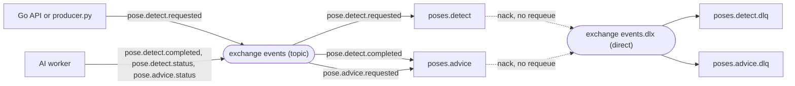
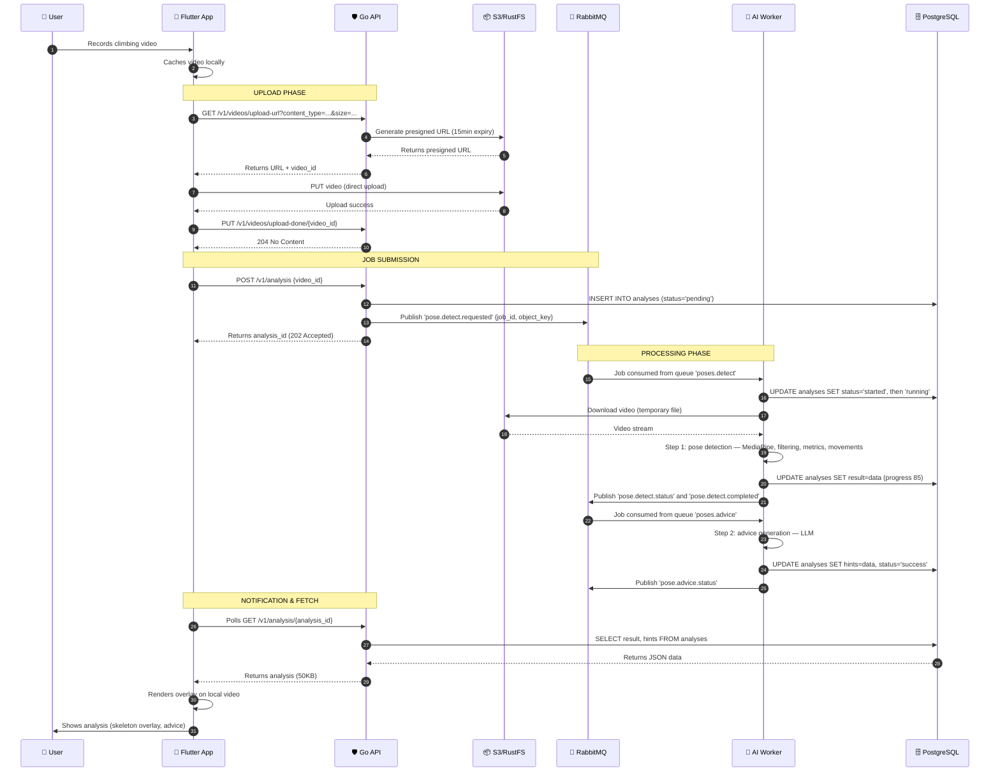

:::danger
**Version:** 1.3

à totalement revoir, c’est n’importe quoi c’est un four tout, y’a des benchmark, des coûts, etc
:::

---

# System Overview

---

## Philosophy

Ascension's architecture is built on the principle of **separation of concerns** with a focus on **asynchronous processing** and **cost-effective scaling**. The system is designed to handle computationally expensive AI workloads without degrading user experience.

---

## Core Design Patterns

### 1\. Event-Driven Architecture

The system uses an event-driven pattern where:

- User actions trigger events
- Events are published to a message queue
- Workers consume events asynchronously
- Results trigger completion events
- UI updates via WebSocket notifications

**Benefits**:

- Non-blocking user experience
- Natural load distribution
- Easy to add new event handlers
- Fault tolerance (retry failed events)

### 2\. CQRS (Command Query Responsibility Segregation)

Commands (write operations) and Queries (read operations) follow different paths:

**Commands** (e.g., "Analyze this video"):

- API validates request
- Job published to queue
- Worker processes asynchronously
- Result stored in database

**Queries** (e.g., "Get my analysis"):

- API retrieves from database
- Response cached for frequent queries
- Direct to client

### 3\. Client-Side Rendering

Instead of server-side video encoding, we return mathematical data:

**Traditional Approach** (Avoided):

```
Video (50MB) → AI Processing → Enhanced Video (50MB) → Client
Total bandwidth: 100MB
Processing time: 45s + encoding (30s)

```

**Our Approach**:

```
Video (50MB) → AI Processing → JSON (50KB) → Client renders overlay
Total bandwidth: 50MB
Processing time: 45s (no encoding)

```

**Savings per video**:

- Bandwidth: 50MB saved (50% reduction)
- Processing: 30s saved
- Storage: No need to keep processed videos

---

## System Layers

### Layer 1: Client (Flutter Mobile App)

**Responsibilities**:

- User interface and interaction
- Local video capture and caching
- Direct upload to object storage
- Rendering analysis overlays
- WebSocket connection for real-time updates

**Key Technologies**:

- Flutter SDK
- CustomPainter for overlay rendering
- WebSocket client
- HTTP/2 client

**Data Flow**:

1. Capture or select video
2. Keep video in local cache
3. Request presigned upload URL from API
4. Upload directly to S3/RustFS
5. Notify API of upload completion
6. Await WebSocket notification
7. Fetch JSON analysis
8. Render skeleton overlay and coaching advice on local video

### Layer 2: API Gateway (Go)

**Responsibilities**:

- Authentication and authorization (JWT validation)
- Request validation
- Presigned URL generation
- Job orchestration
- Result delivery

**Key Technologies**:

- Go (Gin framework)
- JWT for authentication
- pgx for database access
- RabbitMQ client (amqp091-go)

**NOT Responsible For**:

- Video processing (too heavy)
- Video storage (handled by object storage)
- AI inference (delegated to workers)

**API Endpoints**:

```
POST   /v1/auth/register
POST   /v1/auth/login
DELETE /v1/auth/logout
PUT    /v1/auth/refresh
GET    /v1/videos/upload-url     # Returns presigned URL
PUT    /v1/videos/upload-done/:id # Confirms upload complete
POST   /v1/analysis              # Triggers AI analysis
GET    /v1/analysis/:id          # Fetch results

```

### Layer 3: Message Queue (RabbitMQ)

**Responsibilities**:

- Job queue management with message persistence
- Pub/Sub for events via exchanges
- Dead letter queue for failed jobs
- Flexible routing with routing keys

**Topology (AI worker, implemented)**:

One durable topic exchange, `events`, carries every job and status message. Each queue is bound with the routing keys it consumes. A failed or rejected message is dead-lettered through the direct exchange `events.dlx` into `<queue>.dlq`.



*Summary: the API publishes `pose.detect.requested` on the `events` exchange. The worker consumes `poses.detect`, then publishes `pose.detect.completed`, which feeds `poses.advice`. Both steps publish their statuses. Messages that fail for good go to the dead-letter queues.*

| Queue | Bound routing keys | Payload | Handler |
| --- | --- | --- | --- |
| `poses.detect` | `pose.detect.requested` | `{job_id, object_key}` | `pose_detect_request` |
| `poses.advice` | `pose.detect.completed`, `pose.advice.requested` | `{job_id}` | `pose_advice_request` |

Status messages (`pose.detect.status`, `pose.advice.status`) carry `{job_id, status, message}` (`message` is optional and short) with `status` among `pending`, `started`, `running`, `success`, `failed`. The `job_id` is the `analyses.id`; the bucket is a configuration value, not part of the message. The JSON Schemas in `schemas/` are the source of truth for these payloads.

**Reliability rules**:

- Queues are durable and declared with the dead-letter arguments. Queues created by an older version must be deleted once, since RabbitMQ refuses a redeclaration with different arguments.
- Each worker process takes one message at a time (`prefetch_count=1`) and runs the job in a thread, so heartbeats keep flowing during long jobs.
- A payload that fails validation is rejected without running the handler and lands in the dead-letter queue. No status is published for it (there is no reliable `job_id`), so the analysis stays `pending` and must be detected on the server side.

**Planned queues**: hold detection, Ghost Mode and training programs will get their own queues and routing keys. Their former names (`vision.hold_detection`, `vision.ghost`, `training.program`) are **planned and must be redefined** under the new convention (exchange `events`, queues and keys named by feature).

### Layer 4: AI Workers (Python + PyTorch + MediaPipe + OpenCV)

A single Python service (`apps/ai/`) handles all AI tasks, routed through RabbitMQ into **two distinct pipelines**. Only the first two steps of the vision pipeline exist today; see the [AI worker overview](../apps/ai/overview.md) and the [worker README](../../../../apps/ai/README.md).

Pipeline 1: Vision Pipeline

All computer-vision tasks that rely on MediaPipe Pose and image processing:

| Step | Queue | Input | Output | Status |
| --- | --- | --- | --- | --- |
| 1\. Hold Detection | Planned (name to be redefined) | Photo of the route | JSON hold map (positions + types) | Planned. User photographs the wall, AI detects and classifies holds (crimp, sloper, jug…). User can manually correct misclassified holds before proceeding. |
| 2\. Pose detection | `poses.detect` | `{job_id, object_key}` (video in RustFS) | `analyses.result`: filtered landmarks, joint angles, speeds, arm extension, metrics, movements and pauses | **Implemented.** MediaPipe Pose extracts 33 keypoints per frame, filters and smooths them, then computes angles, metrics and movements. Hands are unreliable on the sample video. |
| 3\. Advice | `poses.advice` | `{job_id}` (the worker reads `analyses.result` back) | `analyses.hints`: structured advice in French | **Implemented.** Computed values only, sent to an interchangeable OpenAI-compatible LLM (`LLM_BASE_URL`, `LLM_API_KEY`, `LLM_MODEL`). No hold map or route context yet. Real providers are not tested. |
| 4\. Ghost Mode | Planned (name to be redefined) | Route photo + selected holds + user morphology | JSON ghost step sequence + step images | Planned. Computes an optimal movement sequence (pathfinding) for the user's body proportions from an empty route photo. Output is a step-by-step sequence with generated images showing each move. |

**Key design**: Video analysis (steps 2–3) and Ghost Mode (step 4) are completely decoupled. Video analysis takes a climbing video to extract pose landmarks and generate coaching advice. Ghost Mode operates strictly on an route photo: after hold detection and user selection, it uses climber morphology to generate step-by-step guidance images.

Pipeline 2: Training Pipeline (CPU-only)

| Step | Queue | Input | Output | Status |
| --- | --- | --- | --- | --- |
| 1\. Program Generation | Planned (name to be redefined) | User profile (goals, injuries, level, analysis history) | JSON training program | Planned. Algorithm selects and personalizes training routines based on the user's objectives, injury history, and past performance data from analyses. |

This pipeline does **not** require GPU or video processing. It runs as a lightweight algorithm (rule-based + optional LLM for textual personalization in the future).

Worker Architecture

One worker process consumes both implemented queues, one job at a time. Handlers live in `apps/ai/src/worker/handlers/`, one per routing flow, and the pipeline steps in numbered modules (`_1_mediapipe`, `_2_advice`) that do not depend on RabbitMQ, PostgreSQL or storage. Scaling is done by adding replicas.

The canonical pipeline pattern (as implemented in `apps/ai/src/worker/handlers/pose_detect_request.py` for `poses.detect`) is:

1. **Take**: mark the analysis `started` in PostgreSQL (`analyses.status`, `progress`) and publish `started`.
2. **Download**: fetch the asset from RustFS (S3 API through boto3) into a temporary file that is always deleted.
3. **Process**: run the AI/algorithm module, reporting progress.
4. **Persist**: write `result` (or `hints`) to PostgreSQL (psycopg 3, parameterized queries).
5. **Publish**: publish the status on `pose.<step>.status` and, for detect, `pose.detect.completed` to trigger the next step.
6. **Ack or dead-letter**: `ack` on success. On failure, `nack` without requeue so the message goes to `<queue>.dlq`.

Failure handling:

- Temporary errors (storage, database, LLM) are retried three times with an in-memory backoff (2 s, then 4 s).
- Permanent errors (invalid payload, missing or unreadable video) are not retried: the analysis becomes `failed` with a short message, the status is published once, and the message is dead-lettered. Tracebacks stay in the logs.
- `success` is written only after the advice step. If the LLM fails, the analysis still ends in `success` with `hints = NULL`, and `pose.advice.status` is `failed`; the advice step can be rerun with `pose.advice.requested`.
- A redelivered detect message for an analysis already in `success` is acknowledged and ignored.

Each worker process:

- Declares its queues as **durable**, with the dead-letter arguments, and `events` as a **topic + durable** exchange at startup.
- Sets `prefetch_count=1` (one job at a time per worker instance).
- Retries the initial RabbitMQ connection up to **12 × 5 s** (`RABBITMQ_MAX_RETRIES`, `RABBITMQ_RETRY_DELAY`) to handle Docker Compose startup race conditions.
- Exits with a non-zero code if a connection fails or drops, so the container is restarted.

**Implementation status:**

| Queue | Module | Status |
| --- | --- | --- |
| `poses.detect` | `apps/ai/src/worker/handlers/pose_detect_request.py` | ✅ Implemented (not yet fed by the Go API) |
| `poses.advice` | `apps/ai/src/worker/handlers/pose_advice_request.py` | ✅ Implemented (provider calls untested) |
| Hold detection | — | Planned |
| Ghost Mode | — | Planned |
| Training program | — | Planned |

See the [AI worker overview](../apps/ai/overview.md), the [2D pipeline decomposition](../apps/ai/pipeline-2d-decomposition.md) and the [worker README](../../../../apps/ai/README.md) for the full AI layer documentation.

Typical Processing Flows

**Video Analysis Flow**:

1. User uploads the video, then the API creates a `pending` analysis and publishes `pose.detect.requested`.
2. The worker runs the pose detection and stores the per-frame result (`analyses.result`, progress 85).
3. `pose.detect.completed` triggers the advice step, which stores `analyses.hints` and sets the analysis to `success`.
4. The app polls `GET /v1/analysis/:id`. A `pose.detect.status` of `success` does **not** mean the analysis is over: it ends with `pose.advice.status`.

**Ghost Mode Flow (Photo-only, planned)**:

1. User photos route, then a hold detection job classifies holds by type and color.
2. User validates or manually selects holds on the route photo.
3. API triggers a ghost job (photo + selected holds + morphology), and pathfinding generates step-by-step images.

### Layer 5: Data Persistence

PostgreSQL (Structured Data)

**Schema Design**:

```sql
-- Users table
CREATE TABLE users (
    id UUID PRIMARY KEY DEFAULT gen_random_uuid(),
    email VARCHAR(255) UNIQUE NOT NULL,
    password_hash VARCHAR(255) NOT NULL,
    created_at TIMESTAMP DEFAULT NOW(),
    subscription_tier VARCHAR(50) DEFAULT 'freemium'
);

-- Videos table
CREATE TABLE videos (
    id UUID PRIMARY KEY DEFAULT gen_random_uuid(),
    user_id UUID REFERENCES users(id),
    storage_url TEXT NOT NULL,
    duration_seconds INTEGER,
    file_size_bytes BIGINT,
    uploaded_at TIMESTAMP DEFAULT NOW(),
    saved BOOLEAN DEFAULT FALSE,
    expires_at TIMESTAMP  -- NULL if saved
);

-- Analysis results table (simplified: see the database schema specification for the real columns)
CREATE TABLE analyses (
    id UUID PRIMARY KEY DEFAULT gen_random_uuid(),
    video_id UUID REFERENCES videos(id),
    status job_status DEFAULT 'pending',  -- pending, started, running, success, failed
    result JSONB,  -- Skeleton, angles, metrics, movements (written by the AI worker)
    hints JSONB,   -- Structured advice, NULL if the LLM step failed
    processing_time_ms INTERVAL,
    created_at TIMESTAMP DEFAULT NOW(),
    completed_at TIMESTAMP
);

-- Analysis metadata (for quick queries)
CREATE TABLE analysis_metrics (
    id UUID PRIMARY KEY DEFAULT gen_random_uuid(),
    analysis_id UUID REFERENCES analyses(id),
    max_reach_cm FLOAT,
    avg_tension FLOAT,
    movement_efficiency FLOAT,
    hold_count INTEGER
);

```

**Indexes**:

```sql
CREATE INDEX idx_videos_user_id ON videos(user_id);
CREATE INDEX idx_videos_expires_at ON videos(expires_at) WHERE saved = FALSE;
CREATE INDEX idx_analyses_video_id ON analyses(video_id);
CREATE INDEX idx_analyses_status ON analyses(status);

```

RustFS/S3 (Object Storage)

RustFS replaces MinIO (see the [MinIO deprecation audit](audits/minio-deprecation.md) and the [object storage benchmark](benchmark/object-storage.md)). The Go API and the AI worker both use the S3 API; the worker uses boto3 with path-style addressing. The bucket must exist before the worker starts: the Go API creates it at startup.

**Bucket Structure** (target layout, not enforced by the code today):

```
ascension-videos/
├── uploads/
│   └── {user_id}/
│       └── {video_id}.mp4
├── saved/
│   └── {user_id}/
│       └── {video_id}.mp4
└── thumbnails/
    └── {video_id}.jpg

```

**Lifecycle Policies** (target, not configured today and not verified against RustFS):

```json
{
  "Rules": [
    {
      "Id": "DeleteUnsavedVideos",
      "Status": "Enabled",
      "Filter": {
        "Prefix": "uploads/"
      },
      "Expiration": {
        "Days": 7
      }
    }
  ]
}
```

---

## Data Flow: Complete Video Analysis

The diagram shows the contract implemented by the AI worker. The Go API still publishes on the old queue `vision.skeleton` and uses the old status values until the backend handoff is applied, so an analysis started from the app does not reach the worker yet.



---

## Scaling Strategy

### Horizontal Scaling Points

1. **API Servers**: Add more instances behind load balancer
2. **AI Workers**: Add more worker processes/containers
3. **Database**: Read replicas for query distribution
4. **Object Storage**: Inherently scalable (S3/RustFS)
5. **RabbitMQ**: RabbitMQ Cluster for high availability

### Vertical Scaling Points

1. **AI Workers**: Upgrade to more powerful GPUs
2. **Database**: Increase RAM for larger cache
3. **RabbitMQ**: Increase memory for larger queue

### Auto-scaling Triggers

- **API**: CPU > 70% or Request Queue > 100
- **Workers**: Queue depth > 50 jobs
- **Database**: Connection pool saturation

---

## Fault Tolerance

### API Server Failure

- **Impact**: New requests fail
- **Mitigation**: Multiple API instances behind load balancer
- **Recovery**: Automatic (load balancer detects failure)

### AI Worker Failure

- **Impact**: Job remains in queue
- **Mitigation**: Job timeout + dead letter queue
- **Recovery**: Job reassigned to healthy worker

### Database Failure

- **Impact**: Cannot write/read results
- **Mitigation**: Database replica + automated failover
- **Recovery**: Promote replica to primary

### Object Storage Failure

- **Impact**: Cannot upload/download videos
- **Mitigation**: Multi-region replication (production)
- **Recovery**: Automatic (S3 SLA: 99.99%)

### RabbitMQ Failure

- **Impact**: Queue unavailable, jobs cannot be published or consumed
- **Mitigation**: RabbitMQ clustering with mirrored queues
- **Recovery**: Automatic failover to replica node, persistent messages survive restart

---

## Security Architecture

### Authentication Flow

```
User → API: POST /auth/login {email, password}
API → DB: Verify credentials
API → API: Generate JWT (expires 24h)
API → User: Returns {access_token, refresh_token}

User → API: All requests include: Authorization: Bearer <token>
API → API: Verify JWT signature + expiry
API → DB: Fetch user permissions

```

### Authorization Levels

- **Freemium**: 10 analyses/month, with ads, no Ghost Mode, max 5 routines
- **Premium**: 30 analyses/month (20€/month), Ghost Mode (30 uses/month), unlimited routines, standard server priority
- **Infinity**: 100 analyses/month (30€/month), Ghost Mode (100 uses/month), unlimited routines, server priority

### Data Protection

- **In Transit**: TLS 1.3 for all external communication
- **At Rest**: Encrypted S3 buckets, encrypted DB volumes
- **Secrets**: Environment variables, never in code
- **API Keys**: Stored hashed with bcrypt

---

## Monitoring Strategy

**Stack**: Prometheus (metrics) + Grafana (dashboards) + Loki (logs)

### Key Metrics

**API**:

- Request rate (requests/second)
- Error rate (%)
- Response time (p50, p95, p99)
- Active WebSocket connections

**AI Workers**:

- Queue depth
- Processing time per video
- GPU utilization (%)
- Failed jobs count

**Database**:

- Query time (p50, p95)
- Connection pool usage
- Cache hit rate

**Object Storage**:

- Upload success rate
- Download bandwidth
- Storage used (GB)

### Alerting Rules

- API error rate > 5% for 5 minutes → Page on-call
- Queue depth > 200 jobs → Scale workers
- Database CPU > 80% for 10 minutes → Alert
- Storage approaching quota → Warning

---

## Cost Analysis

### Development Phase (Single Machine)

```
Local Docker Compose: Free (runs on dev machine)
RustFS Storage: Included locally
Total: ~€0/month

```

### Staging Phase (Single Hetzner VPS)

```
Hetzner VPS (CX31 - 4 vCPU, 8GB RAM): ~€12/month
RustFS Storage (included on VPS): €0
Total: ~€12/month

```

### Production Phase (1,000 active users — Hetzner)

```
Hetzner VPS API+DB (CPX31 - 4 vCPU, 8GB): ~€15/month
Hetzner VPS AI Worker (CCX23 - 4 vCPU, 16GB): ~€30/month
RabbitMQ (self-hosted on API VPS): €0
RustFS (self-hosted Object Storage): €0
Hetzner Volume Storage (500GB): ~€25/month
Data Transfer (20TB included): €0
Total: ~€70/month (~€0.07 per user)

```

### Production Phase (100,000 active users — Hetzner / Kubernetes)

```
Hetzner Dedicated Servers (3x AX41): ~€150/month
Hetzner GPU Server (or cloud GPU): ~€200-500/month
PostgreSQL (replicated): Included on dedicated servers
RabbitMQ Cluster: Included on dedicated servers
RustFS Cluster (Object Storage): Included
Hetzner Volume Storage (50TB): ~€2,500/month
Data Transfer (included): €0
Total: ~€3,000-3,500/month (~€0.035 per user)

```

---

## Performance Benchmarks

### Target SLAs

- **API Response Time**: p95 < 200ms
- **Video Upload**: Network dependent (client → S3)
- **Analysis Processing**: < 60s for 30s video
- **WebSocket Notification**: < 100ms after completion
- **Result Fetch**: < 100ms
- **Total User Wait Time**: < 60s (upload + processing)

### Bottleneck Analysis

**Current Bottleneck**: GPU compute time

- **Solution**: Add more workers or upgrade GPUs

**Future Bottleneck** (at scale): Database writes

- **Solution**: Write batching, read replicas

---

## Technology Choices Rationale

### Why Go over Node.js/Rust? (Backend Migration)

We migrated the API Gateway server from Rust (Axum) to Go (Gin) for several reasons:

- **Development Velocity**: Go's minimal syntax and faster compile times accelerate feature delivery.
- **Onboarding**: Easier for new team members to read and write Go code compared to Rust.
- **Concurrency**: Goroutines provide extremely high throughput and low latency, similar to Tokio tasks, but with a much lower cognitive load.
- **Robust standard library**: Simplified database connection pooling and HTTP handling.

*Note: The initial Rust prototype helped us validate benchmarks and establish performance guidelines, but Go was chosen for the long-term production gateway.*

### Why PostgreSQL over MongoDB?

- Structured data fits relational model
- ACID transactions for user accounts
- Better support for complex queries (JOIN user + video + analysis)
- JSONB support for flexible analysis data

### Why RabbitMQ over Redis?

- Purpose-built message broker with guaranteed delivery
- Dead letter queues for failed job management
- Persistent messages survive broker restarts
- Flexible routing system for different job types
- Industry standard for reliable async processing

### Why RustFS?

- S3-compatible API (easy production migration)
- Self-hosted (no cloud costs)
- Docker-friendly
- Replaces MinIO Community Edition, deprecated and archived upstream in April 2026 (see the [MinIO deprecation audit](audits/minio-deprecation.md) and the [object storage benchmark](benchmark/object-storage.md))
- Python access goes through boto3, since RustFS documents no dedicated Python SDK

---

## Next Steps

1. Read [Development Deployment](page:8981c8bc-85fc-4a2b-9c89-5c38cf81b6d6) to set up local environment
2. Review [API Gateway Documentation](./components/api-gateway.md) for implementation details
3. Understand [Video Analysis Workflow](./workflows/video-analysis-flow.md) for the complete flow

---

**Last Updated**: 2026-10-30 **Maintainer**: Ascension Development Team
