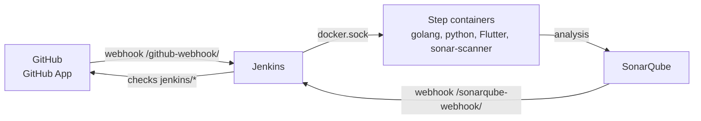

:::success
**Version:** 1.1
:::

---

# Jenkins & SonarQube Administration Guide

This guide describes how Jenkins and SonarQube are set up for Ascension: accounts, credentials, server configuration, build environment, maintenance and troubleshooting. To use the pipelines, see the [Jenkins & SonarQube Guide](./jenkins-sonarqube-guide.md).

:::warning
This guide never holds a password or a token. Secrets are stored in Jenkins credentials and in the team's password storage, never in the repository.
:::

---

## 1\. Components

| Component                                                                         | Location                             | Role                                                                         |
| --------------------------------------------------------------------------------- | ------------------------------------ | ---------------------------------------------------------------------------- |
| Jenkins                                                                           | `https://jenkins.ascension-eip.fr`   | Runs the server, AI and mobile pipelines                                     |
| SonarQube Community Build 26.10                                                   | `https://sonarqube.ascension-eip.fr` | Analyses the code of `dev` and computes the quality gates                    |
| GitHub App "Ascension Jenkins"                                                    | Ascension-EIP organization           | Gives Jenkins read access to the repositories and sends it the GitHub events |
| [jenkins-shared-library](https://github.com/Ascension-EIP/jenkins-shared-library) | GitHub repository                    | Holds the pipeline stages, loaded by every `Jenkinsfile`                     |

Jenkins and SonarQube run as Docker containers on the production VPS. Both are deployed and managed through **Coolify**, with Traefik as the reverse proxy and HTTPS termination.

The diagram below shows how the components talk to each other: GitHub sends its events to Jenkins through the GitHub App, Jenkins drives the VPS Docker daemon to run each step, sends the analyses to SonarQube, and SonarQube returns the quality gate through its webhook.



---

## 2\. Accounts and permissions

### 2.1 Jenkins

Authorization uses the **Role-Based Strategy** (_Manage Jenkins › Manage and Assign Roles_), with two global roles:

| Role        | Permissions                                            | Members                                            |
| ----------- | ------------------------------------------------------ | -------------------------------------------------- |
| `admin`     | Overall › Administer                                   | Maintainers, and the `ascension` emergency account |
| `developer` | Overall › Read, Job › Read, Build, Cancel, View › Read | Other team members                                 |

- `anonymous` and `authenticated` have no role: every member needs a personal account.
- Never give `Run › Replay` or `Job › Configure` to `developer`. A build can drive the VPS Docker daemon, so running modified pipeline code amounts to controlling the VPS.
- Sign-up is disabled. To add a member: _Manage Jenkins › Users › Create User_, then _Assign Roles › Add User or Group_.

### 2.2 SonarQube

- Every member has a personal account, with the same login as in Jenkins. Every account belongs to the `sonar-users` group, which can browse the projects.
- Maintainers also belong to `sonar-administrators`.
- The technical user `jenkins` (_Jenkins CI_) only has the global **Execute Analysis** permission. Nobody logs in with it.
- `sonar-users` has neither **Execute Analysis** nor **Create Projects**: only Jenkins sends analyses, and projects are created by administrators.
- Global permissions: _Administration › Security › Global Permissions_ (`/admin/permissions`). Users: `/admin/users`.

---

## 3\. Credentials

All credentials are in _Manage Jenkins › Credentials › System › Global credentials_, with the **Global** scope.

| ID                | Kind        | Content                                                                   | Used by                                                             |
| ----------------- | ----------- | ------------------------------------------------------------------------- | ------------------------------------------------------------------- |
| `github-app`      | GitHub App  | App ID and private key (PKCS#8) of the GitHub App "Ascension Jenkins"     | Branch sources of the jobs, shared library retrieval, GitHub checks |
| `sonarqube-token` | Secret text | Global Analysis Token `jenkins-ascension` of the SonarQube user `jenkins` | SonarQube server configuration                                      |

### 3.1 Renewing the SonarQube token

1. Log in to SonarQube as `jenkins`, then _My Account › Security_.
2. Generate a **Global Analysis Token** named `jenkins-ascension`.
3. In Jenkins, open `sonarqube-token`, click **Update** and paste the new token.
4. Revoke the previous token in SonarQube.

### 3.2 Renewing the GitHub App private key

1. In the GitHub App settings (_Organization settings › Developer settings › GitHub Apps › Ascension Jenkins_), click **Generate a private key**.
2. Convert it to PKCS#8:

   ```bash
   openssl pkcs8 -topk8 -inform PEM -outform PEM -nocrypt -in <downloaded-key>.pem -out jenkins-github-app.pem
   ```

3. In Jenkins, update the **Key** of `github-app`, then **Test Connection** against `Ascension-EIP`.
4. Delete the previous key in the GitHub App settings, and both `.pem` files from your machine.

---

## 4\. Jenkins configuration

### 4.1 System settings

| Setting          | Location                                     | Value                                                                                                            |
| ---------------- | -------------------------------------------- | ---------------------------------------------------------------------------------------------------------------- |
| Shared library   | _System › Global Trusted Pipeline Libraries_ | Name `jenkins-shared-library`, default version `main`, version override allowed, GitHub source with `github-app` |
| SonarQube server | _System › SonarQube servers_                 | Name `SonarQube`, URL `https://sonarqube.ascension-eip.fr`, token `sonarqube-token`                              |

Required plugins: Pipeline, Git, GitHub Branch Source, GitHub Checks, SonarQube Scanner, Role-based Authorization Strategy, Workspace Cleanup, JUnit.

### 4.2 Jobs

The three jobs are **Multibranch Pipelines** on `https://github.com/Ascension-EIP/Ascension`, with the `github-app` credential. They only differ by their script path and their check name.

| Job                | Script Path               | Status checks name |
| ------------------ | ------------------------- | ------------------ |
| `ascension-server` | `apps/server/Jenkinsfile` | `jenkins/server`   |
| `ascension-ai`     | `apps/ai/Jenkinsfile`     | `jenkins/ai`       |
| `ascension-mobile` | `apps/mobile/Jenkinsfile` | `jenkins/mobile`   |

Behaviours of every job:

| Behaviour                          | Setting                                                                                                                    |
| ---------------------------------- | -------------------------------------------------------------------------------------------------------------------------- |
| Discover branches                  | All branches                                                                                                               |
| Filter by name (with wildcards)    | Include `main staging dev PR-*`, nothing excluded                                                                          |
| Discover pull requests from origin | Merging the pull request with the current target branch revision                                                           |
| Discover pull requests from forks  | **Removed**: code from a fork must never run with access to the VPS Docker daemon                                          |
| Status Checks Properties           | Check name from the table above, **Suppress log output in checks** and **Skip GitHub Branch Source notifications** checked |

Orphaned Item Strategy: discard old items after 7 days.

Jenkins builds `main`, `staging` and `dev` as branches, and every pull request. A feature branch is only built once it has a pull request, so nothing is built twice. Do not go back to **Exclude branches that are also filed as PRs**: `dev` always has an open pull request to `staging`, so it would never be built as a branch, and the SonarQube analysis, which only runs on the `dev` branch, would never run.

:::warning
Each job needs its own **Status checks name**. With the same name, the three jobs overwrite each other's check on GitHub. When a job is created with **Copy from**, change both the **Script Path** and the check name before saving: the first branch scan starts right after the save, with the copied values.
:::

---

## 5\. SonarQube configuration

| Setting                     | Value                                                                                           |
| --------------------------- | ----------------------------------------------------------------------------------------------- |
| Projects                    | `ascension-server`, `ascension-ai`, `ascension-mobile`, created as local projects               |
| Main branch of each project | `dev`                                                                                           |
| New code definition         | Number of days: 30 (the project version never changes, so _Previous version_ would never reset) |
| Webhook                     | `Jenkins`, URL `https://jenkins.ascension-eip.fr/sonarqube-webhook/`                            |

- Without the webhook, Jenkins never gets the quality gate result and the build only ends at the 10 minute timeout.
- SonarQube Community Build has no Dart analyzer: the analysis of `ascension-mobile` is disabled in `apps/mobile/Jenkinsfile` until a Dart plugin is installed.

---

## 6\. GitHub App

| Setting                | Value                                                                                                                              |
| ---------------------- | ---------------------------------------------------------------------------------------------------------------------------------- |
| Webhook URL            | `https://jenkins.ascension-eip.fr/github-webhook/`                                                                                 |
| Repository permissions | Administration: read, Checks: read and write, Commit statuses: read and write, Contents: read, Metadata: read, Pull requests: read |
| Events                 | Check run, Check suite, Pull request, Push, Repository                                                                             |
| Installation           | Ascension-EIP organization, only `Ascension` and `jenkins-shared-library`                                                          |

To give Jenkins access to another repository, add it to the installation (_Install App › Configure_).

---

## 7\. Build environment

Jenkins runs in Docker with the host's `docker.sock` and a `docker` CLI mounted. The `dockerRun` step of the shared library starts each pipeline step as a sibling container of Jenkins, with the Jenkins volumes (`--volumes-from`): the workspace and the caches have the same paths as in Jenkins.

- Steps run as root in their container, then the workspace is handed back to the `jenkins` user, so the workspace cleanup always works.
- The caches live in `/var/jenkins_home/ci-cache` and are kept across builds:

| Path                      | Content                                          |
| ------------------------- | ------------------------------------------------ |
| `go/mod`, `go/build`      | Go modules and build cache                       |
| `uv`                      | `uv` package cache                               |
| `pub`                     | Flutter `pub` cache                              |
| `sonar`                   | SonarQube scanner cache                          |
| `tools/uv/<version>`      | `uv` binary, installed by the first AI build     |
| `tools/flutter/<version>` | Flutter SDK, installed by the first mobile build |

Flutter and `uv` are installed in the cache because their images are not published for every version: the Flutter image only provides the system dependencies, and the `uv` images lag behind the `uv` releases.

---

## 8\. Maintenance

| Task                               | How                                                                                                                        |
| ---------------------------------- | -------------------------------------------------------------------------------------------------------------------------- |
| Update Go, Python, `uv` or Flutter | Change the version in the `Jenkinsfile` of the application. A new Flutter or `uv` version is installed by the next build   |
| Free disk space                    | Delete an old version folder in `/var/jenkins_home/ci-cache/tools`, or a whole cache folder: the next build fills it again |
| Add a team member                  | Create the Jenkins and SonarQube accounts, then assign the Jenkins role (section 2)                                        |
| Restart Jenkins or SonarQube       | From Coolify, on the matching service                                                                                      |

---

## 9\. Troubleshooting

| Symptom                                                                            | Cause                                                                                                                       | Fix                                                                                                  |
| ---------------------------------------------------------------------------------- | --------------------------------------------------------------------------------------------------------------------------- | ---------------------------------------------------------------------------------------------------- |
| A job runs the stages of another application                                       | The job was copied and its **Script Path** was saved unchanged; the first branch scan used it                               | Fix the Script Path, then **Build Now** on the branch                                                |
| A build skips everything after a configuration fix                                 | The same commit already has a successful build, and the build was not started by hand                                       | Click **Build Now**: a build started by hand always runs                                             |
| Checks named `Jenkins` or `continuous-integration/jenkins/branch` stay in progress | Builds started before **Status Checks Properties** was set publish under the default names, and nothing ever completes them | No action: they only stay on that commit and disappear with the next one                             |
| The SonarQube stage is always skipped on `dev`                                     | `dev` is excluded as a branch because of its open pull request to `staging`                                                 | Use **All branches** with the name filter of section 4.2                                             |
| The SonarQube stage waits until its timeout                                        | The SonarQube webhook to `/sonarqube-webhook/` is missing or failing                                                        | Check the webhook and its last deliveries in SonarQube (_Administration › Configuration › Webhooks_) |
| The scanner hangs at `SCM Publisher`                                               | The native `git blame` of the scanner stops reading git's output                                                            | Already handled: `sonarAnalysis` sets `sonar.scm.use.blame.algorithm=GIT_FILES_BLAME` (JGit)         |
| `SonarQube installation ... does not match any configured installation`            | No SonarQube server named `SonarQube` in Jenkins                                                                            | Add it in _System › SonarQube servers_ (section 4.1)                                                 |

---

## 10\. Security notes

- A build can start containers on the VPS Docker daemon, which gives full control of the host. Only code from the organization is built: pull requests from forks are not discovered, and `Replay` is reserved to administrators.
- Logs stay in Jenkins and are not copied to GitHub checks.
- SonarQube requires authentication for every page and API call.
- The host setting `vm.max_map_count` is 262144, below the 524288 recommended by SonarQube. SonarQube runs, but raise it if its search engine fails to start.
