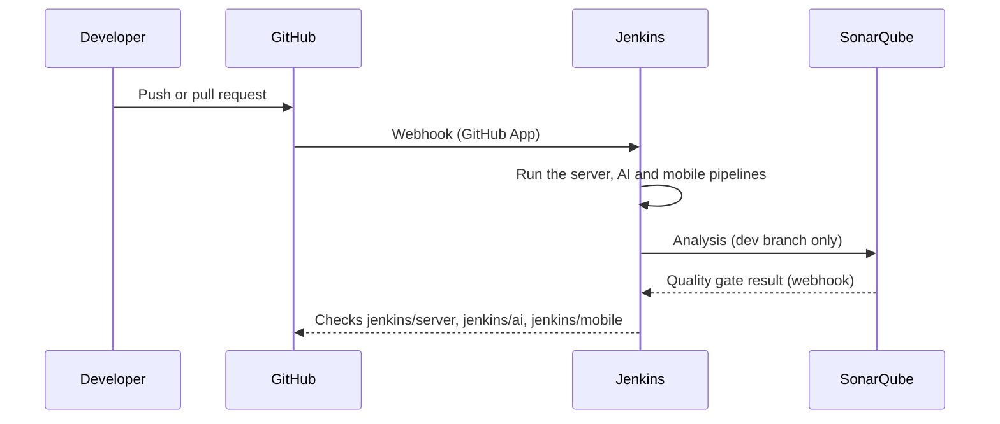

:::success
**Version:** 1.0
:::

---

# Jenkins & SonarQube Guide

This guide explains how the Jenkins pipelines and the SonarQube analyses check your code, how to read their results on a pull request, and how to change a pipeline. For accounts, credentials and server configuration, see the [Jenkins & SonarQube Administration Guide](./jenkins-sonarqube-administration-guide.md).

| Service   | URL                                  |
| --------- | ------------------------------------ |
| Jenkins   | `https://jenkins.ascension-eip.fr`   |
| SonarQube | `https://sonarqube.ascension-eip.fr` |

---

## 1\. Overview

Jenkins runs one pipeline per application (server, AI, mobile) on the project VPS. Each pipeline checks the code (format, lint, build, tests), then sends the analysis to SonarQube on the `dev` branch. The results come back on the pull request as GitHub checks.

The GitHub Actions CI described in the [GitHub Actions & Hooks Guide](./github-actions-and-hooks-guide.md) keeps running alongside Jenkins.

The diagram below follows a push: GitHub notifies Jenkins, Jenkins runs the pipeline of each application, SonarQube analyses `dev` and returns its quality gate, and Jenkins publishes one check per application on GitHub.



---

## 2\. Pipelines

Each application has its own Jenkins job and its own `Jenkinsfile`. A `Jenkinsfile` only sets variables: the stages are defined in the [jenkins-shared-library](https://github.com/Ascension-EIP/jenkins-shared-library) repository.

| Jenkins job        | Jenkinsfile               | Stages                                                 | Watched paths              | SonarQube project  |
| ------------------ | ------------------------- | ------------------------------------------------------ | -------------------------- | ------------------ |
| `ascension-server` | `apps/server/Jenkinsfile` | Dependencies, Format, Lint, Build, Tests, SonarQube    | `apps/server/`, `schemas/` | `ascension-server` |
| `ascension-ai`     | `apps/ai/Jenkinsfile`     | Toolchain, Dependencies, Lint, Build, Tests, SonarQube | `apps/ai/`, `schemas/`     | `ascension-ai`     |
| `ascension-mobile` | `apps/mobile/Jenkinsfile` | Toolchain, Dependencies, Format, Lint, Tests           | `apps/mobile/`             | Disabled           |

What each stage runs:

| Application      | Format                                | Lint                          | Build                   | Tests                                     |
| ---------------- | ------------------------------------- | ----------------------------- | ----------------------- | ----------------------------------------- |
| Server (Go)      | `gofmt -l .` must list no file        | `go vet ./...`                | `go build ./cmd/server` | `go test` with coverage                   |
| AI (Python)      | Not checked                           | `uv run ruff check src tests` | `uv build`              | `pytest` with coverage and a JUnit report |
| Mobile (Flutter) | `dart format --set-exit-if-changed .` | `flutter analyze`             | Not built               | `flutter test --coverage`                 |

Every step runs in an official Docker image (`golang`, `python`, a Flutter image), with the same tool versions as the GitHub Actions CI.

---

## 3\. Reading the results on a pull request

Each job publishes its own check on the pull request:

| Check            | Job                |
| ---------------- | ------------------ |
| `jenkins/server` | `ascension-server` |
| `jenkins/ai`     | `ascension-ai`     |
| `jenkins/mobile` | `ascension-mobile` |

- **Success:** every stage passed, or the pipeline was skipped because the application did not change (see section 4, _When a pipeline is skipped_).
- **Failure:** open the check, then **Details**, to reach the Jenkins build. The check lists the stages and their duration, so you can see which one failed.
- **Logs:** they stay in Jenkins and are not copied to GitHub. Log in to Jenkins with your account to read them (**Console Output** on the build page).

A pull request is built on the result of its merge into the target branch, so a check also fails when the merge breaks the code.

---

## 4\. When a pipeline is skipped

To avoid building an application that did not change, a pipeline skips its stages when none of its watched paths changed since the last successful build of the branch. The build then succeeds with the description `No change in ...`.

A pipeline always builds:

- on a pull request;
- on the first build of a branch;
- when the build was started by hand with **Build Now**.

To build again, open the job, then the branch (for example `ascension-server` › `dev`), and click **Build Now**.

---

## 5\. SonarQube

- **Analysed branch:** only `dev`. SonarQube Community Build analyses a single branch per project, so feature branches and pull requests are not analysed: they would overwrite the results of `dev`.
- **Projects:** `ascension-server` and `ascension-ai`. Each one is configured by the `sonar-project.properties` file of its application.
- **Coverage:** Go coverage comes from `apps/server/coverage.out`, Python coverage from `apps/ai/coverage.xml`.
- **Quality gate:** after the analysis, Jenkins waits for the quality gate of the project. A failed quality gate fails the build of `dev`.
- **Mobile:** disabled. SonarQube Community Build has no Dart analyzer; the `ascension-mobile` project stays empty until a Dart plugin is installed.

Log in to SonarQube with your account to browse the issues, the coverage and the duplications of each project.

---

## 6\. Fixing a failing build

Run the same check locally before pushing again:

| Failing stage | Server                   | AI                  | Mobile                   |
| ------------- | ------------------------ | ------------------- | ------------------------ |
| Format        | `moon run server:format` | Not checked         | `moon run mobile:format` |
| Lint          | `moon run server:lint`   | `moon run ai:lint`  | `moon run mobile:lint`   |
| Build         | `moon run server:build`  | `moon run ai:build` | Not built                |
| Tests         | `moon run server:test`   | `moon run ai:test`  | `moon run mobile:test`   |

The Format stage fails when a file is not formatted: run the format task, commit the result and push again. The build log lists the files to format.

---

## 7\. Changing a pipeline

### 7.1 Changing a variable

Edit the `Jenkinsfile` of the application. The available variables:

| Variable          | Pipelines | Role                                                                                  |
| ----------------- | --------- | ------------------------------------------------------------------------------------- |
| `goVersion`       | Server    | Go version, used as the `golang:<goVersion>` image                                    |
| `pythonVersion`   | AI        | Python version, used as the `python:<pythonVersion>-bookworm` image                   |
| `uvVersion`       | AI        | `uv` version. It must build the `uv_build` backend pinned in `apps/ai/pyproject.toml` |
| `flutterVersion`  | Mobile    | Flutter SDK version, installed once in the Jenkins cache                              |
| `watchPaths`      | All       | Paths that trigger a build                                                            |
| `enableSonarqube` | All       | Turns the SonarQube analysis on or off                                                |
| `sonarBranch`     | All       | Branch analysed by SonarQube                                                          |

Keep the versions aligned with `.moon/toolchain.yml` and the GitHub Actions CI.

### 7.2 Changing the stages

The stages live in the [jenkins-shared-library](https://github.com/Ascension-EIP/jenkins-shared-library) repository: `vars/runServerCI.groovy`, `vars/runAiCI.groovy` and `vars/runMobileCI.groovy`, with the shared helpers `dockerRun`, `hasChanges` and `sonarAnalysis`. Its `README.md` documents every variable.

To test a change of the library before merging it:

1. Push the change on a branch of `jenkins-shared-library`.
2. On a test branch of this repository, point the `Jenkinsfile` to that branch:

   ```groovy
   @Library('jenkins-shared-library@<library-branch>') _
   ```

3. Push the test branch and check its build in Jenkins.
4. Once the library change is merged into `main`, delete the test branch: the `Jenkinsfile` of `dev` always loads `@main`.

---

## 8\. Access

| Service   | Account                     | Rights                                                                                   |
| --------- | --------------------------- | ---------------------------------------------------------------------------------------- |
| Jenkins   | One account per team member | `developer`: see the jobs and their logs, start and cancel builds. `admin`: full access. |
| SonarQube | One account per team member | Browse the projects and their results. Administrators also manage the configuration.     |

Ask a Jenkins or SonarQube administrator if you have no account.
